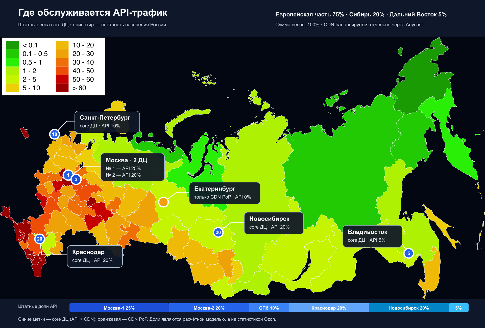
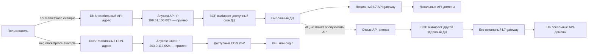
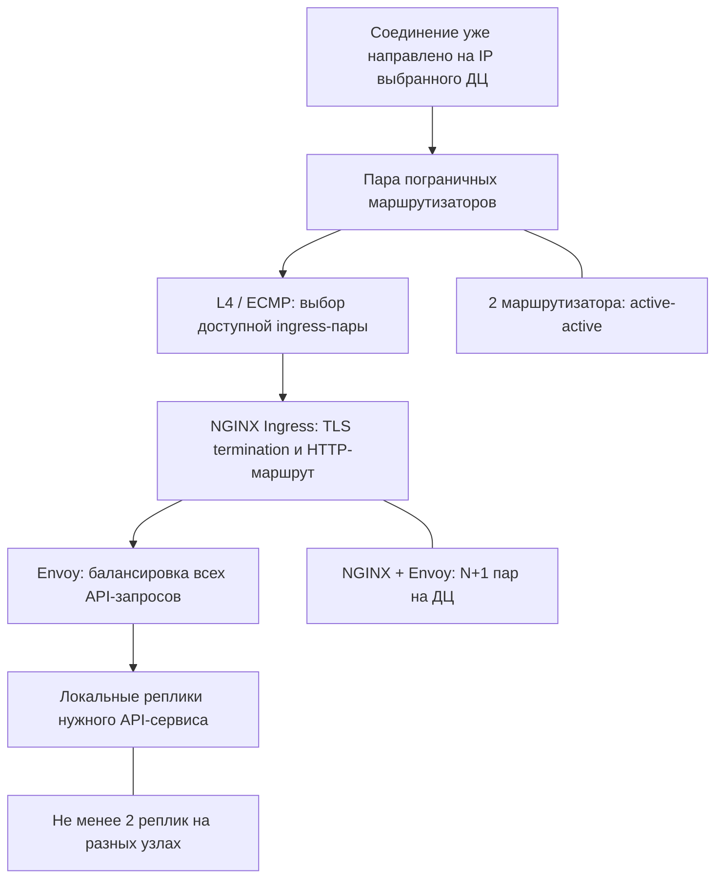

# tp_highload_2026
Курсовая работа по курсу "Проектирование высоконагруженных систем" VK технопарк

## 1. Тема и целевая аудитория
### Тип сервиса
Высоконагруженный маркетплейс (на примере сервиса ozon)

### Функционал mvp
1. Регистрация и авторизация пользователей
2. Просмотр главной страницы с персонализированной лентой рекомендаций
3. Просмотр каталога товаров
4. Поиск и просмотр карточки товара
5. Добавление и изменение товаров в корзине
6. Выбор ПВЗ и оформление заказа
7. Просмотр и добавление рейтинга товаров и отзывов

### Ключевые продуктовые решения
1. Главная страница формируется персонально для пользователя на основе рекомендательной системы.
2. Рейтинг товара рассчитывается на основе оценок пользователей и отображается вместе с отзывами.
3. Покупатель может оставить отзыв на товар только после покупки

### Целевая аудитория
По данным ozon 84 млн пользователей в месяц.[[1]](#source1) География распределения пользователя такова: ~94.7% пользователей из РФ, остальные 5% пользователей из-за рубежа. Средний трафик из стран зарубежья не превышает 1% на страну.[[2]](#source2)

В РФ около 27% приходится на Московскую область, Москву и СПБ.[[3]](#source3)

Причем с мобильных устройств кол-во транзакционных запросов е-ком 79% против 37% на десктопе.[[4]](#source4)


## 2. Расчет нагрузки
### Аудиторные метрики

| Метрика |                            Значение |
|---------|------------------------------------:|
| MAU     |               84 млн[[1]](#source1) |
| DAU     | 44 млн[[5]](#source5) |

### Расчет среднего количества действий пользователя в день

##### Регистрация 
По данным Ozon, на конец I квартала 2026 года база активных покупателей составила 67,3 млн человек, увеличившись на 16% год к году [[5]](#source5). Число активных покупателей годом ранее составляло 58,02 млн. Значит годовой прирост 9,28 млн покупателей. Пусть 85% данного прироста приходится на новых зарегистрированных пользователей. Тогда оценочное количество регистраций в сутки составляет 9,28 млн * 0,85 / 365 = 21 610. При DAU = 44 млн среднее количество регистраций на одного пользователя в сутки составляет 21 610 / 44 000 000 ≈ 0,00049.


##### Авторизация
Примем, что срок жизни пользовательской сессии составляет 30 дней. Предполагая, что пользователи посещают сервис ежедневно и повторно авторизуются после истечения срока сессии, получим среднее количество авторизаций 1/30 = 0,033.

##### Просмотр главной страницы с персонализированной лентой рекомендаций
Нет статистики, примем, что каждый пользователь дневной аудитории, независимо от авторизации, просматривает персонализированную ленту в среднем 2 раза в сутки. Страница рекомендаций доступна всем пользователям, поэтому среднее количество её просмотров на одного пользователя DAU составляет **2** просмотра в сутки.

##### Скролл ленты рекомендаций на главной странице
При первом открытии главной страницы загружается 24 карточки товаров. В среднем пользователь выполняет 2 скролла; каждый скролл подгружает ещё 12 карточек и формирует отдельный запрос к сервису рекомендаций. При 2 просмотрах главной в сутки среднее количество запросов подгрузки ленты на пользователя составляет 2 * 2 = **4** в сутки.

##### Просмотр каталога товаров
В связи с отсутствием публичной статистики примем допущение, что пользователь посещает сервис 2 раза в сутки, в 60% сессий открывает каталог и просматривает в среднем 2 страницы. Каталог доступен как авторизованным, так и неавторизованным пользователям, поэтому расчёт ведётся по всей дневной аудитории (DAU), без разделения пользователей по статусу авторизации. Среднее количество просмотров каталога на одного пользователя в сутки составляет 2 × 0,6 × 2 = **2,4**.

##### Поиск товаров
В связи с отсутствием публичной статистики примем допущение, что пользователь посещает сервис 2 раза в сутки, в 60% сессий использует поиск и выполняет в среднем 2 поисковых запроса. Поиск доступен как авторизованным, так и неавторизованным пользователям. Среднее количество поисковых запросов на одного пользователя в сутки составляет 2 * 0,6 * 2 = 2,4.

##### Просмотр карточки товара
В связи с отсутствием публичной статистики примем допущение, что пользователь посещает сервис 2 раза в сутки, в 75% сессий просматривает карточки товаров и открывает в среднем 4 карточки за такую сессию. Среднее количество просмотров карточек товаров на одного пользователя в сутки составляет 2 * 0,75 * 4 = 6.

##### Добавление товара в корзину
Пусть 20% дневной аудитории добавляют товары в корзину и каждый из них выполняет в среднем 2 добавления в сутки. Среднее количество добавлений товара в корзину на одного пользователя составляет 0,2 * 2 = 0,4.

##### Изменение корзины
пусть 10% дневной аудитории изменяют содержимое корзины и каждый из них выполняет в среднем 2 изменения в сутки. Среднее количество изменений корзины на одного пользователя составляет 0,1 * 2 = 0,2.

##### Выбор ПВЗ
пусть 15% дневной аудитории выбирают ПВЗ и каждый из них выполняет это действие в среднем 1 раз в сутки. Среднее количество выборов ПВЗ на одного пользователя составляет 0,15 * 1 = 0,15.

##### Оформление заказа
По данным Ozon за II квартал 2025 года, количество активных покупателей превысило 60 млн, а частотность покупок составила 30 заказов в год. Для оценки примем 60 млн покупателей. Тогда количество заказов в сутки составляет 60 млн * 30 / 365 ≈ 4,93 млн. При DAU = 44 млн среднее количество оформлений заказа на одного пользователя составляет 4,93 / 44 ≈ 0,112 в сутки. Оценка предполагает равномерное распределение заказов и требует сопоставимости периодов исходных показателей.

##### Просмотр рейтинга и отзывов
В связи с отсутствием публичной статистики примем допущение, что 40% дневной аудитории просматривают рейтинги и отзывы товаров и каждый из них выполняет в среднем 3 просмотра в сутки. Среднее количество просмотров рейтингов и отзывов на одного пользователя составляет 0,4 * 3 = 1,2.

##### Добавление рейтинга и отзыва
пусть покупатели оставляют рейтинг и отзыв для 5% оформленных заказов. При среднем количестве заказов 0,112 на пользователя в сутки получаем 0,112 * 0,05 = 0,0056 отзыва на одного пользователя в сутки. Предполагается, что один заказ соответствует одному оцениваемому товару; при нескольких товарах в заказе показатель необходимо пересчитать.


| Действие                                                            | Среднее количество действий пользователя в день |
|---------------------------------------------------------------------|------------------------------------------------:|
| Регистрация                                                         |                                         0,00049 |
| Авторизация                                                         |                                           0,033 |
| Просмотр главной страницы с персонализированной лентой рекомендаций |                                               2 |
| Скролл ленты рекомендаций на главной странице                       |                                               4 |
| Просмотр каталога товаров                                           |                                             2,4 |
| Поиск товаров                                                       |                                             2,4 |
| Просмотр карточки товара                                            |                                               6 |
| Добавление товара в корзину                                         |                                             0,4 |
| Изменение корзины                                                   |                                             0,2 |
| Выбор ПВЗ                                                           |                                            0,15 |
| Оформление заказа                                                   |                                           0,112 |
| Просмотр рейтинга и отзывов                                         |                                             1,2 |
| Добавление рейтинга и отзыва                                        |                                          0,0056 |

### Средний размер хранилища пользователя
Для оценки среднего объёма пользовательских данных примем следующие допущения. По условию расчёта размер данных на одного пользователя увеличивается втрое, поэтому размеры каждого пользовательского объекта также умножаются на 3:

- Профиль пользователя занимает в среднем 6 КБ.
- В корзине пользователя хранится в среднем 5 товаров. Один элемент корзины занимает 600 Б.
- Средняя частота покупок составляет 30 заказов в год.
- История заказов хранится за расчётный период 4,2 года. Среднее количество заказов на пользователя составляет 30 * 4,2 = 126 шт.
- Средний размер одного заказа составляет 6 КБ.
- Пользователи оставляют отзывы для 5% заказов. Среднее количество отзывов составляет 126 * 0,05 = 6,3 шт.
- Средний размер одного отзыва составляет 3 КБ.

Все значения размеров объектов и периода хранения являются допущениями для расчёта нагрузки.

| Тип данных        | Среднее количество, шт. | Размер объекта | Объём, ГБ |
|-------------------|------------------------:|---------------:|----------:|
| Профиль           |                       1 |           6 КБ |  0,000006 |
| Товары в корзине  |                       5 |          600 Б |  0,000003 |
| Заказы            |                     126 |           6 КБ |  0,000756 |
| Рейтинги и отзывы |                     6,3 |           3 КБ | 0,0000189 |
| Итого             |                   138,3 |              — | 0,0007839 |


### Размер хранения в разбивке по типам данных

##### Данные пользователей

По данным Ozon, на конец I квартала 2026 года количество активных покупателей составило 67,3 млн [[5]](#source5).

Рассчитаем объём по каждому типу данных:

- Профили: 67,3 млн * 6 КБ = 0,4038 ТБ.
- Корзины: 67,3 млн * 5 * 600 Б = 0,2019 ТБ.
- Заказы: 67,3 млн * 126 * 6 КБ = 50,8788 ТБ.
- Отзывы: 67,3 млн * 6,3 * 3 КБ = 1,272 ТБ.

Общий объём пользовательских данных составляет:

0,4038 + 0,2019 + 50,8788 + 1,272 = 52,76 ТБ.

##### Каталог товаров

В связи с отсутствием подтверждённых данных о количестве товарных карточек, что каталог содержит 200 млн товаров. Средний размер данных одной карточки составляет 4 КБ.

Общий объём каталога:

200 млн * 4 КБ = **0,8 ТБ**.

##### Изображения товаров

Примем допущение, что каждый товар содержит в среднем 3 изображения размером 200 КБ каждое. Все три изображения загружаются сразу при показе товарной карточки в ленте, каталоге, поиске и на странице товара.

Количество изображений:

200 млн * 3 = 600 млн шт.

Общий объём изображений:

600 млн * 200 КБ = **120 ТБ**.

##### Сводная таблица

| Тип данных          | Количество, шт. | Размер объекта | Общий объём, ТБ |
|---------------------|----------------:|---------------:|----------------:|
| Профили             |        67,3 млн |           6 КБ |          0,4038 |
| Элементы корзин     |       336,5 млн |          600 Б |          0,2019 |
| Заказы              |       8,48 млрд |           6 КБ |         50,8788 |
| Отзывы              |      423,99 млн |           3 КБ |           1,272 |
| Карточки товаров    |         200 млн |           4 КБ |             0,8 |
| Изображения товаров |         600 млн |         200 КБ |             120 |
| **Итого**           |               — |              — |      **173,56** |

Общий расчётный объём хранилища составляет **173,56 ТБ**.

### Расчёт RPS

Для расчёта среднего количества запросов в секунду используем DAU = 44 млн пользователей и ранее рассчитанное среднее количество действий пользователя в сутки. Одному пользовательскому действию соответствует один запрос; исключение — просмотр главной, при котором первоначальная загрузка и каждый скролл ленты являются отдельными запросами.

Средний RPS рассчитывается по формуле:

RPS_avg = DAU * ActionsPerDAU / 86400

Для расчёта пикового RPS примем коэффициент пиковости K = 5, предполагая, что максимальная интенсивность запросов в течение суток в 5 раз превышает среднюю.

RPS_peak = RPS_avg * 5

Например, для просмотра карточки товара:

RPS_avg = 44 000 000 * 6 / 86400 ≈ 3056

RPS_peak = 3056 * 5 = 15278

#### Сводная таблица RPS

| Тип запроса                            | Средний RPS | Пиковый RPS |
|----------------------------------------|------------:|------------:|
| Регистрация                            |        0,25 |        1,25 |
| Авторизация                            |       16,81 |       84,03 |
| Первоначальная загрузка главной        |     1018,52 |     5092,59 |
| Скролл ленты рекомендаций              |     2037,04 |    10185,19 |
| Каталог товаров                        |     1222,22 |     6111,11 |
| Поиск товаров                          |     1222,22 |     6111,11 |
| Карточка товара                        |     3055,56 |    15277,78 |
| Добавление в корзину                   |      203,70 |     1018,52 |
| Изменение корзины                      |      101,85 |      509,26 |
| Выбор ПВЗ                              |       76,39 |      381,94 |
| Оформление заказа                      |       57,04 |      285,19 |
| Просмотр рейтинга и отзывов            |      611,11 |     3055,56 |
| Добавление рейтинга и отзыва           |        2,85 |       14,26 |
| **Итого**                              | **9625,56** | **48127,80** |

Запросы выдачи рекомендаций при скролле учтены отдельно. Загрузка изображений учитывается в расчёте сетевого трафика через CDN.

Проверка тенденции: после пересчёта карточка товара остаётся лидером по RPS (15 277,78 пиковых RPS против 9 166,67 ранее). Следующим по нагрузке становится отдельный запрос скролла ленты рекомендаций (10 185,19 пиковых RPS); это ожидаемое следствие учёта пагинации и не меняет лидирующий endpoint.

### 3. Расчёт сетевого трафика

Для расчёта пикового сетевого трафика используем ранее полученные значения пикового RPS. В связи с отсутствием публичной статистики о размерах ответов API Ozon примем средние размеры ответов как допущения.

Пиковый трафик рассчитаем по формуле:

Traffic_peak = RPS_peak * Size_response * 8 / 10^9

где Size_response — размер ответа в байтах.

#### API-трафик

| Тип запроса | Пиковый RPS | Размер ответа | Трафик, Гбит/с |
|---|---:|---:|---:|
| Первоначальная загрузка главной (24 карточки) | 5093 | 30 КБ | 1,222 |
| Скролл ленты главной (12 карточек) | 10185 | 15 КБ | 1,222 |
| Каталог товаров | 6111 | 25 КБ | 1,222 |
| Поиск товаров | 6111 | 20 КБ | 0,978 |
| Карточка товара | 15278 | 15 КБ | 1,833 |
| Просмотр отзывов | 3056 | 10 КБ | 0,244 |
| Выбор ПВЗ | 382 | 10 КБ | 0,031 |
| Остальные запросы | ≈1913 | 2 КБ | 0,031 |
| **Итого** | | | **≈6,78** |

#### Изображения товаров

Изображения загружаются при просмотре главной страницы, каталога, результатов поиска и карточек товаров. В каждой товарной карточке загружаются сразу 3 изображения.

Примем следующие допущения:

- Средний размер изображения составляет 200 КБ.
- На первоначальной выдаче главной загружается 24 * 3 = 72 изображения; при каждом скролле — 12 * 3 = 36 изображений.
- В каталоге и поиске сохраняется исходное число товарных карточек в выдаче: соответственно 8 * 3 = 24 и 6 * 3 = 18 изображений.
- Благодаря кешированию на стороне клиента и повторному использованию изображений 50% потенциальных загрузок не требуют повторной передачи.
- Изображения доставляются пользователям через CDN.

Пиковый трафик изображений рассчитывается по формуле:

Traffic_images = RPS_peak * N_images * Size_image * 0,5 * 8 / 10^9

| Тип страницы / запроса                         | Пиковый RPS | Изображений на страницу | Трафик, Гбит/с |
|------------------------------------------------|------------:|------------------------:|---------------:|
| Первоначальная загрузка главной (24 карточки)  |        5093 |                      72 |         293,33 |
| Скролл ленты главной (12 карточек)             |       10185 |                      36 |         293,33 |
| Каталог                                        |        6111 |                      24 |         117,33 |
| Поиск                                          |        6111 |                      18 |          88,00 |
| Карточка товара                                |       15278 |                       3 |          36,67 |
| **Итого**                                      |           — |                       — |     **828,66** |

Таким образом, пиковый трафик изображений от CDN к пользователям составляет приблизительно 828,66 Гбит/с.

Предположим, что 80% оставшихся запросов к изображениям обслуживаются из кеша CDN.

Тогда пиковый трафик от исходного хранилища изображений к CDN составляет:

Traffic_origin = 828,66 × 0,2 = 165,73 Гбит/с.

#### Сводная таблица сетевого трафика

| Тип трафика                 | Пиковый трафик, Гбит/с |
|-----------------------------|-----------------------:|
| API → пользователи          |                   6,78 |
| CDN → пользователи          |                 828,66 |
| **Итого к пользователям**   |             **835,44** |
| Хранилище изображений → CDN |                 165,73 |

Суммарный пиковый исходящий трафик системы к пользователям составляет приблизительно 835,44 Гбит/с.

Дополнительно необходимо учитывать трафик между хранилищем изображений и CDN — 165,73 Гбит/с. Он не прибавляется к пользовательскому трафику, чтобы избежать двойного учёта.

## 4. Глобальная балансировка нагрузки

### Размещение дата-центров

Распределение API-трафика ориентируется на плотность населения: европейская часть России получает большую часть нагрузки, а Дальний Восток — локальную площадку с небольшой долей. Две независимые core-площадки находятся в Москве; остальные core ДЦ — в Санкт-Петербурге, Краснодаре, Новосибирске и Владивостоке. Все шесть работают в режиме **active-active**. Екатеринбург остаётся отдельным **Anycast CDN PoP**: он кеширует и отдаёт изображения, но не исполняет транзакционные API-запросы.



Выбор площадок опирается на географию целевой аудитории из раздела 1:

- **94,7% аудитории находится в РФ** [[2]](#source2), поэтому основная инфраструктура размещается в России. Это сокращает сетевую задержку для подавляющей части покупателей и уменьшает зависимость от международных каналов.
- **27% аудитории приходится на Москву, Московскую область и Санкт-Петербург** [[3]](#source3), но этот показатель не раскрывает долю самого Петербурга. По оценке Петростата на 1 января 2025 года в Петербурге и Ленинградской области проживает около 7,7 млн человек [[6]](#source6). Поэтому для петербургского ДЦ планируем **10% штатного API-трафика**, а для Краснодара — **20%** с учётом нагрузки юга. Это инженерная модель, а не опубликованные доли трафика Ozon. На Москву-1, Москву-2, Санкт-Петербург и Краснодар суммарно планируется **75% API-трафика**; две московские площадки должны быть независимы по электропитанию и операторам связи.
- На Новосибирск планируется **20% API-трафика** как региональную core-площадку для Сибири, на Владивосток — **5%** для Дальнего Востока. Это оценки необходимой ёмкости, а не доли, которые задаёт Anycast. Екатеринбург дополнительно приближает CDN к пользователям Урала.
- Зарубежная аудитория составляет 5,3%, причём ни одна страна не даёт более 1% трафика [[2]](#source2). На текущем масштабе отдельный зарубежный ДЦ не окупается: изображения для этой аудитории доставляет Anycast CDN, а API попадает на ближайший доступный российский API edge и затем в здоровый core ДЦ.

Размещение влияет на продуктовые метрики следующим образом:

- меньшая задержка выдачи и изображений снижает время загрузки страницы и вероятность ухода пользователя до добавления товара в корзину;
- меньшая задержка на оформлении заказа повышает вероятность успешного завершения checkout;
- независимые площадки и резервирование нагрузки снижают вероятность недоступности сервиса и потери заказов при отказе одного ДЦ.

### Почему шесть core ДЦ и отдельный CDN PoP

Один ДЦ был бы единой точкой отказа. Шесть core ДЦ позволяют одновременно разместить основную мощность рядом с населением европейской части страны и сохранить региональные точки присутствия для Сибири и Дальнего Востока. Плановые доли **25% / 20% / 10% / 20% / 20% / 5%** соответствуют Москве-1, Москве-2, Санкт-Петербургу, Краснодару, Новосибирску и Владивостоку. Московские площадки обслуживают не только город, но и широкий центральный регион; Краснодар рассчитан на значительную долю трафика юга. Это исключает прежний перекос модели, в которой под Дальний Восток резервировалось 30% общероссийского API-трафика.

Екатеринбург не становится седьмым core ДЦ, поскольку 828,66 Гбит/с из 835,44 Гбит/с пользовательского трафика приходится на изображения CDN. Для Урала наибольший продуктовый эффект даёт близкий edge-кеш; API-трафик составляет лишь 6,78 Гбит/с и обслуживается шестью core ДЦ. Функциональные домены сервиса — edge/CDN, API gateway, каталог и поиск, рекомендации, профили, корзина, заказы/checkout и отзывы. Каждый API-домен развёрнут во всех шести ДЦ; ни один бизнес-домен не закреплён за единственной площадкой. Вопросы репликации и консистентности stateful-хранилищ рассматриваются отдельно в разделе проектирования данных.

### Распределение API-нагрузки по ДЦ

В штатном режиме API использует **Anycast для выбора ДЦ и локальный L7 gateway внутри него**. Gateway отправляет запрос только в локальный API-домен: межрегионального проксирования каждого запроса здесь нет. Если площадка целиком перестаёт обслуживать API, она отзывает API-анонс, и BGP направляет новые соединения в другой доступный ДЦ. При перегрузке сначала масштабируется локальная площадка; долю входящего трафика можно менять BGP-политиками, но не глобальным L7-распределением по процентам. Доли **25% / 20% / 10% / 20% / 20% / 5%** — прогноз нагрузки и ориентир для ёмкости Москвы-1, Москвы-2, Санкт-Петербурга, Краснодара, Новосибирска и Владивостока. Фактические доли измеряются по трафику и могут отличаться от прогноза, поскольку BGP не гарантирует его точного выполнения.

Таблица ниже умножает общий расчётный пик каждого типа запроса на плановые доли. Это оценка мощности ДЦ, а не настройка L7-маршрутизации.

| Тип запроса | Пиковый RPS всего | Мск-1 25% | Мск-2 20% | СПб 10% | Краснодар 20% | Новосибирск 20% | Владивосток 5% |
|---|---:|---:|---:|---:|---:|---:|---:|
| Регистрация | 1,25 | 0,31 | 0,25 | 0,13 | 0,25 | 0,25 | 0,06 |
| Авторизация | 84,03 | 21,01 | 16,81 | 8,40 | 16,81 | 16,81 | 4,20 |
| Первоначальная загрузка главной | 5 092,59 | 1 273,15 | 1 018,52 | 509,26 | 1 018,52 | 1 018,52 | 254,63 |
| Скролл ленты рекомендаций | 10 185,19 | 2 546,30 | 2 037,04 | 1 018,52 | 2 037,04 | 2 037,04 | 509,26 |
| Каталог товаров | 6 111,11 | 1 527,78 | 1 222,22 | 611,11 | 1 222,22 | 1 222,22 | 305,56 |
| Поиск товаров | 6 111,11 | 1 527,78 | 1 222,22 | 611,11 | 1 222,22 | 1 222,22 | 305,56 |
| Карточка товара | 15 277,78 | 3 819,45 | 3 055,56 | 1 527,78 | 3 055,56 | 3 055,56 | 763,89 |
| Добавление в корзину | 1 018,52 | 254,63 | 203,70 | 101,85 | 203,70 | 203,70 | 50,93 |
| Изменение корзины | 509,26 | 127,32 | 101,85 | 50,93 | 101,85 | 101,85 | 25,46 |
| Выбор ПВЗ | 381,94 | 95,49 | 76,39 | 38,19 | 76,39 | 76,39 | 19,10 |
| Оформление заказа | 285,19 | 71,30 | 57,04 | 28,52 | 57,04 | 57,04 | 14,26 |
| Просмотр рейтинга и отзывов | 3 055,56 | 763,89 | 611,11 | 305,56 | 611,11 | 611,11 | 152,78 |
| Добавление рейтинга и отзыва | 14,26 | 3,57 | 2,85 | 1,43 | 2,85 | 2,85 | 0,71 |
| **Итого на один ДЦ** | **48 127,80** | **12 031,95** | **9 625,56** | **4 812,78** | **9 625,56** | **9 625,56** | **2 406,39** |

Средняя нагрузка / пиковая нагрузка составляют: Москва-1 — 2 406,39 / 12 031,95 RPS, Москва-2, Краснодар и Новосибирск — 1 925,11 / 9 625,56 RPS, Санкт-Петербург — 962,56 / 4 812,78 RPS, Владивосток — 481,28 / 2 406,39 RPS.

Для предварительной оценки резервной ёмкости ниже показано условное пропорциональное перераспределение плановых долей при отказе. Реальный Anycast не использует эти проценты как правило маршрутизации: фактические доли и пики после переключения зависят от регионов пользователей и BGP-маршрутов.

| Сценарий отказа | Наибольшая доля в расчётной модели | Наибольшая нагрузка в расчётной модели |
|---|---:|---:|
| Нет отказа | 25,00% | 12 031,95 peak RPS |
| Москва-1 | 26,67% | 12 834,08 peak RPS |
| Москва-2, Краснодар или Новосибирск | 31,25% | 15 039,94 peak RPS |
| Санкт-Петербург | 27,78% | 13 368,83 peak RPS |
| Владивосток | 26,32% | 12 665,21 peak RPS |
| Одновременный отказ обеих московских площадок | 36,36% | 17 501,02 peak RPS |

В рамках этой условной модели для отказа одной площадки Москва-1 требуется резерв под **31,25%** общего пика, Москве-2, Краснодару и Новосибирску — под **26,67%**, Санкт-Петербургу — под **13,33%**, Владивостоку — под **6,67%**. При отказе всего московского макрорегиона модель даёт 18,18% для Санкт-Петербурга, по 36,36% для Краснодара и Новосибирска и 9,09% для Владивостока. **Это не подтверждённые требования к мощности:** окончательный резерв нужно определять по матрице регионального трафика, реальным BGP-маршрутам и тестам переключения. Нагрузка CDN также не фиксируется по этим долям и контролируется телеметрией Anycast.

Плановые доли и ёмкость API пересматриваются по фактической нагрузке и задержке; распределение CDN-трафика контролируется отдельно по телеметрии Anycast.

### DNS, Anycast и регулирование трафика



- DNS не выполняет балансировку API: `api.marketplace.example` всегда возвращает стабильный Anycast API-адрес. Это исключает зависимость от географии recursive DNS, EDNS Client Subnet и времени жизни DNS-кеша. Указанный на схеме `198.51.100.0/24` — документационный пример выделенного Anycast-префикса API.
- Anycast API-префикс анонсируется из шести core ДЦ. BGP приводит клиента в доступный ДЦ по сетевой топологии (это не гарантия географически ближайшего ДЦ). Его L7 gateway обслуживает запрос через локальный API; при отказе площадки новый маршрут ведёт в другой ДЦ, а не через L7 первого. Anycast не задаёт проценты API-трафика и не выбирает stateful backend.
- Для `img.marketplace.example` DNS аналогично возвращает стабильный Anycast CDN-адрес. Отдельный IPv4-префикс CDN `203.0.113.0/24` анонсируют edge в Москве, Санкт-Петербурге, Краснодаре, Екатеринбурге, Новосибирске и Владивостоке; пользователь попадает на ближайшую по маршрутизации доступную площадку. Оба диапазона на схеме — документационные примеры, а не реальные сети сервиса.
- Площадка проверяет здоровье локального API и ingress каждые 5 секунд. Если весь API-контур ДЦ недоступен после двух последовательных проверок, API-префикс площадки отзывается; новые соединения после сходимости BGP попадают в другой здоровый ДЦ. Изолированный отказ одного сервиса обрабатывается локальными репликами и сам по себе не отзывает анонс всего ДЦ. При восстановлении анонс возвращается после проверки готовности, а трафик наращивается постепенно. DNS-адрес остаётся прежним; фактические доли после отказа определяются BGP и региональным трафиком, а не расчётным профилем из таблицы.
- При полном отказе API edge или CDN edge площадка withdraw'ит соответствующий BGP-анонс Anycast-префикса. Трафик автоматически выбирает один из оставшихся маршрутов. При перекосе CDN-трафика используются BGP communities и AS-path prepend, а также контроль утилизации каналов, cache hit ratio, p95 latency и error rate.

## 5. Локальная балансировка нагрузки

### 5.1. Путь запроса внутри выбранного ДЦ



После выбора ДЦ глобальной балансировкой соединение распределяется на уровне L4 между рабочими ingress-узлами. NGINX завершает TLS и определяет API-маршрут; **каждый API-запрос** затем проходит через связанный с ним Envoy, который выбирает здоровую локальную реплику сервиса. При отказе маршрутизатора или ingress-пары новые соединения идут через оставшиеся локальные узлы. Если ДЦ в целом не может обслуживать API, его Anycast-анонс отзывается по правилам раздела 4; локальный балансировщик не проксирует обычные запросы в другой ДЦ. Изображения идут через отдельный CDN и не нагружают этот API-контур.

### 5.2. Резервирование по уровням

Для локальной балансировки выбираем **`N+1`**: `N` — минимальное число работающих узлов, которое выдерживает расчётный пик, и один дополнительный узел резервирует отказ любого одного узла этого уровня. Модель не требует одновременной потери половины локального пула, поэтому полное дублирование `N*2` не выбираем. Отказ всей площадки обрабатывается на глобальном уровне.

| Уровень | Механизм | Формула резервирования | Почему |
|---|---|---|---|
| Пограничные маршрутизаторы и L4 | Два независимых маршрутизатора работают одновременно; ECMP исключает отказавший маршрут. Каждый выдерживает полный пик ДЦ. | **`N+1`** при `N=1`: два маршрутизатора на ДЦ. | Один остаётся при отказе второго. |
| L7 ingress: NGINX | Соединения распределяются между доступными ingress-узлами; после отказа одного остальные выдерживают пик. | **`N+1`**, где `N=max(ceil(CPS_DC/CPS_узла), ceil(Traffic_DC/Traffic_узла))`. | После отказа одной пары остаётся расчётное `N`. |
| Envoy | Один Envoy размещён рядом с каждым NGINX; при отказе любого компонента вся пара выводится из L4-пула. | **`N+1`** экземпляров Envoy при том же `N`, что для NGINX; пара резервируется целиком. | Envoy и NGINX отказывают как одна ingress-пара. |
| Реплики API-сервиса | Реплики размещены на разных узлах; нездоровый endpoint исключается из выбора Envoy. | **`N+1`** для каждого сервиса, минимум две реплики; `N` определяется по нагрузке сервиса. | Одна реплика может отказать без перегрузки остальных. |

Формулы покрывают отказ узла **внутри** выбранного ДЦ. Отказ всей площадки обрабатывается Anycast/BGP по разделу 4 и требует отдельной проверки ёмкости других ДЦ.

### 5.3. Расчёт количества ingress-узлов

Входные параметры берём из предыдущих разделов и двух опубликованных тестов NGINX:

| Параметр | Принято для расчёта |
|---|---|
| Пиковые API-запросы | **48 127,80 RPS** по системе; доли ДЦ `p_i` из раздела 4. |
| Выходящий API-трафик | **6,78 Гбит/с** к пользователям по разделу 3; CDN-изображения сюда не входят. |
| Мощность ingress-узла | 8 CPU-ядер выделены NGINX, порт 10 Гбит/с; Envoy на том же узле получает отдельный CPU-резерв. |
| TLS-ориентир | **3 399 HTTPS CPS** на 8 CPU по [тесту 2017 года](https://blog.nginx.org/blog/testing-the-performance-of-nginx-and-nginx-plus-web-servers). |
| Проверка чувствительности | [Тест Ingress 2019 года](https://blog.nginx.org/blog/testing-performance-nginx-ingress-controller-kubernetes) дал **31 485 SSL TPS** на 8 CPU без HT и **8,64 Гбит/с** HTTP-throughput в отдельном опыте. Это не совместная производительность TLS и сети. |
| Коэффициент загрузки | `u = 0,7`: доступно **2 379,3 новых TLS-соединения/с** и **7 Гбит/с** на расчётный узел. |
| Сценарий соединений | Один новый HTTPS-сеанс на каждый запрос — верхняя оценка `CPS_i = RPS_i`. Keep-alive может уменьшить её, но без измерений запас не снимаем. |
| Сетевой запас | Удваиваем рассчитанный пользовательский API-поток: учитываем передачу ответа от сервиса к ingress и от ingress к клиенту. Для двух пограничных маршрутизаторов предполагаем такой же порт 10 Гбит/с каждый. |

Для площадки `i` её плановая доля `p_i` записывается числом от 0 до 1. Сначала определяем пик соединений и осторожную оценку сетевого обмена, затем выбираем больший из двух лимитов:

```text
T_i       = 48 127,80 × p_i                         новых HTTPS-соединений/с
B_i       = 2 × 6,78 × p_i                           Гбит/с совокупного обмена
N_TLS,i   = ceil(T_i / 2 379,3)
N_net,i   = ceil(B_i / 7)
L7_i      = max(N_TLS,i, N_net,i) + 1                 пар NGINX + Envoy (N+1)
L4_i      = N_net,i + 1                              пограничных маршрутизаторов (N+1)
```

| ДЦ | Доля `p_i` | `T_i`, соединений/с | `B_i`, Гбит/с | `N_TLS` | `N_net` | L7-пары | L4-узлы |
|---|---:|---:|---:|---:|---:|---:|---:|
| Москва-1 | 25% | 12 031,95 | 3,390 | 6 | 1 | **7** | **2** |
| Москва-2 | 20% | 9 625,56 | 2,712 | 5 | 1 | **6** | **2** |
| Санкт-Петербург | 10% | 4 812,78 | 1,356 | 3 | 1 | **4** | **2** |
| Краснодар | 20% | 9 625,56 | 2,712 | 5 | 1 | **6** | **2** |
| Новосибирск | 20% | 9 625,56 | 2,712 | 5 | 1 | **6** | **2** |
| Владивосток | 5% | 2 406,39 | 0,678 | 2 | 1 | **3** | **2** |
| **Итого** | **100%** | **48 127,80** | **13,560** | **26** | **6** | **32** | **12** |

Проверка для Москвы-1: `N_TLS = ceil(12 031,95 / 2 379,3) = 6`, `N_net = ceil(3,390 / 7) = 1`; следовательно, `L7 = max(6, 1) + 1 = 7` пар и `L4 = 1 + 1 = 2` маршрутизатора. Во всех ДЦ L7 ограничивает число новых TLS-соединений, а не порт. **Итоговый предварительный резерв — 32 пары NGINX + Envoy и 12 пограничных маршрутизаторов.** Измерение только NGINX не доказывает производительность пары с Envoy; также нужно проверить полнодуплексную сеть, пакеты/с на маршрутизаторах и отказ узла под смешанной нагрузкой. После теста и замера фактических долей Anycast расчёт следует уточнить.

## Список источников
1. <a id="source1"> https://corp.ozon.ru/ru/sth/ozon-pokazyvaet-pribyl-chetvertyy-kvartal-podryad-5a3eed7d?__rr=3</a>
2. <a id="source2"> https://www.similarweb.com/ru/website/ozon.ru/#geography</a>
3. <a id="source3"> https://performance.ozon.ru/display/#auditory</a>
4. <a id="source4"> https://mediascope.net/upload/iblock/958/5sd52fq5leoqcf2a2h4bkv5v2hoa48n5/%D0%9D%D0%A0%D0%A4_Mediascope_ecom.pdf</a>
5. <a id="source5"> https://ir.ozon.com/ru/sth/f31836ed?__rr=3&abt_att=1</a>
6. <a id="source6"> https://78.rosstat.gov.ru/storage/mediabank/11000825_022025.pdf</a>
7. <a id="source7"> https://blog.nginx.org/blog/testing-performance-nginx-ingress-controller-kubernetes</a>
8. <a id="source8"> https://blog.nginx.org/blog/testing-the-performance-of-nginx-and-nginx-plus-web-servers</a>
