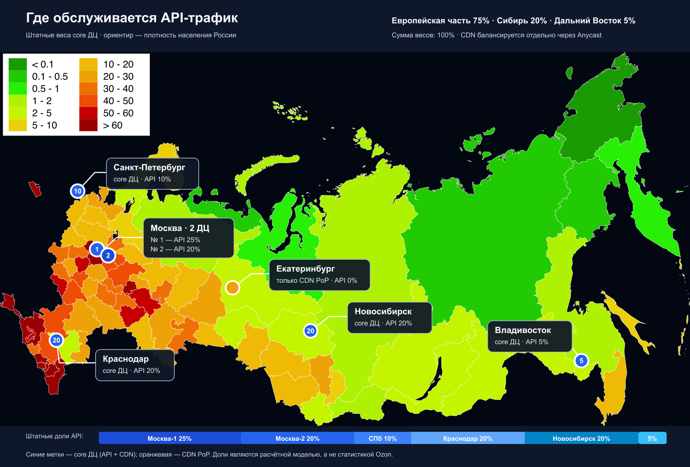
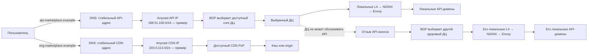
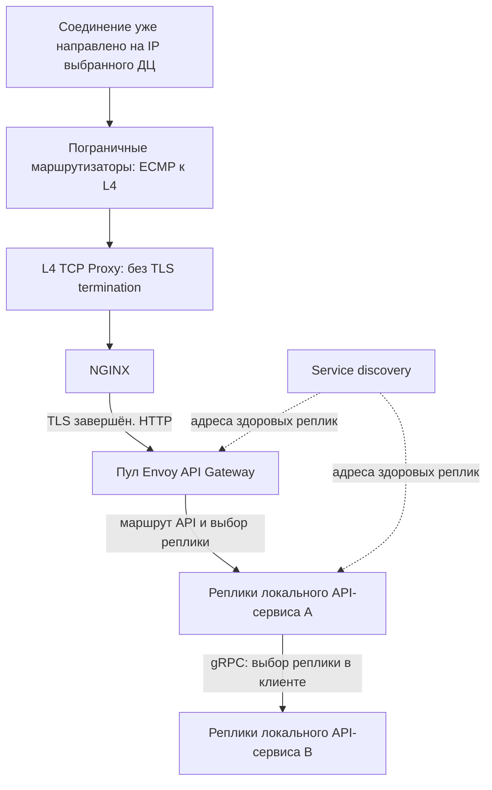
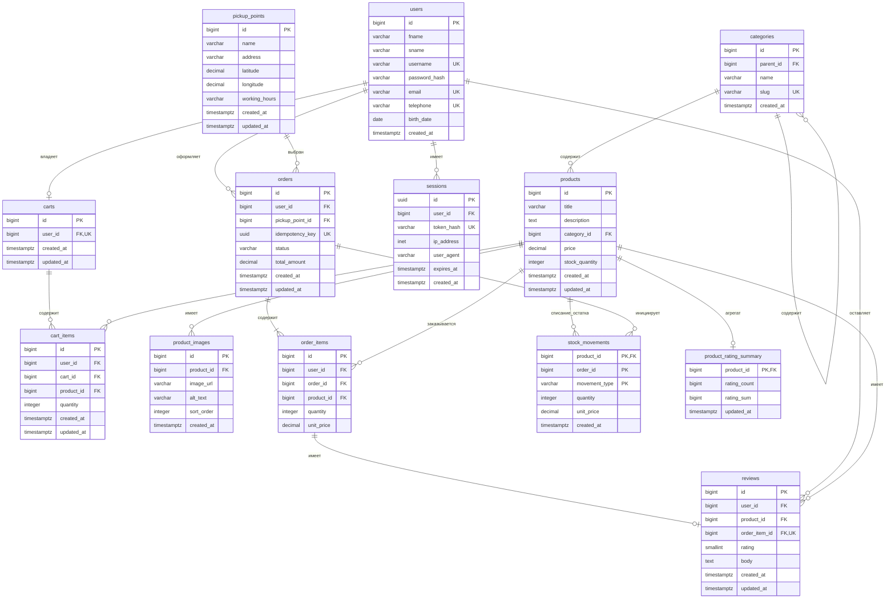
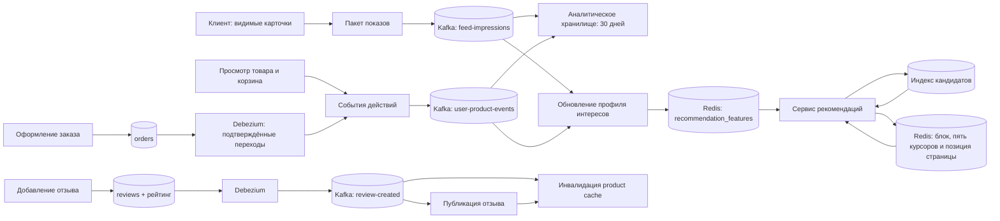
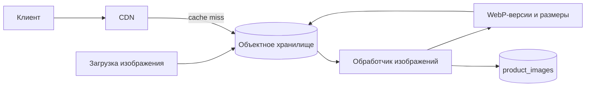
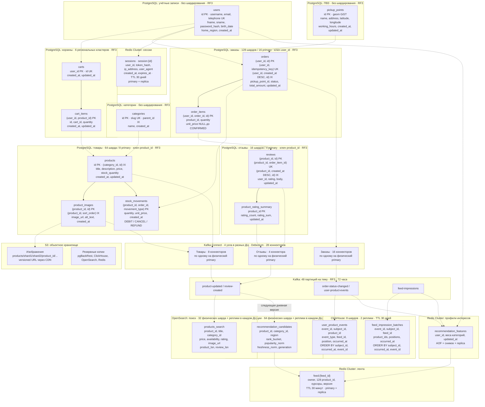
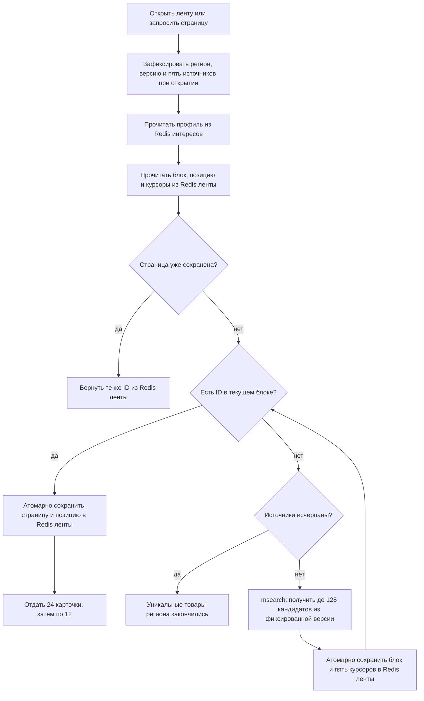
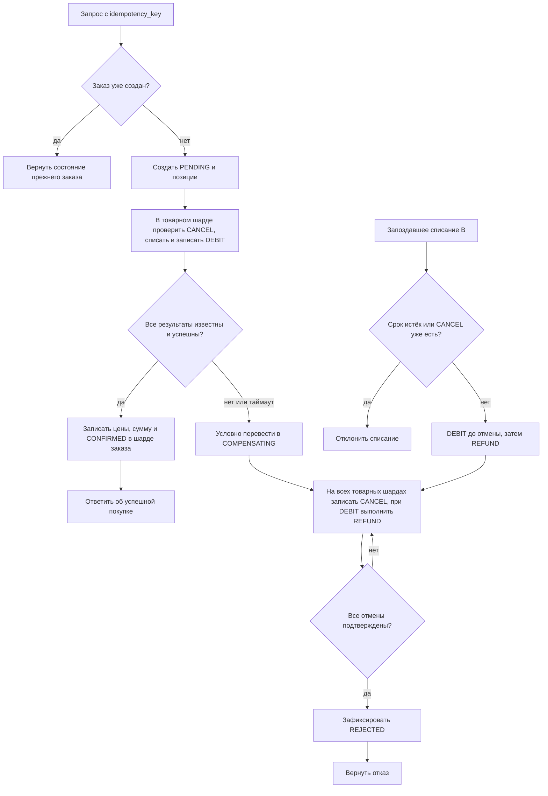
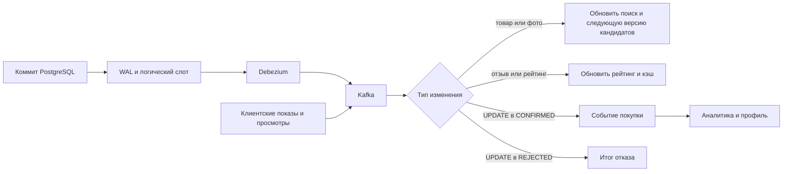

# tp_highload_2026
Курсовая работа по курсу "Проектирование высоконагруженных систем" VK технопарк

## 1. Тема и целевая аудитория
### Тип сервиса
Высоконагруженный маркетплейс (на примере сервиса ozon)

### Функционал mvp
1. Регистрация и авторизация пользователей
2. Просмотр главной страницы с персонализированной лентой рекомендаций
3. Просмотр каталога товаров
4. Поиск и просмотр карточки товара
5. Добавление и изменение товаров в корзине
6. Выбор ПВЗ и оформление заказа
7. Просмотр и добавление рейтинга товаров и отзывов

### Ключевые продуктовые решения
1. Главная страница формируется персонально для пользователя на основе рекомендательной системы.
2. Рейтинг товара рассчитывается на основе оценок пользователей и отображается вместе с отзывами.
3. Покупатель может оставить отзыв на товар только после покупки

### Целевая аудитория
По данным ozon 84 млн пользователей в месяц.[[1]](#source1) География распределения пользователя такова: ~94.7% пользователей из РФ, остальные 5% пользователей из-за рубежа. Средний трафик из стран зарубежья не превышает 1% на страну.[[2]](#source2)

В РФ около 27% приходится на Московскую область, Москву и СПБ.[[3]](#source3)

Причем с мобильных устройств кол-во транзакционных запросов е-ком 79% против 37% на десктопе.[[4]](#source4)


## 2. Расчет нагрузки
### Аудиторные метрики

| Метрика |                            Значение |
|---------|------------------------------------:|
| MAU     |               84 млн[[1]](#source1) |
| DAU     | 44 млн[[5]](#source5) |

### Расчет среднего количества действий пользователя в день

##### Регистрация 
По данным Ozon, на конец I квартала 2026 года база активных покупателей составила 67,3 млн человек, увеличившись на 16% год к году [[5]](#source5). Число активных покупателей годом ранее составляло 58,02 млн. Значит годовой прирост 9,28 млн покупателей. Пусть 85% данного прироста приходится на новых зарегистрированных пользователей. Тогда оценочное количество регистраций в сутки составляет 9,28 млн * 0,85 / 365 = 21 610. При DAU = 44 млн среднее количество регистраций на одного пользователя в сутки составляет 21 610 / 44 000 000 ≈ 0,00049.


##### Авторизация
Примем, что срок жизни пользовательской сессии составляет 30 дней. Предполагая, что пользователи посещают сервис ежедневно и повторно авторизуются после истечения срока сессии, получим среднее количество авторизаций 1/30 = 0,033.

##### Просмотр главной страницы с персонализированной лентой рекомендаций
Нет статистики, примем, что каждый пользователь дневной аудитории, независимо от авторизации, просматривает персонализированную ленту в среднем 2 раза в сутки. Страница рекомендаций доступна всем пользователям, поэтому среднее количество её просмотров на одного пользователя DAU составляет **2** просмотра в сутки.

##### Скролл ленты рекомендаций на главной странице
При первом открытии главной страницы загружается 24 карточки товаров. В среднем пользователь выполняет 2 скролла. Каждый скролл подгружает ещё 12 карточек и формирует отдельный запрос к сервису рекомендаций. При 2 просмотрах главной в сутки среднее количество запросов подгрузки ленты на пользователя составляет 2 * 2 = **4** в сутки.

##### Просмотр каталога товаров
В связи с отсутствием публичной статистики примем допущение, что пользователь посещает сервис 2 раза в сутки, в 60% сессий открывает каталог и просматривает в среднем 2 страницы. Каталог доступен как авторизованным, так и неавторизованным пользователям, поэтому расчёт ведётся по всей дневной аудитории (DAU), без разделения пользователей по статусу авторизации. Среднее количество просмотров каталога на одного пользователя в сутки составляет 2 × 0,6 × 2 = **2,4**.

##### Поиск товаров
В связи с отсутствием публичной статистики примем допущение, что пользователь посещает сервис 2 раза в сутки, в 60% сессий использует поиск и выполняет в среднем 2 поисковых запроса. Поиск доступен как авторизованным, так и неавторизованным пользователям. Среднее количество поисковых запросов на одного пользователя в сутки составляет 2 * 0,6 * 2 = 2,4.

##### Просмотр карточки товара
В связи с отсутствием публичной статистики примем допущение, что пользователь посещает сервис 2 раза в сутки, в 75% сессий просматривает карточки товаров и открывает в среднем 4 карточки за такую сессию. Среднее количество просмотров карточек товаров на одного пользователя в сутки составляет 2 * 0,75 * 4 = 6.

##### Добавление товара в корзину
Пусть 20% дневной аудитории добавляют товары в корзину и каждый из них выполняет в среднем 2 добавления в сутки. Среднее количество добавлений товара в корзину на одного пользователя составляет 0,2 * 2 = 0,4.

##### Изменение корзины
пусть 10% дневной аудитории изменяют содержимое корзины и каждый из них выполняет в среднем 2 изменения в сутки. Среднее количество изменений корзины на одного пользователя составляет 0,1 * 2 = 0,2.

##### Выбор ПВЗ
пусть 15% дневной аудитории выбирают ПВЗ и каждый из них выполняет это действие в среднем 1 раз в сутки. Среднее количество выборов ПВЗ на одного пользователя составляет 0,15 * 1 = 0,15.

##### Оформление заказа
По данным Ozon за II квартал 2025 года, количество активных покупателей превысило 60 млн, а частотность покупок составила 30 заказов в год. Для оценки примем 60 млн покупателей. Тогда количество заказов в сутки составляет 60 млн * 30 / 365 ≈ 4,93 млн. При DAU = 44 млн среднее количество оформлений заказа на одного пользователя составляет 4,93 / 44 ≈ 0,112 в сутки. Оценка предполагает равномерное распределение заказов и требует сопоставимости периодов исходных показателей.

##### Просмотр рейтинга и отзывов
В связи с отсутствием публичной статистики примем допущение, что 40% дневной аудитории просматривают рейтинги и отзывы товаров и каждый из них выполняет в среднем 3 просмотра в сутки. Среднее количество просмотров рейтингов и отзывов на одного пользователя составляет 0,4 * 3 = 1,2.

##### Добавление рейтинга и отзыва
пусть покупатели оставляют рейтинг и отзыв для 5% оформленных заказов. При среднем количестве заказов 0,112 на пользователя в сутки получаем 0,112 * 0,05 = 0,0056 отзыва на одного пользователя в сутки. Предполагается, что один заказ соответствует одному оцениваемому товару. При нескольких товарах в заказе показатель необходимо пересчитать.


| Действие                                                            | Среднее количество действий пользователя в день |
|---------------------------------------------------------------------|------------------------------------------------:|
| Регистрация                                                         |                                         0,00049 |
| Авторизация                                                         |                                           0,033 |
| Просмотр главной страницы с персонализированной лентой рекомендаций |                                               2 |
| Скролл ленты рекомендаций на главной странице                       |                                               4 |
| Просмотр каталога товаров                                           |                                             2,4 |
| Поиск товаров                                                       |                                             2,4 |
| Просмотр карточки товара                                            |                                               6 |
| Добавление товара в корзину                                         |                                             0,4 |
| Изменение корзины                                                   |                                             0,2 |
| Выбор ПВЗ                                                           |                                            0,15 |
| Оформление заказа                                                   |                                           0,112 |
| Просмотр рейтинга и отзывов                                         |                                             1,2 |
| Добавление рейтинга и отзыва                                        |                                          0,0056 |

### Средний размер хранилища пользователя
Для оценки среднего объёма пользовательских данных примем следующие допущения. По условию расчёта размер данных на одного пользователя увеличивается втрое, поэтому размеры каждого пользовательского объекта также умножаются на 3:

- Профиль пользователя занимает в среднем 6 КБ.
- В корзине пользователя хранится в среднем 5 товаров. Один элемент корзины занимает 600 Б.
- Средняя частота покупок составляет 30 заказов в год.
- История заказов хранится за расчётный период 4,2 года. Среднее количество заказов на пользователя составляет 30 * 4,2 = 126 шт.
- Средний размер одного заказа составляет 6 КБ.
- Пользователи оставляют отзывы для 5% заказов. Среднее количество отзывов составляет 126 * 0,05 = 6,3 шт.
- Средний размер одного отзыва составляет 3 КБ.

Все значения размеров объектов и периода хранения являются допущениями для расчёта нагрузки.

| Тип данных        | Среднее количество, шт. | Размер объекта | Объём, ГБ |
|-------------------|------------------------:|---------------:|----------:|
| Профиль           |                       1 |           6 КБ |  0,000006 |
| Товары в корзине  |                       5 |          600 Б |  0,000003 |
| Заказы            |                     126 |           6 КБ |  0,000756 |
| Рейтинги и отзывы |                     6,3 |           3 КБ | 0,0000189 |
| Итого             |                   138,3 |              — | 0,0007839 |


### Размер хранения в разбивке по типам данных

##### Данные пользователей

По данным Ozon, на конец I квартала 2026 года количество активных покупателей составило 67,3 млн [[5]](#source5).

Рассчитаем объём по каждому типу данных:

- Профили: 67,3 млн * 6 КБ = 0,4038 ТБ.
- Корзины: 67,3 млн * 5 * 600 Б = 0,2019 ТБ.
- Заказы: 67,3 млн * 126 * 6 КБ = 50,8788 ТБ.
- Отзывы: 67,3 млн * 6,3 * 3 КБ = 1,272 ТБ.

Общий объём пользовательских данных составляет:

0,4038 + 0,2019 + 50,8788 + 1,272 = 52,76 ТБ.

##### Каталог товаров

В связи с отсутствием подтверждённых данных о количестве товарных карточек, что каталог содержит 200 млн товаров. Средний размер данных одной карточки составляет 4 КБ.

Общий объём каталога:

200 млн * 4 КБ = **0,8 ТБ**.

##### Изображения товаров

Примем допущение, что каждый товар содержит в среднем 3 изображения размером 200 КБ каждое. Все три изображения загружаются сразу при показе товарной карточки в ленте, каталоге, поиске и на странице товара.

Количество изображений:

200 млн * 3 = 600 млн шт.

Общий объём изображений:

600 млн * 200 КБ = **120 ТБ**.

##### Сводная таблица

| Тип данных          | Количество, шт. | Размер объекта | Общий объём, ТБ |
|---------------------|----------------:|---------------:|----------------:|
| Профили             |        67,3 млн |           6 КБ |          0,4038 |
| Элементы корзин     |       336,5 млн |          600 Б |          0,2019 |
| Заказы              |       8,48 млрд |           6 КБ |         50,8788 |
| Отзывы              |      423,99 млн |           3 КБ |           1,272 |
| Карточки товаров    |         200 млн |           4 КБ |             0,8 |
| Изображения товаров |         600 млн |         200 КБ |             120 |
| **Итого**           |               — |              — |      **173,56** |

Общий расчётный объём хранилища составляет **173,56 ТБ**.

### Расчёт RPS

Для расчёта среднего количества запросов в секунду используем DAU = 44 млн пользователей и ранее рассчитанное среднее количество действий пользователя в сутки. Одному пользовательскому действию соответствует один запрос. Исключение — просмотр главной, при котором первоначальная загрузка и каждый скролл ленты являются отдельными запросами.

Средний RPS рассчитывается по формуле:

RPS_avg = DAU * ActionsPerDAU / 86400

Для расчёта пикового RPS примем коэффициент пиковости K = 5, предполагая, что максимальная интенсивность запросов в течение суток в 5 раз превышает среднюю.

RPS_peak = RPS_avg * 5

Например, для просмотра карточки товара:

RPS_avg = 44 000 000 * 6 / 86400 ≈ 3056

RPS_peak = 3056 * 5 = 15278

#### Сводная таблица RPS

| Тип запроса                            | Средний RPS | Пиковый RPS |
|----------------------------------------|------------:|------------:|
| Регистрация                            |        0,25 |        1,25 |
| Авторизация                            |       16,81 |       84,03 |
| Первоначальная загрузка главной        |     1018,52 |     5092,59 |
| Скролл ленты рекомендаций              |     2037,04 |    10185,19 |
| Каталог товаров                        |     1222,22 |     6111,11 |
| Поиск товаров                          |     1222,22 |     6111,11 |
| Карточка товара                        |     3055,56 |    15277,78 |
| Добавление в корзину                   |      203,70 |     1018,52 |
| Изменение корзины                      |      101,85 |      509,26 |
| Выбор ПВЗ                              |       76,39 |      381,94 |
| Оформление заказа                      |       57,04 |      285,19 |
| Просмотр рейтинга и отзывов            |      611,11 |     3055,56 |
| Добавление рейтинга и отзыва           |        2,85 |       14,26 |
| **Итого**                              | **9625,56** | **48127,80** |

Запросы выдачи рекомендаций при скролле учтены отдельно. Загрузка изображений учитывается в расчёте сетевого трафика через CDN.

Проверка тенденции: после пересчёта карточка товара остаётся лидером по RPS (15 277,78 пиковых RPS против 9 166,67 ранее). Следующим по нагрузке становится отдельный запрос скролла ленты рекомендаций (10 185,19 пиковых RPS). Это ожидаемое следствие учёта пагинации и не меняет лидирующий endpoint.

### 3. Расчёт сетевого трафика

Для расчёта пикового сетевого трафика используем ранее полученные значения пикового RPS. В связи с отсутствием публичной статистики о размерах ответов API Ozon примем средние размеры ответов как допущения.

Пиковый трафик рассчитаем по формуле:

Traffic_peak = RPS_peak * Size_response * 8 / 10^9

где Size_response — размер ответа в байтах.

#### API-трафик

| Тип запроса | Пиковый RPS | Размер ответа | Трафик, Гбит/с |
|---|---:|---:|---:|
| Первоначальная загрузка главной (24 карточки) | 5093 | 30 КБ | 1,222 |
| Скролл ленты главной (12 карточек) | 10185 | 15 КБ | 1,222 |
| Каталог товаров | 6111 | 25 КБ | 1,222 |
| Поиск товаров | 6111 | 20 КБ | 0,978 |
| Карточка товара | 15278 | 15 КБ | 1,833 |
| Просмотр отзывов | 3056 | 10 КБ | 0,244 |
| Выбор ПВЗ | 382 | 10 КБ | 0,031 |
| Остальные запросы | ≈1913 | 2 КБ | 0,031 |
| **Итого** | | | **≈6,78** |

#### Изображения товаров

Изображения загружаются при просмотре главной страницы, каталога, результатов поиска и карточек товаров. В каждой товарной карточке загружаются сразу 3 изображения.

Примем следующие допущения:

- Средний размер изображения составляет 200 КБ.
- На первоначальной выдаче главной загружается 24 * 3 = 72 изображения. При каждом скролле — 12 * 3 = 36 изображений.
- В каталоге и поиске сохраняется исходное число товарных карточек в выдаче: соответственно 8 * 3 = 24 и 6 * 3 = 18 изображений.
- Благодаря кешированию на стороне клиента и повторному использованию изображений 50% потенциальных загрузок не требуют повторной передачи.
- Изображения доставляются пользователям через CDN.

Пиковый трафик изображений рассчитывается по формуле:

Traffic_images = RPS_peak * N_images * Size_image * 0,5 * 8 / 10^9

| Тип страницы / запроса                         | Пиковый RPS | Изображений на страницу | Трафик, Гбит/с |
|------------------------------------------------|------------:|------------------------:|---------------:|
| Первоначальная загрузка главной (24 карточки)  |        5093 |                      72 |         293,33 |
| Скролл ленты главной (12 карточек)             |       10185 |                      36 |         293,33 |
| Каталог                                        |        6111 |                      24 |         117,33 |
| Поиск                                          |        6111 |                      18 |          88,00 |
| Карточка товара                                |       15278 |                       3 |          36,67 |
| **Итого**                                      |           — |                       — |     **828,66** |

Таким образом, пиковый трафик изображений от CDN к пользователям составляет приблизительно 828,66 Гбит/с.

Предположим, что 80% оставшихся запросов к изображениям обслуживаются из кеша CDN.

Тогда пиковый трафик от исходного хранилища изображений к CDN составляет:

Traffic_origin = 828,66 × 0,2 = 165,73 Гбит/с.

#### Сводная таблица сетевого трафика

| Тип трафика                 | Пиковый трафик, Гбит/с |
|-----------------------------|-----------------------:|
| API → пользователи          |                   6,78 |
| CDN → пользователи          |                 828,66 |
| **Итого к пользователям**   |             **835,44** |
| Хранилище изображений → CDN |                 165,73 |

Суммарный пиковый исходящий трафик системы к пользователям составляет приблизительно 835,44 Гбит/с.

Дополнительно необходимо учитывать трафик между хранилищем изображений и CDN — 165,73 Гбит/с. Он не прибавляется к пользовательскому трафику, чтобы избежать двойного учёта.

## 4. Глобальная балансировка нагрузки

### Размещение дата-центров

Распределение API-трафика ориентируется на плотность населения: европейская часть России получает большую часть нагрузки, а Дальний Восток — локальную площадку с небольшой долей. Все шесть DC представлнных на картинке работают в режиме ```active-active```. Екатеринбург остаётся отдельным ```Anycast CDN PoP```: он кеширует и отдаёт изображения, но не исполняет API-запросы.



Выбор площадок опирается на географию целевой аудитории из раздела 1:

- **94,7% аудитории находится в РФ** [[2]](#source2), поэтому основная инфраструктура размещается в России. Это сокращает сетевую задержку для подавляющей части покупателей и уменьшает зависимость от международных каналов.
- **27% аудитории приходится на Москву, Московскую область и Санкт-Петербург** [[3]](#source3), но этот показатель не раскрывает долю самого Петербурга. По оценке Петростата на 1 января 2025 года в Петербурге и Ленинградской области проживает около 7,7 млн человек [[6]](#source6). Поэтому для петербургского ДЦ планируем **10% штатного API-трафика**, а для Краснодара — **20%** с учётом нагрузки юга. На Москву-1, Москву-2, Санкт-Петербург и Краснодар суммарно планируется **75% API-трафика**. Важно, чтобы две московские площадки были независимы по электропитанию и операторам связи.
- На Новосибирск планируется **20% API-трафика** как региональную core-площадку для Сибири, на Владивосток — **5%** для Дальнего Востока. Екатеринбург дополнительно приближает CDN к пользователям Урала.
- Зарубежная аудитория составляет 5,3%, причём ни одна страна не даёт более 1% трафика [[2]](#source2). На текущем масштабе отдельный зарубежный ДЦ не окупается: изображения для этой аудитории доставляет Anycast CDN, а API-соединение Anycast направляет сразу в доступный российский core ДЦ, где его принимает локальный L7 gateway.

Размещение влияет на продуктовые метрики следующим образом:

- меньшая задержка выдачи и изображений снижает время загрузки страницы и вероятность ухода пользователя до добавления товара в корзину.
- меньшая задержка на оформлении заказа повышает вероятность успешного завершения checkout.
- независимые площадки и резервирование нагрузки снижают вероятность недоступности сервиса и потери заказов при отказе одного ДЦ.

### Почему шесть core ДЦ и отдельный CDN PoP

Один ДЦ был бы единой точкой отказа. Шесть core ДЦ позволяют одновременно разместить основную мощность рядом с населением европейской части страны и сохранить региональные точки присутствия для Сибири и Дальнего Востока. Плановые доли API-трафика по ДЦ:

| Core ДЦ | Плановая доля API-трафика |
|---|---:|
| Москва-1 | 25% |
| Москва-2 | 20% |
| Санкт-Петербург | 10% |
| Краснодар | 20% |
| Новосибирск | 20% |
| Владивосток | 5% |
| **Итого** | **100%** |

Московские площадки обслуживают не только город, но и широкий центральный регион. Краснодар рассчитан на значительную долю трафика юга. Это исключает прежний перекос модели, в которой под Дальний Восток резервировалось 30% общероссийского API-трафика.

Екатеринбург не становится седьмым core ДЦ, поскольку 828,66 Гбит/с из 835,44 Гбит/с пользовательского трафика приходится на изображения CDN. Для Урала наибольший продуктовый эффект даёт близкий edge-кеш. API-трафик составляет лишь 6,78 Гбит/с и обслуживается шестью core ДЦ. Функциональные домены сервиса — edge/CDN, API gateway, каталог и поиск, рекомендации, профили, корзина, заказы/checkout и отзывы. Каждый API-домен развёрнут во всех шести ДЦ. Ни один бизнес-домен не закреплён за единственной площадкой. Вопросы репликации и консистентности stateful-хранилищ рассматриваются отдельно в разделе проектирования данных.

### Распределение API-нагрузки по ДЦ

В штатном режиме API использует **Anycast для выбора ДЦ и локальный L7 gateway внутри него**. Gateway отправляет запрос только в локальный API-домен: межрегионального проксирования каждого запроса здесь нет. Если площадка целиком перестаёт обслуживать API, она отзывает API-анонс, и BGP направляет новые соединения в другой доступный ДЦ. При перегрузке сначала масштабируется локальная площадка. Долю входящего трафика можно менять BGP-политиками, но не глобальным L7-распределением по процентам. Доли из таблицы выше — прогноз нагрузки и ориентир для ёмкости, а не фиксированное правило маршрутизации. Фактические доли измеряются по трафику и могут отличаться от прогноза, поскольку BGP не гарантирует его точного выполнения.

Таблица ниже умножает общий расчётный пик каждого типа запроса на плановые доли. Это оценка мощности ДЦ, а не настройка L7-маршрутизации.

| Тип запроса | Пиковый RPS всего | Мск-1 25% | Мск-2 20% | СПб 10% | Краснодар 20% | Новосибирск 20% | Владивосток 5% |
|---|---:|---:|---:|---:|---:|---:|---:|
| Регистрация | 1,25 | 0,31 | 0,25 | 0,13 | 0,25 | 0,25 | 0,06 |
| Авторизация | 84,03 | 21,01 | 16,81 | 8,40 | 16,81 | 16,81 | 4,20 |
| Первоначальная загрузка главной | 5 092,59 | 1 273,15 | 1 018,52 | 509,26 | 1 018,52 | 1 018,52 | 254,63 |
| Скролл ленты рекомендаций | 10 185,19 | 2 546,30 | 2 037,04 | 1 018,52 | 2 037,04 | 2 037,04 | 509,26 |
| Каталог товаров | 6 111,11 | 1 527,78 | 1 222,22 | 611,11 | 1 222,22 | 1 222,22 | 305,56 |
| Поиск товаров | 6 111,11 | 1 527,78 | 1 222,22 | 611,11 | 1 222,22 | 1 222,22 | 305,56 |
| Карточка товара | 15 277,78 | 3 819,45 | 3 055,56 | 1 527,78 | 3 055,56 | 3 055,56 | 763,89 |
| Добавление в корзину | 1 018,52 | 254,63 | 203,70 | 101,85 | 203,70 | 203,70 | 50,93 |
| Изменение корзины | 509,26 | 127,32 | 101,85 | 50,93 | 101,85 | 101,85 | 25,46 |
| Выбор ПВЗ | 381,94 | 95,49 | 76,39 | 38,19 | 76,39 | 76,39 | 19,10 |
| Оформление заказа | 285,19 | 71,30 | 57,04 | 28,52 | 57,04 | 57,04 | 14,26 |
| Просмотр рейтинга и отзывов | 3 055,56 | 763,89 | 611,11 | 305,56 | 611,11 | 611,11 | 152,78 |
| Добавление рейтинга и отзыва | 14,26 | 3,57 | 2,85 | 1,43 | 2,85 | 2,85 | 0,71 |
| **Итого на один ДЦ** | **48 127,80** | **12 031,95** | **9 625,56** | **4 812,78** | **9 625,56** | **9 625,56** | **2 406,39** |

| Core ДЦ | Средняя нагрузка, RPS | Пиковая нагрузка, RPS |
|---|---:|---:|
| Москва-1 | 2 406,39 | 12 031,95 |
| Москва-2 | 1 925,11 | 9 625,56 |
| Санкт-Петербург | 962,56 | 4 812,78 |
| Краснодар | 1 925,11 | 9 625,56 |
| Новосибирск | 1 925,11 | 9 625,56 |
| Владивосток | 481,28 | 2 406,39 |
| **Итого** | **9 625,56** | **48 127,80** |

Для предварительной оценки резервной ёмкости ниже показано условное пропорциональное перераспределение плановых долей при отказе. Реальный Anycast не использует эти проценты как правило маршрутизации: фактические доли и пики после переключения зависят от регионов пользователей и BGP-маршрутов.

| Сценарий отказа | Наибольшая доля в расчётной модели | Наибольшая нагрузка в расчётной модели |
|---|---:|---:|
| Нет отказа | 25,00% | 12 031,95 peak RPS |
| Москва-1 | 26,67% | 12 834,08 peak RPS |
| Москва-2, Краснодар или Новосибирск | 31,25% | 15 039,94 peak RPS |
| Санкт-Петербург | 27,78% | 13 368,83 peak RPS |
| Владивосток | 26,32% | 12 665,21 peak RPS |
| Одновременный отказ обеих московских площадок | 36,36% | 17 501,02 peak RPS |

Плановые доли и ёмкость API пересматриваются по фактической нагрузке и задержке. Распределение CDN-трафика контролируется отдельно по телеметрии Anycast.

### DNS, Anycast и регулирование трафика



- DNS не выполняет балансировку API: `api.marketplace.example` всегда возвращает стабильный Anycast API-адрес. Это исключает зависимость от географии recursive DNS, EDNS Client Subnet и времени жизни DNS-кеша.
- Anycast API-префикс анонсируется из шести core ДЦ. BGP приводит клиента в доступный ДЦ по сетевой топологии. При отказе ДЦ BGP направляет новые соединения в другой доступный ДЦ, где запрос проходит через местные L4, NGINX, Envoy и API. Anycast не задаёт проценты API-трафика и не выбирает stateful backend.
- Для `img.marketplace.example` DNS аналогично возвращает стабильный Anycast CDN-адрес. Отдельный префикс CDN анонсируют edge в Москве, Санкт-Петербурге, Краснодаре, Екатеринбурге, Новосибирске и Владивостоке. Пользователь попадает на ближайшую по маршрутизации доступную площадку.
- Площадка проверяет здоровье локального API и ingress каждые 5 секунд. Если весь API-контур ДЦ недоступен после двух последовательных проверок, API-префикс площадки отзывается. Новые соединения после сходимости BGP попадают в другой здоровый ДЦ. Изолированный отказ одного сервиса обрабатывается локальными репликами и сам по себе не отзывает анонс всего ДЦ. При восстановлении анонс возвращается после проверки готовности, а трафик наращивается постепенно.
- При полном отказе API ingress в core ДЦ или CDN edge площадка отзывает соответствующий BGP-анонс Anycast-префикса. Трафик автоматически выбирает один из оставшихся маршрутов.

## 5. Локальная балансировка нагрузки

### 5.1. Путь запроса внутри выбранного ДЦ



- **Выбор ДЦ:** Anycast направляет соединение в доступный ДЦ.
- **L4:** каждый готовый L4 анонсирует пограничным маршрутизаторам локальный маршрут к API VIP. Маршрутизаторы распределяют новые соединения между маршрутами двух зон через ECMP. L4 работает как **TCP Proxy без TLS termination**: принимает клиентское TCP-соединение, открывает отдельное TCP-соединение к здоровому NGINX своей зоны и передаёт через себя зашифрованный TLS-поток.
- **NGINX:** завершает клиентский TLS, применяет внешние правила обработки и передаёт API-запрос в пул Envoy своей зоны отказа.
- **Envoy API Gateway:** определяет нужный сервис и выбирает его здоровую локальную реплику.
- **Межсервисный вызов:** если сервис вызывает другой сервис, его gRPC-клиент получает адреса реплик через service discovery и сам выбирает одну из них. Внутренний вызов не возвращается в L4, NGINX или Envoy Gateway.
- **Отказы:** при отказе экземпляра NGINX или Envoy новые запросы направляются к здоровым экземплярам. Если L4-узел или весь ingress-стек его зоны недоступен, проверка готовности вызывает отзыв **локального маршрута к VIP** этого L4 из ECMP-пула. **Новые** соединения принимает L4 другой зоны. Уже открытые TCP-соединения через отказавший узел обрываются и требуют переподключения клиента. Глобальный Anycast-анонс ДЦ отзывается только тогда, когда ни одна зона не может принимать API-трафик (раздел 4).
- **Изображения:** идут через отдельный CDN и не нагружают этот API-контур.

### 5.2. Резервирование по уровням

Внутри каждого ДЦ выделены **две независимые зоны отказа — A и B**. В каждой зоне работают L4, кластер NGINX и кластер Envoy. Размеры компонентов рассчитываются **независимо**. Каждая зона способна принять **весь пик входящего API-трафика ДЦ**, поэтому для всех трёх уровней ingress применяется **`2N`**: по `N` узлов необходимой мощности в каждой зоне. Если L4 достаточно одного узла на зону, это два узла всего, но модель всё равно двухзонная, а не резерв одного узла в общей зоне. Реплики API-сервисов резервируются отдельно по **`N+1`**. В штатном режиме оба ingress-стека активны и делят нагрузку. Резервируется их мощность, а не простаивающие узлы. Отказ всего ДЦ обрабатывается глобальной балансировкой.

| Уровень | Режим работы | Механизм | Формула резервирования | Почему |
|---|---|---|---|---|
| L4 и входной VIP | L4 обеих зон активны. Каждый зональный пул выдерживает полный пик ДЦ. | Пограничные маршрутизаторы направляют соединения к L4 по ECMP. Проверка готовности локального ingress-стека управляет маршрутом: при отказе зоны её next hop исключается, остаётся маршрут в другую зону. | **`2N_L4`**: по `N_L4` узлов в каждой зоне. Предварительный минимум — 1 + 1. | После потери зоны оставшийся пул выдерживает весь пик. `N_L4` определяется сетью, открытиями TCP-соединений, PPS и числом состояний соединений. |
| L7 ingress: NGINX | Оба кластера активны. Каждый способен принять полный пик ДЦ. | L4 распределяет соединения между здоровыми NGINX. NGINX направляет API-запросы в Envoy своей зоны. | **`N_Nginx×2`**: по `N_Nginx` экземпляров в каждой зоне. | При потере зоны остаётся кластер полной расчётной мощности. |
| Envoy API Gateway | Оба кластера активны. Каждый способен принять полный пик ДЦ. | Каждый NGINX-кластер передаёт запросы своему кластеру Envoy. Envoy выбирает реплику API-сервиса. | **`N_Envoy×2`**: по `N_Envoy` экземпляров в каждой зоне, независимо от числа NGINX. | При потере зоны другой кластер Envoy сохраняет полную расчётную мощность. |
| Реплики API-сервиса | Все здоровые реплики активны и по возможности размещены в разных зонах. | При потере готовности endpoint сначала исключается из списка доступных реплик в service discovery. После обновления Envoy перестаёт выбирать его для новых запросов. | **`N_service+1`** для каждого сервиса, минимум две реплики. `N_service` определяется по нагрузке сервиса. | Покрывается отказ одной реплики. **Потерю зоны и работу всего приложения эта формула не гарантирует**. |

Формула `2N` покрывает потерю одной зоны **для L4, NGINX и Envoy** при подтверждённой мощности каждого зонального пула. `N+1` для реплик сервиса покрывает лишь отказ одной реплики и может не пережить потерю всей зоны. Отказ всей площадки обрабатывается Anycast/BGP по разделу 4 и требует отдельной проверки ёмкости других ДЦ. Отказоустойчивость хранилищ, service discovery и других зависимостей проверяется отдельно: дублирование ingress-стека само по себе не гарантирует работоспособность всего приложения.

### 5.3. Расчёт количества балансировщиков

Исходный пик API — **48 127,80 RPS** (раздел 4), а **6,78 Гбит/с** из раздела 3 — только ответы API пользователям, без CDN. Плановая доля ДЦ `p_i` задаёт штатную нагрузку. Anycast не гарантирует точного соблюдения долей. Обозначим через `q` среднее число API-запросов на одно TLS-соединение за расчётный интервал:

$$
\mathrm{RPS}_i=48\,127{,}80\,p_i,
\qquad
\mathrm{CPS}_i(q)=\frac{\mathrm{RPS}_i}{q}.
$$

Рассматриваем два сценария: **`q=1`** — консервативно, одно новое соединение на каждый запрос. **`q=20`** — предполагаемое переиспользование соединения через Keep-Alive или HTTP/2. Здесь `CPS_i` — число **новых клиентских TLS-сеансов**, а не число всех TCP-соединений, создаваемых L4.

В принятом режиме TCP Proxy один клиентский сеанс создаёт **два TCP-соединения**: клиент → L4 и L4 → NGINX. TLS-соединение при этом одно сквозное: рукопожатие проходит через L4 и завершается на NGINX. Если L4 открывает по одному upstream TCP-соединению на каждый клиентский сеанс, то его нагрузка на создание и хранение соединений равна:

$$
\mathrm{TCPopen}^{\mathrm{L4}}_i(q)=2\,\mathrm{CPS}_i(q),
\qquad
\mathrm{Conn}^{\mathrm{L4}}_i=2\,\mathrm{Conn}^{\mathrm{client}}_i.
$$

`Conn_client` — измеренный пик одновременных клиентских сеансов в ДЦ. Его нельзя заменить RPS. Если реализация L4 переиспользует upstream-соединения, коэффициент 2 пересматривается по замерам.

Для оценки сети дополнительно принимаем **1 КиБ входящего API-запроса** и **3 КиБ обмена в каждом направлении на новое TLS-соединение**. Это оценки, а не результаты измерений.

Предполагаем один полнодуплексный 10G-порт на узел, через который проходят обе его стороны проксирования.

Сначала оцениваем трафик запросов `A_i`, ответов `S_i` и обмена при установке TLS `H_i(q)` в Гбит/с:

$$
\begin{aligned}
A_i &= \frac{\mathrm{RPS}_i\cdot 1\,024\cdot 8}{10^9},\\
S_i &= 6{,}78\,p_i,\\
H_i(q) &= \frac{\mathrm{CPS}_i(q)\cdot 3\,072\cdot 8}{10^9}.
\end{aligned}
$$

Для одного интерфейса, обслуживающего обе стороны проксирования, получаем расчётную сетевую нагрузку каждого типа узла:

$$
\begin{aligned}
B^{\mathrm{NGINX}}_i(q) &= A_i+S_i+H_i(q),\\
B^{\mathrm{Envoy}}_i &= A_i+S_i,\\
B^{\mathrm{L4}}_i(q) &= A_i+S_i+H_i(q).
\end{aligned}
$$

TLS-обмен относится к L4/NGINX-участку, а не к Envoy после TLS termination.

| ДЦ | `p_i` | RPS | Клиентские CPS `q=20` / `q=1` | `B` L4 и NGINX `q=20`, Гбит/с | `B` L4 и NGINX `q=1`, Гбит/с | `B` Envoy, Гбит/с |
|---|---:|---:|---:|---:|---:|---:|
| Москва-1 | 25% | 12 031,95 | 601,60 / 12 031,95 | 1,808 | 2,089 | 1,794 |
| Москва-2 | 20% | 9 625,56 | 481,28 / 9 625,56 | 1,447 | 1,671 | 1,435 |
| Санкт-Петербург | 10% | 4 812,78 | 240,64 / 4 812,78 | 0,723 | 0,836 | 0,717 |
| Краснодар | 20% | 9 625,56 | 481,28 / 9 625,56 | 1,447 | 1,671 | 1,435 |
| Новосибирск | 20% | 9 625,56 | 481,28 / 9 625,56 | 1,447 | 1,671 | 1,435 |
| Владивосток | 5% | 2 406,39 | 120,32 / 2 406,39 | 0,362 | 0,418 | 0,359 |

Для 10G-порта с коэффициентом загрузки `u=0,7` проектный предел — **7 Гбит/с для расчётного потока**, без сложения двух направлений. Максимум в таблице — 2,089 Гбит/с на весь ДЦ при `q=1`. Деление между узлами уменьшит нагрузку отдельного порта.

Число узлов каждого типа считается **независимо**. `C_TLS` — допустимые новые TLS-соединения/с на NGINX, `C_HTTP` — допустимые HTTP-запросы/с на NGINX. `C_Envoy` — допустимые API-запросы/с на Envoy с включёнными авторизацией, маршрутизацией, rate limiting и телеметрией. `B_node` для каждого типа — измеренный допустимый сетевой поток одного узла в Гбит/с в принятой модели. Все пределы должны относиться к одной конфигурации и совместной нагрузке.

**NGINX — TLS, HTTP и сеть:**

$$
\begin{gathered}
N_{\mathrm{NGINX},i}(q)=\max(
\left\lceil\frac{\mathrm{CPS}_i(q)}{C_{\mathrm{TLS}}}\right\rceil,
\left\lceil\frac{\mathrm{RPS}_i}{C_{\mathrm{HTTP}}}\right\rceil,\\
\left\lceil\frac{B^{\mathrm{NGINX}}_i(q)}{B^{\mathrm{NGINX}}_{\mathrm{node}}}\right\rceil
),\\
N^{\mathrm{total}}_{\mathrm{NGINX},i}(q)=2N_{\mathrm{NGINX},i}(q).
\end{gathered}
$$

**Envoy — API-запросы и сеть:**

$$
\begin{gathered}
N_{\mathrm{Envoy},i}=\max(
\left\lceil\frac{\mathrm{RPS}_i}{C_{\mathrm{Envoy}}}\right\rceil,
\left\lceil\frac{B^{\mathrm{Envoy}}_i}{B^{\mathrm{Envoy}}_{\mathrm{node}}}\right\rceil
),\\
N^{\mathrm{total}}_{\mathrm{Envoy},i}=2N_{\mathrm{Envoy},i}.
\end{gathered}
$$

**L4 — сеть, открытия TCP-соединений, пакеты и состояния соединений:**

$$
\begin{gathered}
N_{\mathrm{L4},i}(q)=\max(
\left\lceil\frac{B^{\mathrm{L4}}_i(q)}{B^{\mathrm{L4}}_{\mathrm{node}}}\right\rceil,
\left\lceil\frac{\mathrm{TCPopen}^{\mathrm{L4}}_i(q)}{C_{\mathrm{L4,open}}}\right\rceil,\\
\left\lceil\frac{\mathrm{PPS}^{\mathrm{L4}}_i}{C_{\mathrm{L4,PPS}}}\right\rceil,
\left\lceil\frac{\mathrm{Conn}^{\mathrm{L4}}_i}{C_{\mathrm{L4,Conn}}}\right\rceil
),\\
N^{\mathrm{total}}_{\mathrm{L4},i}(q)=2N_{\mathrm{L4},i}(q).
\end{gathered}
$$

`PPS_L4` — измеренный пик пакетов/с на L4 с учётом обоих плеч прокси. `Conn_L4` — число одновременно поддерживаемых TCP-соединений, а не клиентских сеансов. Пределы `C_L4,open`, `C_L4,PPS` и `C_L4,Conn` определяются совместным нагрузочным тестом выбранной реализации L4. Для каждой зоны требуется полный `N_L4`. Даже когда `N_L4=1`, запись **`2N`** отражает размещение по независимым зонам и проверку отказа одной из них.

[Тест веб-сервера NGINX 2017 года](https://blog.nginx.org/blog/testing-the-performance-of-nginx-and-nginx-plus-web-servers) дал 3 399 HTTPS CPS при 8 CPU. С `u=0,7` это **2 379,3 CPS** как предварительный ориентир `C_TLS`. [Тест NGINX Ingress 2019 года](https://blog.nginx.org/blog/testing-performance-nginx-ingress-controller-kubernetes) дал 31 485 SSL TPS без HT на 8 CPU, 236 703 HTTPS RPS и 8,64 Гбит/с throughput — **в отдельных опытах** с различными размерами ответов. Различались процессоры, версии NGINX/OpenSSL, TLS-настройки и топология. Ни один тест не измерял наш совместный профиль с WAF, Envoy и backend. Поэтому `C_HTTP`, пределы Envoy и L4 остаются неизвестными до испытаний.

Следующая таблица показывает **только вклад TLS и 10G-порта в предварительную потребность NGINX** при `C_TLS=2 379,3 CPS`, `B_Nginx,node=7 Гбит/с`. Предел `C_HTTP` не известен, поэтому даже значения NGINX с резервированием — **нижние границы**, а не подтверждённое число машин. Для Envoy и L4 данных ещё меньше.

| ДЦ | NGINX на зону `q=20` / `q=1`, не менее | NGINX с `2N` `q=20` / `q=1`, не менее | Envoy на зону | Envoy с `2N` | L4 на зону | L4 всего |
|---|---:|---:|---|---|---|---|
| Москва-1 | 1 / 6 | 2 / 12 | Требует измерений | Требует измерений | Требует TCPopen/PPS/Conn | Не менее 2 |
| Москва-2 | 1 / 5 | 2 / 10 | Требует измерений | Требует измерений | Требует TCPopen/PPS/Conn | Не менее 2 |
| Санкт-Петербург | 1 / 3 | 2 / 6 | Требует измерений | Требует измерений | Требует TCPopen/PPS/Conn | Не менее 2 |
| Краснодар | 1 / 5 | 2 / 10 | Требует измерений | Требует измерений | Требует TCPopen/PPS/Conn | Не менее 2 |
| Новосибирск | 1 / 5 | 2 / 10 | Требует измерений | Требует измерений | Требует TCPopen/PPS/Conn | Не менее 2 |
| Владивосток | 1 / 2 | 2 / 4 | Требует измерений | Требует измерений | Требует TCPopen/PPS/Conn | Не менее 2 |

Пример для Москвы-1 при `q=1`:

$$
\mathrm{CPS}=12\,031{,}95,\qquad
\left\lceil\frac{12\,031{,}95}{2\,379{,}3}\right\rceil=6,\qquad
\left\lceil\frac{2{,}089}{7}\right\rceil=1\ \text{по сетевой нагрузке}.
$$

Значит **только по известным ограничениям** требуется не менее шести NGINX на зону, или двенадцати с `2N`. При `q=20` TLS-требование падает до одного узла на зону, но HTTP-производительность ещё не проверена. Складывать строки таблицы в окончательный итог оборудования нельзя.

Резервирование двух зон внутри ДЦ **не заменяет межЦОДовое**: при отказе Москвы-1 её плановые 25% запросов должны принять другие площадки. В условной пропорциональной модели раздела 4 для любого оставшегося ДЦ `j`:

$$
p'_j=\frac{p_j}{1-0{,}25}.
$$

У площадки с исходными 20% это **26,67%**, или **12 834,08 peak RPS** вместо 9 625,56. Для неё следует заново применить все формулы этого раздела к RPS, CPS и сетевой нагрузке после переключения. Реальный результат зависит от BGP-маршрутов Anycast, поэтому окончательный резерв проверяется на фактическом распределении и испытанием отказа ДЦ.

## 6. Логическая схема БД
### 6.1 Схема БД



Персональные списки не хранятся. Кандидаты берутся из общего индекса, сводка интересов — из отдельного Redis Cluster `recommendation_features`. Другой кластер Redis хранит текущий блок ленты, аналитическое хранилище — сырые действия.

### 6.2 Объём и нагрузка основных данных

| Название таблицы | Назначение | Количество | Средний размер записи | Общий объём | QPS записи<br>средний / пиковый | QPS чтения<br>средний / пиковый |
|---|---|---:|---:|---:|---:|---:|
| `users` | Учётные записи | 67,3 млн | ≈6 КБ | ≈403,8 ГБ | 0,25 / 1,25 | 16,81 / 84,03 |
| `categories` | Иерархия категорий | ≈155 | ≈256 Б | ≈39,7 КБ | низкая | 1 222,22 / 6 111,11 |
| `products` | Карточки и остатки | 200 млн | ≈4 КБ | ≈0,8 ТБ | не менее 171,12 / 855,57 | 8 555,56 / 42 777,78 |
| `product_images` | Метаданные фото | 600 млн | ≈512 Б | ≈307,2 ГБ | низкая | 8 555,56 / 42 777,78 |
| `carts` | Корзины | 67,3 млн | ≈64 Б | ≈4,3 ГБ | 305,56 / 1 527,78 | 305,56 / 1 527,78 |
| `cart_items` | Позиции корзин | 336,5 млн | ≈600 Б | ≈201,9 ГБ | 305,56 / 1 527,78 | 305,56 / 1 527,78 |
| `orders` | Заказы | 8,48 млрд | ≈6 КБ | ≈50,88 ТБ | не менее 114,08 / 570,38 | 2,85 / 14,26 |
| `order_items` | Позиции заказов | 25,44 млрд | ≈128 Б | ≈3,26 ТБ | не менее 342,24 / 1 711,14 | 2,85 / 14,26 |
| `stock_movements` | Списания, отмены и возвраты остатка | ≈14,8 млн списаний в сутки, ≈518 млн за 35 дней | ≈128 Б | ≈66,3 ГБ без отмен и возвратов | не менее 171,12 / 855,57 | низкая |
| `pickup_points` | ПВЗ | ≈60 тыс. | ≈1 КБ | ≈60 МБ | низкая | 76,39 / 381,94 |
| `reviews` | Отзывы | 423,99 млн | ≈3 КБ | ≈1,27 ТБ | 2,85 / 14,26 | 611,11 / 3 055,56 |
| `product_rating_summary` | Рейтинг товара | до 200 млн | ≈32 Б | до ≈6,4 ГБ | 2,85 / 14,26 | из кэша карточки |
| `sessions` | Сессии | 44 млн активных | ≈512 Б | ≈22,5 ГБ | 16,81 / 84,03 | 441,84 / 2 209,20 |
| **Итого для реляционной БД без `sessions` и компенсаций** |  |  |  | **≈57,20 ТБ** |  |  |

`sessions` хранится в Redis и не входит в итог SQL. `recommendation_features` — отдельный Redis Cluster с одной записью по `user_id`. Пример значения: 16 пар `(category_id, weight)` занимают `16 × (8 + 2) = 160 Б`, остальное в пределах 256 Б — время, версия и offsets Kafka. Для всех 67,3 млн пользователей это `≈17,23 ГБ` значений или `≈34,46 ГБ` с репликой до накладных расходов Redis. Размер ключа нужно проверить через [Redis `MEMORY USAGE`](https://redis.io/docs/latest/commands/memory-usage/).

Обработчик Kafka обновляет веса категорий и хранит offset вместе с профилем, чтобы повторное чтение не удваивало веса. Сырые события в профиль не входят. AOF с `appendfsync everysec` сохраняет профиль для обычного перезапуска. При потере всего кластера ежедневный снимок из S3 дополняется событиями Kafka. Репликация Redis асинхронна, поэтому последние изменения после отказа также могут потребовать воспроизведения ([Redis persistence](https://redis.io/docs/latest/operate/oss_and_stack/management/persistence/)).

Формирование блоков требует `1 018,52 / 5 092,59` чтений профиля/с. Пик записи без объединения событий — `(3 430,37 + 3 055,56) × 5 ≈ 32 429,65 QPS`. Для гостей используются регион, категория и временный профиль до входа.

Пик принят равным `5 ×` среднему QPS. Чтения товаров суммируют главную, каталог, поиск и карточку. `sessions` учитывает авторизованные операции. Рекомендации создаются по запросу, события идут через Kafka. Записи заказа включают `PENDING` и `CONFIRMED`, позиции — фиксацию цены. `stock_movements` фиксирует прямое списание, отмену новых списаний и возврат. `CANCEL` и `REFUND` при неудачном оформлении в базовый QPS и 66,3 ГБ не включены. При доле неуспешных заказов `f` маркеры отмены добавляют до `66,3 × f ГБ` за 35 дней, возвраты — дополнительно до `66,3 × f ГБ`. Журнал хранится 35 дней после завершения заказа, записи незавершённых заказов не удаляются.

Обоснование QPS:

- Средний QPS = `44 млн DAU × действий на пользователя / 86 400`. Пик в 5 раз выше.
- Регистрация: `пользователь → users (запись)` — `0,25 / 1,25 QPS`.
- Авторизация: `пользователь → users (чтение) → sessions (запись)` — `16,81 / 84,03 QPS`.
- Главная и лента: `сервис рекомендаций → products → product_images` — `1 018,52 + 2 037,04 = 3 055,56 QPS`. Первые блоки: `1 018,52 / 5 092,59 QPS`, следующие зависят от скролла.
- Каталог: `пользователь → categories → products → product_images` — `1 222,22 / 6 111,11 QPS` чтения.
- Поиск: `пользователь → products → product_images` — `1 222,22 / 6 111,11 QPS` чтения.
- Карточка товара: `пользователь → products → product_images` — `3 055,56 / 15 277,78 QPS` чтения.
- Просмотр рейтинга и отзывов: `пользователь → reviews` — `611,11 / 3 055,56 QPS` чтения.
- Корзина: `sessions → carts → cart_items` — `305,56 / 1 527,78 QPS` чтения и записи.
- Выбор ПВЗ: `пользователь → sessions → pickup_points` — `76,39 / 381,94 QPS` чтения `pickup_points`.
- Заказ: `sessions → orders → order_items → products → stock_movements` — `57,04 / 285,19` заказов/с и `171,12 / 855,57` списаний/с при трёх товарах. `PENDING` подтверждается после списаний во всех товарных шардах.
- Отзыв: `сервис заказов → reviews` — `2,85 / 14,26 QPS` проверки покупки и записи отзыва в разных шардах.
- Действия: `карточка / корзина / заказ → Kafka` — `3 430,37 / 17 151,85 событий/с`. Показы ленты считаются отдельно в п. 6.4.

Обоснование количества записей:

- `users`: 67,3 млн активных покупателей.
- `categories`: около 155 пользовательских категорий каталога. Детальная товарная таксономия в расчёт не входит.
- `products`: 200 млн товарных карточек — принятое допущение для каталога.
- `product_images`: 600 млн = 200 млн товаров × 3 фотографии.
- `carts`: 67,3 млн, по одной активной корзине на пользователя.
- `cart_items`: 336,5 млн = 67,3 млн пользователей × 5 товаров в корзине.
- `orders`: 8,48 млрд = 67,3 млн пользователей × 126 заказов за 4,2 года.
- `order_items`: 25,44 млрд = 8,48 млрд заказов × 3 товара в заказе. Три товара — допущение.
- `pickup_points`: около 60 тыс. — допущение для сети федерального маркетплейса.
- `reviews`: 423,99 млн = 8,48 млрд заказов × 5% отзывов.
- `stock_movements`: около 14,8 млн списаний в сутки = 4,93 млн заказов × 3 товара. За 35 дней это около 518 млн записей `DEBIT` без отмен и возвратов. Для каждого неуспешного заказа маркеры `CANCEL` пишутся по всем товарам. Завершённые записи удаляются через 35 дней, незавершённые остаются до согласования. Новое списание по старому заказу запрещает срок `orders.created_at + 30 минут`.
- `product_rating_summary`: не более 200 млн строк, по одной на товар с оценками.
- `sessions`: 44 млн активных сессий, по принятому значению DAU.
- Сырые события взаимодействий: около 8,89 млрд за 30 дней = `44 млн × (6 просмотров + 0,4 добавления в корзину + 0,112 × 3 покупки) × 30 дней`. Они хранятся в аналитическом контуре, а не в реляционной БД.


### 6.3 Кеширование

| Кэшируемые данные | Ключ | TTL | ReadQPS | WriteQPS | Назначение |
|---|---|---:|---:|---:|---|
| Блок ленты и курсоры | `feed:{feed_id}` | 30 мин | 3 055,56 | от 1 018,52 | 128 ID. Следующий блок создаётся по мере скролла. |
| Карточка товара | `product:{product_id}` | 5 мин | ≈69 056 | низкая | Инвалидация при смене цены или остатка. |
| Страница каталога | `catalog:{category_id}:{page}` | 5 мин | 1 222,22 | низкая | Популярные страницы. |
| Изображения | CDN URL с версией | 24 ч | ≈103 583 | низкая | Новый URL не требует инвалидации. |

Лента читает общий индекс товаров и профиль интересов. На 30 минут фиксируются версия индекса, четыре предпочтительные категории и источник остальных категорий. Для пяти непересекающихся источников сохраняются позиции курсора. Сервис ранжирует блок из 128 уникальных ID по алгоритму п. 8.1. Первая страница содержит 24 карточки, следующие — по 12. Исчерпанный блок заменяется новым с сохранённых позиций. Redis хранит текущий блок и последнюю страницу для сетевого повтора. Недоступные товары заменяются следующими кандидатами.

Курсор содержит `feed_id`, версию и позицию страницы, привязан к сеансу. Повтор запроса возвращает те же ID, уже загруженные карточки не переставляются. Лимита в 100 товаров нет. Через 30 минут или после утраты кэша начинается новая подборка. Между разными страницами сеанса повторов нет. Число уникальных товаров ограничено размером каталога.

Гость получает товары по региону и категории, при неизвестной категории — по региональной популярности. При входе его временный профиль по `anonymous_session_id` сливается с профилем `user_id`. Новые интересы влияют на следующие блоки. Курсор и непересекающиеся источники категорий сохраняют отсутствие повторов.

Лента: `44 млн × (2 открытия + 4 скролла) / 86 400 = 3 055,56 QPS`, пик `15 277,78`. Открытия дают `1 018,52 / 5 092,59` новых блоков/с в среднем и на пике. Оценка 128 кандидатов требует до `5 092,59 × 128 ≈ 651 852` обработанных ID/с на пике без глубокого скролла. Один `msearch` содержит до пяти подзапросов. Первые блоки дают до `5 092,59 × 5 ≈ 25 463` поисковых подзапросов/с по всей системе. Дополнительные блоки увеличивают поток пропорционально глубине скролла. Типичная глубина `24 + 2 × 12 = 48` товаров даёт hit rate первого блока `4 / (2 + 4) = 66,7%`. Чтение карточек — `≈69 056 QPS` по формуле `1 018,52 × 24 + 2 037,04 × 12 + 1 222,22 × 8 + 1 222,22 × 6 + 3 055,56 × 1`. Для изображений учтён клиентский кэш 50%.

Оценка ключа ленты — 2 048 Б: 128 ID (1 024 Б), последняя страница (до 192 Б), курсоры и метаданные (≈832 Б). При пике открытий за 30 минут активны `5 092,59 × 1 800 ≈ 9,17 млн` ключей. Одна копия занимает `≈18,77 ГБ`, копия с репликой и запасом 30% — `18,77 × 2 × 1,3 ≈ 48,81 ГБ RAM`. Размер ключа и фрагментацию нужно проверить через [Redis `MEMORY USAGE`](https://redis.io/docs/latest/commands/memory-usage/). При превышении 2 КБ RAM пересчитывается пропорционально.

Из 832 Б для курсоров и метаданных до 160 Б отводится на пять курсоров по 32 Б, до 32 Б — на четыре `category_id`, остальные 640 Б — на версию, владельца, позицию страницы и служебные данные. Если сериализованный `search_after` окажется больше, оценку 2 КБ и RAM нужно пересчитать по `MEMORY USAGE`.

Размещение RAM для этого кэша по долям API-трафика из раздела 4 (ГБ, основная копия + реплика + запас):

| ДЦ | В штатном режиме | При отказе другого ДЦ, максимум | Планируемая RAM |
|---|---:|---:|---:|
| Москва-1 | 12,20 | 15,25 | 16 |
| Москва-2 | 9,76 | 13,02 | 16 |
| Санкт-Петербург | 4,88 | 6,51 | 8 |
| Краснодар | 9,76 | 13,02 | 16 |
| Новосибирск | 9,76 | 13,02 | 16 |
| Владивосток | 2,44 | 3,25 | 4 |
| **Итого выделено** | **48,81** | — | **76** |

При отказе ДЦ нагрузка остальных масштабируется как `p / (1 − p_отказавшего)`. Например, Москва-1 после потери ДЦ с долей 20% требует `48,81 × 25% / 80% ≈ 15,25 ГБ`. Таблица учитывает только кэш ленты, не отдельный Redis Cluster профилей.

Нагрузка на БД после кэширования:

| Таблица | Исходный ReadQPS | Кэш и ожидаемый hit rate | ReadQPS из БД после кэша |
|---|---:|---:|---:|
| `products` | 8 555,56 | Карточки товаров, 95% | 427,78 |
| `product_images` | 8 555,56 | Карточки товаров, 95% | 427,78 |
| `categories` | 1 222,22 | Страницы каталога, 90% | 122,22 |

`ReadQPS БД = исходный ReadQPS × (1 − hit rate)`. Записи идут в основную БД и инвалидируют кэш.

### 6.4 Буферы событий



| Буфер | Событие | Средний / пиковый поток | Объём за срок хранения при среднем потоке | Срок хранения |
|---|---|---:|---:|---:|
| `feed-impressions` | Пакеты реально увиденных карточек ленты | не более 3 055,56 / 15 277,78 событий/с | до ≈185,86 ГБ | 72 часа |
| `user-product-events` | Просмотр карточки, корзина, покупка | 3 430,37 / 17 151,85 событий/с | ≈56,91 ГБ | 72 часа |
| `review-created` | Создание или изменение отзыва | 2,85 / 14,26 событий/с | ≈189 МБ | 72 часа |
| CDC заказов | Изменения `orders`, минимум два статуса на заказ | не менее 114,08 / 570,38 событий/с | не менее ≈7,57 ГБ при 256 Б | 72 часа |

Клиент отправляет пакет показов только для карточек, видимых хотя бы наполовину. Повторы удаляются. Пакет содержит `event_id`, время, `user_id` или `anonymous_session_id`, `feed_id` и пары `(product_id, position)`. Просмотр, корзина и покупка идут отдельными событиями, с `feed_id` и позицией при переходе из ленты. Отправка асинхронна и не блокирует заказ.

Верхняя граница: два первых пакета по 24 карточки и четыре пакета скролла по 12 на DAU. Это `44 млн × 6 = 264 млн` пакетов/сутки и `3 055,56 / 15 277,78 событий/с`. При 320 Б и 192 Б на пакет объём равен `44 млн × (2 × 320 + 4 × 192) ≈ 61,95 ГБ/сутки`, или `≈2,58 ГБ/ч`. Это отдельная нагрузка клиентской телеметрии. Реальный поток меньше, если карточки не попали в экран.

Действия: `44 млн × (6 + 0,4 + 0,112 × 3) = 296,384 млн/сутки`. При 64 Б это `≈18,97 ГБ/сутки`, или `≈790 МБ/ч`. Вместе с показами: до `560,384 млн событий` и `≈80,92 ГБ/сутки`, за 30 дней `≈2,43 ТБ` без сжатия и реплик. Kafka за 72 часа хранит `(61,95 + 18,97) × 3 ≈ 242,76 ГБ` логически или `≈728,29 ГБ` с тремя копиями. `review-created` добавляет ≈0,19 ГБ. Пик `K = 5` на все 72 часа не переносится. Прежние 790 МБ/ч не включали показы.

Kafka разделяет события по `user_id` или `anonymous_session_id`. Обработчик обновляет профиль асинхронно, сырые события хранятся 30 дней. При входе гостевой профиль сливается с пользовательским. Событие привязки сохраняет связь в аналитике без переписывания истории. Дубли удаляются по `event_id`. Покупка публикуется из перехода `orders` в `CONFIRMED`, прочие итоги заказа — из перехода в `REJECTED`.

`review-created`: `2,85 × 86 400 × 256 Б ≈ 63 МБ/сутки`. Отзыв и агрегат рейтинга записываются вместе. Debezium передаёт изменения в Kafka после коммита. Обработчик инвалидирует кэш карточки. Агрегат восстанавливается из `reviews`.

CDC товаров при допущении 171,12 изменений/с и 256 Б на сообщение добавляет ≈11,36 ГБ за 72 часа логически. CDC заказов при двух изменениях статуса на заказ добавляет не менее `114,08 × 256 Б × 259 200 с ≈ 7,57 ГБ`. Вместе с показами, действиями и отзывами это не менее ≈261,88 ГБ логически и ≈785,64 ГБ при RF3. Компенсации добавляют изменения товаров и статусов сверх этой нижней границы. Обработчик публикует покупку только при переходе в `CONFIRMED`, результат отказа — при `REJECTED`. Для дедупликации используются `order_id` и конечный статус. Размеры CDC сообщений требуют замера.

### 6.5 Требования консистентности

| Данные или операция | Требование | Допустимое отставание | Механизм |
|---|---|---:|---|
| Регистрация | Строгая | 0 | Транзакция и UNIQUE для `username`, `email`, `telephone`. |
| Корзина | Строгая | 0 | Один пользовательский шард, транзакция, ключ `(user_id, product_id)`. |
| Товар, цена, остаток | Строгая | 0 | Товар изменяется в транзакции, Debezium читает подтверждённое изменение из WAL. |
| Заказ и остаток | Локальная строгость, межшардовое согласование | До `CONFIRMED` или `REJECTED` | Saga: `PENDING` в шарде заказов, прямое условное списание с `DEBIT` в товарных шардах. После всех ответов цены и `CONFIRMED` фиксируются в шарде заказа. При ошибке `COMPENSATING`, `CANCEL` для каждого товара, `REFUND` выполненных списаний и `REJECTED` только после всех подтверждений. Конечные статусы неизменяемы. Повторы по `idempotency_key`, зависшие операции завершает обработчик. |
| Отзыв | Проверка покупки | 0 для допуска | Сервис заказов проверяет владельца, товар и `CONFIRMED`. Отзыв пишется в отдельном шарде отзывов. |
| Рейтинг | Строгая в шарде отзывов | 0 в PostgreSQL | `reviews` и `product_rating_summary` меняются одной транзакцией. Кэш обновляется через CDC. |
| Кэш товара | В конечном счёте | До 5 минут | Инвалидация по событию, TTL как запасной предел. |
| Лента | В конечном счёте | До 30 минут | Новые действия влияют на следующие блоки, выданные карточки сохраняют порядок. |
| Вход гостя | Read-your-writes | До следующего блока | Гостевой профиль сливается с `user_id`, ранее выданные ID не повторяются. |
| Сессия | Read-your-writes | 0 на primary | Создание и проверка через Redis primary. |
| Аналитика | В конечном счёте | До 1 часа | Показы и действия идут через Kafka, подтверждённые покупки — через CDC заказов. |
| Изображения | В конечном счёте | До 24 часов | Версионированный URL, удаление старой версии после TTL. |

### 6.6 Распределение нагрузки по ключам

Средний QPS предполагает равномерное распределение. Исключения:

| Ключ распределения | Исключение из равномерного распределения | Последствие |
|---|---|---|
| `product_id` | Акционные товары | Кэш карточек, фото и отзывов, проверка пика одного ключа. |
| `category_id` | Популярные категории | Кэш страниц каталога. |
| `feed_id`, `user_id` | Массовое открытие ленты | Redis распределён по `feed_id`, RAM рассчитана в п. 6.3. |
| `pickup_point_id` | ПВЗ крупных городов | Кэш и реплики справочника. |
| `image_url` | Популярные фото | CDN-кэш и версионированный URL. |
| `order_id`, `cart_id` | Всплеск оформлений | Запас QPS и ограничение нагрузки. |

### 6.7 Файловое хранилище

`product_images` хранит метаданные и URL. Файлы лежат в S3 и выдаются через CDN.



| Параметр | Значение |
|---|---|
| Тип хранилища | S3-совместимое объектное хранилище. |
| Объектный ключ | `products/{shard1}/{shard2}/{product_id}/{image_id}/{version}/{size}.webp`. |
| Количество файлов | 600 млн: 200 млн товаров × 3 изображения. |
| Средний размер файла | 200 КБ. |
| Полезный объём | ≈120 ТБ: `600 млн × 200 КБ`. |
| Доступ | Публичный versioned URL через CDN. Origin недоступен клиенту напрямую. |
| Средний / пиковый CDN ReadQPS после клиентского кэша | ≈103 583 / 517 917 запросов изображений в секунду. |
| Ожидаемый CDN cache hit rate | 90%. |
| Средний / пиковый Origin ReadQPS после CDN | ≈10 358 / 51 792 запросов в секунду. |
| Обновление изображения | Создаётся новый объект с новой `version`. Старый объект удаляется после истечения TTL CDN. |

Репликация или erasure coding увеличат физический объём сверх 120 ТБ.

Ключ делится на два уровня по первым 15 битам SHA-256 десятичного `product_id`: 7 бит для `shard1`, 8 для `shard2`. Оба сегмента записываются двумя hex-цифрами. Это `128 × 256 = 32 768` конечных префиксов, в среднем `200 млн / 32 768 ≈ 6 104` товаров на префикс при цели 5–10 тыс. Отклонение при равномерном хеше ≈78, фактический максимум требует проверки. На верхних уровнях 128 и 256 дочерних префиксов. В S3 это логические префиксы, не каталоги и не лимит AWS ([документация](https://docs.aws.amazon.com/AmazonS3/latest/userguide/using-prefixes.html)). Расчёт 600 млн файлов учитывает одну WebP-версию трёх фото на товар. Другие размеры и версии увеличат объём.

При пике `1 035 833` запросов изображений/с клиентский кэш 50% снижает нагрузку CDN до `≈517 917 QPS`, в среднем — `≈103 583 QPS`. CDN с hit rate 90% передаёт в S3 `≈51 792 QPS` на пике и `≈10 358 QPS` в среднем.

## 7. Физическая схема БД

### 7.1 Выбор хранилища

| Тип хранилища | Данные / таблицы | Причина выбора |
|---|---|---|
| PostgreSQL: учётные записи | `users` | Глобальная уникальность логина, почты и телефона. Без шардирования. |
| PostgreSQL: категории | `categories` | Малый справочник с собственной схемой обновления. Без шардирования. |
| PostgreSQL: ПВЗ | `pickup_points` | Пространственный поиск и отдельное масштабирование сети ПВЗ. Без шардирования. |
| PostgreSQL: корзины | `carts`, `cart_items` | Региональные кластеры по `home_region`. Объём 206,2 ГБ не требует 128 шардов заказов. |
| PostgreSQL: заказы | `orders`, `order_items` | Локальные транзакции по `user_id`, идемпотентность заказа. |
| PostgreSQL: товары | `products`, `product_images`, `stock_movements` | Списание остатка и журнал операции в одном шарде. Метаданные фото остаются отдельными строками. |
| PostgreSQL: отзывы | `reviews`, `product_rating_summary` | Независимый рост отзывов и транзакционное обновление рейтинга. |
| Redis Cluster | `sessions`, `feed:{feed_id}`, `recommendation_features` | Быстрый доступ по ключу и TTL. Профиль сохраняется, лента пересоздаётся. |
| OpenSearch: два кластера в каждом ДЦ | `products_search`, `recommendation_candidates` | Разные нагрузки и маршрутизация шардов для поиска и ленты. |
| ClickHouse | `feed_impression_batches`, `user_product_events` | Пакетная запись и аналитика событий за 30 дней. |
| Kafka и Debezium | `feed-impressions`, `user-product-events`, CDC товаров, отзывов и заказов | Передача изменений после коммита и повторное чтение событий. |
| S3-совместимое хранилище | Изображения, резервные копии | Объекты раздаются через CDN. Копии отделены от БД. |

### 7.2 Физическая схема



Сплошная линия — FK внутри шарда. Пунктир — связь через сервис или событие. `PK` — первичный, `UK` — уникальный, `IX` — вторичный индекс. `RF` — число копий.

### 7.3 Индексы

В PostgreSQL первичные и уникальные ключи создают B-tree индексы. Основные индексы запросов:

- `users(lower(username))`, `users(lower(email))`, `users(telephone)` — уникальные данные для входа.
- `categories(slug)` — уникальный адрес категории.
- `categories(parent_id)` — дочерние категории.
- `carts(user_id)`, `carts(id)` — корзина пользователя и уникальный ID.
- `cart_items(user_id, product_id)` — позиции корзины без дублей.
- `orders(user_id, idempotency_key)` — повтор оформления заказа.
- `orders(user_id, created_at DESC, id)` — история заказов.
- `order_items(user_id, order_id, id)` — позиции заказа.
- `products(category_id, id)` — товары категории.
- `product_images(product_id, sort_order)` — порядок фотографий.
- `stock_movements(product_id, order_id, movement_type)` — не более одного списания, маркера отмены и возврата для товара в заказе.
- `reviews(product_id, order_item_id)` — один отзыв на купленную позицию.
- `reviews(product_id, created_at DESC, id)` — лента отзывов.
- `product_rating_summary(product_id)` — рейтинг товара.

Для поиска ближайших ПВЗ используется GiST `pickup_points(geom)`. В OpenSearch поиск и подбор кандидатов опираются на инвертированные индексы. В ClickHouse обе таблицы событий сортируются по `(subject_id, occurred_at, event_id)` и разбиваются на дневные партиции с TTL 30 дней. Redis использует доступ по ключу без вторичных индексов.

### 7.4 Денормализация

| Производные или дублируемые данные | Источник | Зачем и как обновляются |
|---|---|---|
| `cart_items.user_id`, `order_items.user_id` | `carts`, `orders` | Поиск и запись позиций в шарде владельца без межшардового соединения. Локальные FK проверяют связь. |
| `order_items.unit_price`, `orders.total_amount` | Цены из `stock_movements(DEBIT)` | При `PENDING` цены позиций пусты. Цены и сумма заказа записываются вместе с `CONFIRMED` и далее не меняются. |
| `product_rating_summary` | `reviews` | Рейтинг обновляется в той же транзакции, что и отзыв. |
| `products_search` | Товары, фото, рейтинг | Документ собирает данные карточки для поиска. Поля обновляются через CDC с контролем позиции источника. |
| `recommendation_candidates` | Товары, категории, регионы, популярность и свежесть | Общий набор кандидатов заменяет персональные списки. Дневная версия не меняется в течение сеанса, актуальные цену и остаток проверяет товарный сервис. |
| `recommendation_features` | Показы и действия пользователя | Веса интересов позволяют формировать ленту без чтения сырых событий. Обновляются из Kafka, сохраняются в Redis с AOF и снимками. |

PostgreSQL остаётся источником данных о товарах, заказах и отзывах. Производные данные обновляются из событий, поэтому допускают указанное в п. 6.5 отставание. Межкластерные связи (`orders → users`, `reviews → order_items`, `products → categories`) проверяют сервисы. SQL FK между кластерами нет.

### 7.5 Шардирование

**PostgreSQL.** `users`, `categories` и `pickup_points` находятся в независимых кластерах без шардирования. Их объёмы равны 403,8 ГБ, 39,7 КБ и 60 МБ. Один primary для `users` обеспечивает глобальные UNIQUE. Справочники масштабируются репликами. Корзины занимают 206,2 ГБ и делятся на шесть региональных кластеров по `home_region`. В крупнейшем регионе это около 51,6 ГБ, поэтому хеш-шардирование корзин пока не требуется. Заказы делятся по домашнему региону и `user_id`. Старшие 7 бит `user_id` задают виртуальный шард заказа. Смена региона не переносит данные. `orders.id` и `order_items.id` глобально уникальны.

Числа **128 виртуальных шардов и 16 основных узлов** получены из плановых ограничений. Заказы и позиции без индексов и WAL занимают `50,88 + 3,26 = 54,14 ТБ`. При окне переноса до 2 часов и скорости 70 МБ/с один шард должен содержать не более 0,5 ТБ. Нужно `54,14 / 0,5 ≈ 109` шардов. Выбрано **128**, или семь бит в `user_id`. На шард приходится `54,14 / 128 ≈ 0,423 ТБ`, из них `397,5 ГБ` занимают заказы. С индексами перенос может занять больше времени.

Для основного узла принято 8 ТБ SSD, из которых 4 ТБ доступны полезным данным. На узле помещается до девяти шардов: `9 × 0,423 ≈ 3,81 ТБ`. При долях трафика **25/20/10/20/20/5%** предполагаются **32/26/13/26/25/6** шардов по шести ДЦ. Для них нужны **4/3/2/3/3/1** основных узлов, всего **16**. В среднем это `54,14 / 16 ≈ 3,38 ТБ` и `(570,38 + 1 711,14) / 16 ≈ 143` пиковых записей заказов и позиций в секунду на узел. Доли данных, диск и скорость переноса требуется проверить замерами.

Товары, метаданные фото и журнал списаний делятся на **64 виртуальных шарда на 8 основных узлах** по `SHA-256(product_id) mod 64`. Локальная транзакция уменьшает остаток и пишет `stock_movements`. В среднем это 8 виртуальных шардов и `1,17 ТБ / 8 ≈ 0,15 ТБ` полезных данных на узел. Узлы размещены в шести ДЦ, два дополнительных primary распределяются по фактической нагрузке. При равномерном распределении пиковые записи товаров дают `855,57 / 8 ≈ 107` операций/с на узел. Шарды можно переносить между узлами, а пик одного популярного товара проверяется отдельно. Карта шардов направляет запрос на нужный узел.

**Отзывы.** `reviews` и `product_rating_summary` занимают до 1,28 ТБ. Они делятся на 16 виртуальных шардов по `SHA-256(product_id) mod 16` на четырёх основных узлах, около 80 ГБ на шард. Это отделяет чтение отзывов от списания остатка. Рейтинг меняется локально в той же транзакции. При 3 055,56 пиковых чтений отзывов получается в среднем 764 запроса/с на узел до кэша. Число узлов предварительное.

**Redis Cluster.** Сессии, блоки ленты и профили используют отдельные кластеры из-за разных TTL и требований к сохранности. Это не даёт массовым запросам ленты вытеснить сеансы или профили. Ключи распределяются по hash slots: сессии — по ID, лента — по `feed_id`, профили — по `user_id`.

**OpenSearch.** В каждом ДЦ работают два независимых кластера. `products_search` использует 32 физических шарда с маршрутизацией по `product_id`. При 200 млн товаров это в среднем 6,25 млн документов на шард. `recommendation_candidates` использует 64 физических шарда и маршрут `region|category_id` с `routing_partition_size=8`: популярная группа распределяется по восьми шардам. Оба кластера имеют по одной реплике каждого шарда. На пике ожидаются 6 111,11 поисковых запросов/с и 5 092,59 созданий первого блока ленты/с по всей системе. Для каждого нового блока один `msearch` содержит до пяти подзапросов, то есть до 25 463 подзапросов/с на пике первых блоков. Глубокий скролл добавляет новые блоки. Локальное размещение сокращает межЦОДовые обращения. Кандидаты строятся в отдельной дневной версии, alias переключается после готовности индекса. Предыдущая версия хранится 30 минут. На время переключения нужны место и память для обеих версий. Актуальные цену и остаток проверяет товарный сервис. Размер документов, перекос категорий и достаточность числа шардов проверяются нагрузочным тестом.

**ClickHouse.** События распределяются по `hash(subject_id) mod 8`, чтобы записи разных пользователей обрабатывались параллельно, а история одного субъекта попадала в один шард. Дневные партиции позволяют удалять данные по TTL 30 дней. Число 8 проверяется на потоке событий.

**Kafka.** В каждой теме 48 партиций. Ключи партиционирования:

- действия и показы — `user_id` или `anonymous_session_id`
- сырые CDC изменения — первичный ключ строки, в том числе `(user_id, order_id)` для заказа
- производные события покупки — `user_id`, нормализованные события карточки и рейтинга — `product_id`

Это сохраняет порядок для одной строки в сыром CDC и одного субъекта или товара в нормализованных темах. Между товарным и заказным шардами общего порядка нет. 48 партиций позволяют нескольким обработчикам читать поток параллельно. Число партиций проверяется на пиковой нагрузке.

**S3.** Ключ изображения содержит два уровня хеша `product_id`: `shard1` и `shard2`. Они распределяют 200 млн товаров по 32 768 логическим префиксам, в среднем по 6 104 товара на конечный префикс. Это укладывается в целевой диапазон 5–10 тыс. товаров, подробнее в п. 6.7.

#### Межшардовое оформление заказа

Заказ оформляется последовательностью локальных транзакций. Отдельного состояния резерва товара нет, при покупке остаток сразу уменьшается:

1. Создать `orders(PENDING)` и `order_items` в шарде заказа. UNIQUE `(user_id, idempotency_key)` возвращает тот же заказ при повторе. Срок приёма новых списаний — 30 минут от `orders.created_at`.
2. На каждом товарном шарде под блокировкой строки товара проверить `CANCEL` и прежний `DEBIT`. Новое списание разрешено до срока приёма, только при достаточном остатке и отсутствии `CANCEL`. Изменение остатка и `stock_movements(DEBIT)` с ценой выполняются одной локальной транзакцией. Повтор возвращает цену из прежнего `DEBIT`.
3. Когда все списания подтверждены, в одной транзакции шарда заказа заполнить `order_items.unit_price`, вычислить `orders.total_amount` как сумму `quantity × unit_price` и условно перевести `PENDING` в `CONFIRMED`. Только после коммита ответить клиенту об успешной покупке. Debezium публикует переход статуса.
4. При ошибке или неизвестном результате условно перевести заказ в `COMPENSATING` и послать отмену всем товарным шардам. Под блокировкой строки товара отмена записывает `CANCEL`, а при наличии `DEBIT` один раз возвращает остаток и пишет `REFUND`. Если ответ шарда потерян, запрос повторяется. Заказ становится `REJECTED` только после подтверждения всех отмен. Запоздавшее списание встречает `CANCEL` и не выполняется. Зависшие операции продолжает согласующий обработчик. Подробная последовательность и сравнение с 2PC приведены в п. 8.2.

Перед отзывом сервис заказов проверяет `user_id`, `order_item_id`, `product_id` и `CONFIRMED`. Отзыв и агрегат рейтинга записываются в одной транзакции шарда отзывов. UNIQUE `(product_id, order_item_id)` исключает дубль. Debezium передаёт изменения отзыва и рейтинга после коммита.

### 7.6 Масштабирование Debezium

Debezium читает WAL каждого физического primary, а не каждого виртуального шарда. Один PostgreSQL-коннектор выполняется одной задачей, поэтому увеличение `tasks.max` не ускоряет чтение одного источника. Расчёт по исходным записям:

| Домен | Primary и коннекторы | Изменений/с на коннектор, среднее / пик |
|---|---:|---:|
| Заказы, `orders` | 16 | `114,08 / 16 ≈ 7,13` / `570,38 / 16 ≈ 35,65` |
| Товары, `products` | 8 | `171,12 / 8 ≈ 21,39` / `855,57 / 8 ≈ 106,95` |
| Отзывы и агрегат рейтинга | 4 | `5,70 / 4 ≈ 1,43` / `28,52 / 4 ≈ 7,13` |
| **Итого** | **28** | |

Это нижняя оценка: обновления каталога, компенсации и служебные поля CDC увеличивают поток. Для 28 задач предварительно выделяются **4 узла Kafka Connect в разных ДЦ**. При равномерном размещении это 7 задач на узел, после отказа одного — до 10 на каждый из трёх оставшихся. Четыре узла — допущение для отказоустойчивости, их мощность проверяется по CPU, памяти, задержке CDC и удерживаемому WAL. [Debezium](https://debezium.io/documentation/reference/stable/connectors/postgresql.html), [Kafka Connect](https://kafka.apache.org/36/kafka-connect/administration/).

Каждый коннектор использует отдельный логический слот и publication. После переключения primary он должен продолжить чтение с сохранённой позиции. Контролируются задержка от коммита до Kafka, состояние задач, `restart_lsn` и объём удерживаемого WAL. Если один источник отстаёт, проверяются запись Kafka, размер сообщений и скорость чтения WAL. Добавление Kafka Connect workers помогает распределить коннекторы, но не распараллеливает один источник. Первоначальные снимки больших таблиц планируются отдельно от рабочего пика.

### 7.7 Репликация

Каждый кластер PostgreSQL: primary и **две standby в других ДЦ**. Patroni: `synchronous_mode=quorum`, `synchronous_node_count=1`, `synchronous_mode_strict=true`. PostgreSQL: `synchronous_commit=on`. Коммит ждёт WAL на удалённой standby. Без неё запись блокируется. Для подтверждённых заказов цель — **RPO 0 при потере одного ДЦ**, переключение — **до 15 минут**. Пять узлов etcd обеспечивают quorum. Старый primary ограждается, ручное переключение на отставшую копию запрещено. Межрегиональная репликация повышает задержку записи. [PostgreSQL](https://www.postgresql.org/docs/current/runtime-config-wal.html), [Patroni](https://patroni.readthedocs.io/en/latest/replication_modes.html).

SQL: **57,20 ТБ** полезных данных, **171,60 ТБ** с тремя копиями без индексов, WAL и запаса места.

Debezium читает логические слоты товарных, отзывных и заказных кластеров. Для PostgreSQL 17+ слоты настраиваются с поддержкой failover. Контролируются задержка коннектора и удерживаемый WAL. При потере слота проекции пересобираются из таблиц PostgreSQL. [Debezium](https://debezium.io/documentation/reference/stable/connectors/postgresql.html).

### 7.8 Клиентские библиотеки и интеграции

Клиенты не привязаны к языку приложения:

| Хранилище | Клиент и интеграция |
|---|---|
| PostgreSQL | Драйвер через PgBouncer. Маршрутизация по карте шардов. |
| Redis Cluster | Клиент RESP с поддержкой hash slots и перенаправлений `MOVED/ASK`. |
| Kafka | Producer с подтверждением. Consumer фиксирует offset после записи и устраняет дубли по `event_id`. |
| ClickHouse | Native client с пакетной записью аналитических событий. |
| OpenSearch | REST-клиент обращается к локальному кластеру ДЦ. |
| Debezium | PostgreSQL connector на каждый физический primary товарного, отзывного и заказного домена. |
| S3 | SDK для загрузки, версий и URL изображений. |

Kafka использует `RF=3` по трём ДЦ, `min.insync.replicas=2`, `acks=all` и хранение **72 часа**. Пользовательские события занимают **242,76 ГБ** логически. При допущении 256 Б на CDC сообщение товары добавляют ≈11,36 ГБ, отзывы ≈0,19 ГБ, заказы не менее ≈7,57 ГБ за 72 часа. Итого не менее **261,88 ГБ** логически и **785,64 ГБ** с RF3. Расчёт не учитывает служебные поля Debezium и дополнительные переходы статуса, поэтому размеры сообщений требуют замера. [Kafka](https://kafka.apache.org/documentation/).

### 7.9 Балансировка запросов и мультиплексирование подключений

API работает в ближайшем ДЦ. Карта шардов выбирает PostgreSQL-узел. **PgBouncer в режиме транзакций** мультиплексирует соединения до `COMMIT`. Состояние SQL-сеанса и session-level locks не используются. Заказы, остатки и актуальные чтения идут на primary. Допускающие задержку чтения — на реплики. [PgBouncer](https://www.pgbouncer.org/features.html).

### 7.10 Резервное копирование

| Хранилище | Резервирование и восстановление |
|---|---|
| PostgreSQL | `pgBackRest`: полная копия раз в неделю, дифференциальная ежедневно, непрерывный WAL в отдельном S3. Хранение 35 дней, PITR. |
| ClickHouse | Ежедневная копия в S3. После восстановления — повторное чтение Kafka. Две реплики: до 4,86 ТБ без сжатия. |
| OpenSearch | Раздельные снимки поиска и кандидатов в S3. Восстановление из снимка и CDC, при пробеле в журнале — пересборка из PostgreSQL. |
| Redis | Профиль: AOF `appendfsync everysec`, ежедневный снимок в отдельном S3, удалённая реплика. После полной потери — снимок и воспроизведение Kafka. Сессии: реплика. Блок ленты: без копии. |
| S3 | Три копии изображений в разных ДЦ, versioning, отдельный backup bucket. ≈360 ТБ на три копии без старых версий. |

[pgBackRest](https://pgbackrest.org/user-guide.html), [ClickHouse](https://github.com/ClickHouse/clickhouse-docs/blob/main/docs/operations_/backup_restore/00_overview.md), [OpenSearch](https://docs.opensearch.org/latest/tuning-your-cluster/availability-and-recovery/snapshots/snapshot-restore/).

## 8. Алгоритмы

### 8.1. Формирование ленты рекомендаций

**Блок:** сервис рекомендаций. **Задача:** выдавать персональную ленту без заданного лимита и без повторов в пределах 30-минутного сеанса.

**Вход и ограничения:** регион, профиль интересов из Redis, дневная версия `recommendation_candidates`, наличие товара и курсор. Первый ответ содержит 24 карточки, следующие — по 12. Каталог конечен. Уже выданные карточки сохраняют порядок. Один ключ состояния ленты должен укладываться в расчётные 2 КБ.

**Шаги:**

1. При открытии ленты зафиксировать регион, версию индекса, четыре категории с наибольшими весами и пятый источник из остальных категорий. Каждый товар имеет одну основную категорию, поэтому источники не пересекаются. Для гостя использовать региональные веса.
2. Хранить `search_after` отдельно для каждого источника. В неизменяемой дневной версии кандидатов сортировать документы по `(rank_bucket, product_id)`, где `product_id` устраняет ничьи. Запросить через `msearch` до 128 кандидатов суммарно, распределяя места по весам и оставляя минимум 12 мест общему источнику. Если источник закончился, передать его долю остальным.
3. Для кандидатов вычислить `score = 0,6 × interest + 0,3 × popularity + 0,1 × freshness`. `interest` — неотрицательный вес основной категории из `recommendation_features`, делённый на максимальный вес профиля, при нулевом максимуме результат равен нулю. Для гостя используются региональные веса. `popularity = min(1, daily_actions / P95_region)` по действиям предыдущих суток из аналитики, при нулевом `P95_region` результат равен нулю. `freshness = max(0, 1 − age_days / 30)` по возрасту товара на момент сборки индекса. Все три составляющие лежат в диапазоне 0–1. `popularity` и `freshness` записаны в дневную версию кандидатов и не меняются в течение сеанса. Ранжировать 128 ID по убыванию оценки, при равенстве — по хешу `(feed_id, product_id)`.
4. Выдавать страницы из блока. На границе сформировать следующий блок с сохранённых позиций. Если товар стал недоступен, взять следующий кандидат того же источника. Повтор запроса возвращает сохранённую страницу.
5. Новые действия меняют веса при формировании следующего блока. Набор пяти источников остаётся фиксированным до конца сеанса, а в общем источнике новые интересы влияют на оценку кандидатов. После входа гостя его профиль объединяется с пользовательским. Через 30 минут начинается новая подборка.

**Структуры данных:** `recommendation_features`, пять курсоров `search_after`, версия индекса и блок ID в Redis. У каждого товара одна основная категория и не более одного документа в источнике данного региона. Версия индекса, регион и набор источников фиксируются на сеанс. Эти условия и монотонные курсоры исключают повтор ID в пределах сохранённого сеанса. Альтернатива — хранить персональные списки для всех пользователей. Она требует массовой записи и места под миллиарды ID. Выбранный вариант создаёт блоки по запросу и допускает долгий скролл. Размещение индекса и кэша описано в п. 6.3 и 7.5.

**Почему эти параметры:** блок 128 покрывает обычную глубину 48 карточек и сокращает число обращений к индексу. Четыре категории и общий источник оставляют пять курсоров в оценке 2 КБ на сеанс. Минимум 12 мест общему источнику сохраняет разнообразие. Веса 0,6/0,3/0,1 — проектное допущение: интересам отдано большее влияние, популярность страхует слабый профиль, свежесть помогает новым товарам. Качество весов не измерено. Размеры страниц 24 и 12 соответствуют расчёту запросов в п. 2 и 6.3.



Одновременное создание блока для одного `feed_id` завершается атомарной проверкой версии состояния и записью блока с пятью новыми курсорами в Redis. Проигравший параллельный запрос перечитывает сохранённый блок. Повтор страницы использует её номер и сохранённые ID. Если товар недоступен, его позиция всё равно считается пройденной. При утрате ключа начинается новый сеанс, как указано в п. 6.3. Для блока из `k ≤ 128` кандидатов ранжирование стоит `O(k log k)`, состояние — `O(128 + 5)` ID и курсоров. Один блок требует один `msearch` с максимум пятью подзапросами без добора недоступных товаров. Дополнительный добор повышает нагрузку сверх базовой оценки п. 6.3.

### 8.2. Межшардовое оформление заказа

**Блок:** сервис заказов и товарный сервис. **Задача:** не продать больше доступного остатка и вернуть однозначный результат при повторе или сбое. Вход — `user_id`, товары с количеством, ПВЗ и `idempotency_key`. Отдельного резерва нет.

**Ограничения и результат:** товары и заказ находятся в разных шардах, общего SQL-коммита нет. Выбран подход Saga с компенсирующими транзакциями. Успешный ответ возможен только после `CONFIRMED`. При отказе результатом становится `REJECTED` после подтверждения отмены на всех затронутых товарных шардах. `CONFIRMED` и `REJECTED` — неизменяемые конечные статусы. Один ключ идемпотентности соответствует одному заказу.

1. В шарде заказов создать `PENDING` и `order_items` с ещё не заполненной `unit_price`. Уникальный `(user_id, idempotency_key)` при повторе возвращает прежний заказ. Время окончания Saga равно `orders.created_at + 30 минут`. После него товарный шард не принимает новое списание этого заказа.
2. Объединить одинаковые товары. Для каждого товара передать `order_id`, количество и время окончания. Товарный шард блокирует строку `products`, проверяет отсутствие `stock_movements(CANCEL)` и наличие прежнего `DEBIT`. Если `DEBIT` уже есть, вернуть сохранённую цену без нового списания. Иначе условно уменьшить остаток и в той же локальной транзакции записать `DEBIT` с количеством и ценой. Так конкурентные покупки последней единицы разрешаются одним товарным шардом.
3. При таймауте сначала прочитать `stock_movements` нужного товарного шарда и определить фактический результат. Если результат пока неизвестен, не считать операцию неуспешной. Когда все `DEBIT` подтверждены, одной транзакцией шарда заказов записать полученные цены в `order_items`, вычислить `orders.total_amount = Σ(quantity × unit_price)` и условно перевести `PENDING` в `CONFIRMED`. При повторе цену можно снова получить из `DEBIT`. Клиент получает успех после коммита заказа.
4. При отказе товара, истечении времени или невозможности выяснить результат условно перевести `PENDING` в `COMPENSATING`. Отправить отмену **для каждого товара заказа**, включая запросы с неизвестным результатом. На товарном шарде под той же блокировкой строки `products` записать маркер `CANCEL`. Если `DEBIT` уже существует и `REFUND` ещё нет, в той же транзакции вернуть количество и записать `REFUND`. Повтор отмены читает маркер и не возвращает остаток второй раз.
5. Дождаться подтверждения отмены от всех товарных шардов и только затем перевести `COMPENSATING` в `REJECTED`. Если шард недоступен, заказ остаётся `COMPENSATING`, согласующий обработчик повторяет отмену. При запоздавшем списании B отмена либо первой запишет `CANCEL` и заблокирует списание, либо увидит уже выполненный `DEBIT` и вернёт остаток. Переходы `PENDING → CONFIRMED` и `PENDING → COMPENSATING` условны, поэтому обе ветки не могут завершиться одновременно.

**Структуры данных:** `orders`, `order_items`, `products`, `stock_movements` с уникальным ключом `(product_id, order_id, movement_type)` и типами `DEBIT`, `CANCEL`, `REFUND`. У `CANCEL` количество равно нулю и цена отсутствует. Маркер хранится 35 дней после завершения заказа, дольше 30-минутного срока приёма списаний. Успешный заказ не получает `CANCEL`. Согласующий обработчик восстанавливает работу по статусу заказа и журналу товаров. Сильная атомарность сохраняется внутри шарда, а согласование заказа с товарами происходит в конечном счёте. Одна SQL-транзакция между независимыми шардами невозможна. Распределённая 2PC могла бы связать их, но удерживала бы ресурсы при отказе участников и усложнила бы переключение ДЦ. Saga требует компенсации, зато не блокирует все шарды до глобального коммита. Дополнительные `CANCEL` и `REFUND` зависят от доли неуспешных заказов и не входят в базовый QPS п. 6.2.

При `n` разных товарах оформление требует `O(n)` запросов к товарным шардам, компенсация добавляет до `O(n)` отмен. Базовая оценка в п. 6.2 использует три товара на заказ и не включает неуспешные Saga. Срок 30 минут ограничивает жизнь запоздавших команд, 35 дней хранения журнала оставляют запас для повторов и согласования. Эти сроки — проектные допущения, а не измеренные показатели.



### 8.3. Передача изменений через CDC

**Блок:** Debezium, Kafka и обработчики производных данных. **Задача:** доставлять подтверждённые изменения PostgreSQL в поиск, аналитику и профиль интересов после коммита.

**Вход и ограничения:** изменения `products`, `product_images`, `reviews`, `product_rating_summary` и `orders`. Источник истины — PostgreSQL. Производные данные могут отставать, а повторное чтение WAL не должно повторно изменять результат. Порядок гарантируется внутри одного источника и Kafka-партиции, общего порядка между шардами нет. Пользовательские показы и просмотры не входят в CDC.

1. Один коннектор на физический primary читает WAL через логический слот. Всего предусмотрено 16 коннекторов заказов, 8 товаров и 4 отзывов. Позиция чтения сохраняется для продолжения после сбоя.
2. Изменения `products` и `product_images` обновляют живой `products_search`. Новая дневная версия `recommendation_candidates` строится из актуального состояния товаров, текущая версия не меняется. Изменение `product_rating_summary` обновляет рейтинг в поиске, изменение `reviews` сбрасывает кэш. Обработчики применяют новое состояние и проверяют позицию WAL своего источника, поэтому повтор или позднее сообщение не возвращает старые поля документа.
3. Конечные статусы заказа неизменяемы, допустимы только переходы `PENDING → CONFIRMED` и `COMPENSATING → REJECTED`. Обработчик читает события Debezium типа `UPDATE` с `after.status` равным `CONFIRMED` или `REJECTED`. Снимки таблицы и промежуточные статусы игнорируются. Это определяет терминальный переход без чтения старого `status` из `before`: при стандартном `REPLICA IDENTITY` старое значение статуса может отсутствовать. Устойчивый идентификатор результата — `(order_id, status)`, для события товара в покупке — `(order_id, product_id)`. Повторная доставка даёт тот же `event_id`, который потребители устраняют. После `CONFIRMED` позиции заказа уже содержат цены. [Debezium](https://debezium.io/documentation/reference/stable/connectors/postgresql.html).
4. Контролировать задержку CDC и удерживаемый WAL. После переключения primary продолжать с failover slot и сохранённой позиции. При утрате нужного фрагмента WAL пересобрать производные представления из PostgreSQL и повторно вывести терминальные результаты с теми же `event_id`.

**Структуры данных:** логические слоты, Kafka topics, поисковые документы и профиль Redis. Сравниваются три подхода. Прямое CDC из бизнес-таблиц не добавляет запись при каждой операции, но связывает обработчики со схемой строк и требует фильтрации статусов. Transactional Outbox тоже может передаваться через Debezium, даёт готовое бизнес-событие и независимый контракт, но добавляет таблицы и записи. Периодический опрос БД проще в настройке, однако даёт задержку и повторные чтения крупных таблиц. Для текущего набора событий выбран прямой CDC. Показы и просмотры поступают от клиента напрямую в Kafka. Объём потока учтён в п. 6.4 и 7.8, размещение коннекторов — в п. 7.6.

**Почему этот подход:** 28 коннекторов соответствуют 28 физическим primary, а не числу виртуальных шардов. Один PostgreSQL-коннектор читает один источник одной задачей. Четыре узла Kafka Connect предварительно размещают по семь задач, после отказа одного — до десяти на оставшийся узел. За 72 часа расчётная нагрузка Kafka с CDC составляет не менее 261,88 ГБ логически и 785,64 ГБ с тремя копиями. Слоты с поддержкой failover и контроль задержки нужны, чтобы продолжить чтение после переключения primary. Доставка остаётся повторяемой, поэтому обработчики применяют идемпотентные изменения.



## Список источников
1. <a id="source1"> https://corp.ozon.ru/ru/sth/ozon-pokazyvaet-pribyl-chetvertyy-kvartal-podryad-5a3eed7d?__rr=3</a>
2. <a id="source2"> https://www.similarweb.com/ru/website/ozon.ru/#geography</a>
3. <a id="source3"> https://performance.ozon.ru/display/#auditory</a>
4. <a id="source4"> https://mediascope.net/upload/iblock/958/5sd52fq5leoqcf2a2h4bkv5v2hoa48n5/%D0%9D%D0%A0%D0%A4_Mediascope_ecom.pdf</a>
5. <a id="source5"> https://ir.ozon.com/ru/sth/f31836ed?__rr=3&abt_att=1</a>
6. <a id="source6"> https://78.rosstat.gov.ru/storage/mediabank/11000825_022025.pdf</a>
7. <a id="source7"> https://blog.nginx.org/blog/testing-performance-nginx-ingress-controller-kubernetes</a>
8. <a id="source8"> https://blog.nginx.org/blog/testing-the-performance-of-nginx-and-nginx-plus-web-servers</a>
