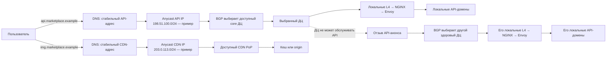
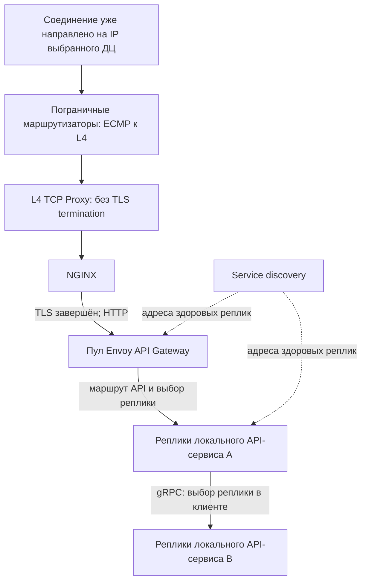
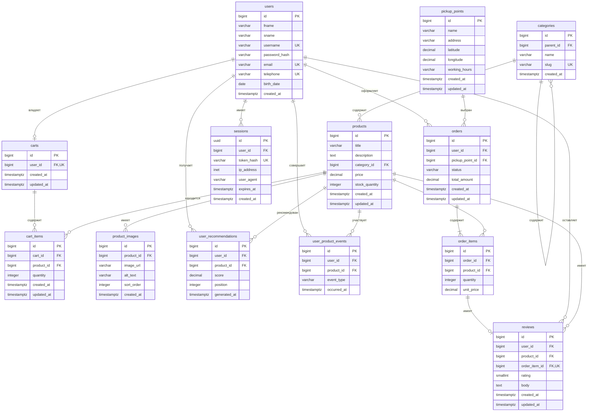
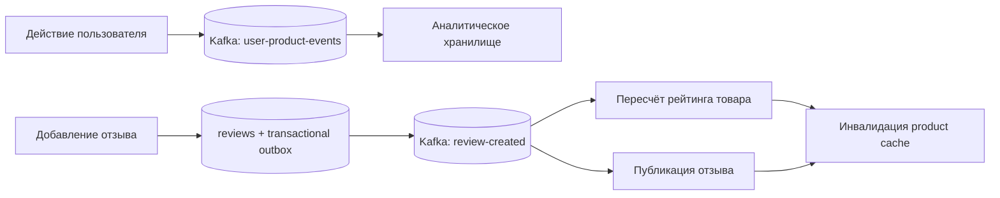
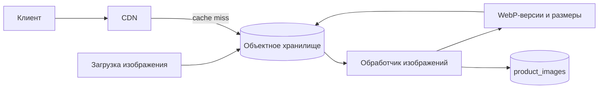

# tp_highload_2026
Курсовая работа по курсу "Проектирование высоконагруженных систем" VK технопарк

## 1. Тема и целевая аудитория
### Тип сервиса
Высоконагруженный маркетплейс (на примере сервиса ozon)

### Функционал mvp
1. Регистрация и авторизация пользователей
2. Просмотр главной страницы с персонализированной лентой рекомендаций
3. Просмотр каталога товаров
4. Поиск и просмотр карточки товара
5. Добавление и изменение товаров в корзине
6. Выбор ПВЗ и оформление заказа
7. Просмотр и добавление рейтинга товаров и отзывов

### Ключевые продуктовые решения
1. Главная страница формируется персонально для пользователя на основе рекомендательной системы.
2. Рейтинг товара рассчитывается на основе оценок пользователей и отображается вместе с отзывами.
3. Покупатель может оставить отзыв на товар только после покупки

### Целевая аудитория
По данным ozon 84 млн пользователей в месяц.[[1]](#source1) География распределения пользователя такова: ~94.7% пользователей из РФ, остальные 5% пользователей из-за рубежа. Средний трафик из стран зарубежья не превышает 1% на страну.[[2]](#source2)

В РФ около 27% приходится на Московскую область, Москву и СПБ.[[3]](#source3)

Причем с мобильных устройств кол-во транзакционных запросов е-ком 79% против 37% на десктопе.[[4]](#source4)


## 2. Расчет нагрузки
### Аудиторные метрики

| Метрика |                            Значение |
|---------|------------------------------------:|
| MAU     |               84 млн[[1]](#source1) |
| DAU     | 44 млн[[5]](#source5) |

### Расчет среднего количества действий пользователя в день

##### Регистрация 
По данным Ozon, на конец I квартала 2026 года база активных покупателей составила 67,3 млн человек, увеличившись на 16% год к году [[5]](#source5). Число активных покупателей годом ранее составляло 58,02 млн. Значит годовой прирост 9,28 млн покупателей. Пусть 85% данного прироста приходится на новых зарегистрированных пользователей. Тогда оценочное количество регистраций в сутки составляет 9,28 млн * 0,85 / 365 = 21 610. При DAU = 44 млн среднее количество регистраций на одного пользователя в сутки составляет 21 610 / 44 000 000 ≈ 0,00049.


##### Авторизация
Примем, что срок жизни пользовательской сессии составляет 30 дней. Предполагая, что пользователи посещают сервис ежедневно и повторно авторизуются после истечения срока сессии, получим среднее количество авторизаций 1/30 = 0,033.

##### Просмотр главной страницы с персонализированной лентой рекомендаций
Нет статистики, примем, что каждый пользователь дневной аудитории, независимо от авторизации, просматривает персонализированную ленту в среднем 2 раза в сутки. Страница рекомендаций доступна всем пользователям, поэтому среднее количество её просмотров на одного пользователя DAU составляет **2** просмотра в сутки.

##### Скролл ленты рекомендаций на главной странице
При первом открытии главной страницы загружается 24 карточки товаров. В среднем пользователь выполняет 2 скролла; каждый скролл подгружает ещё 12 карточек и формирует отдельный запрос к сервису рекомендаций. При 2 просмотрах главной в сутки среднее количество запросов подгрузки ленты на пользователя составляет 2 * 2 = **4** в сутки.

##### Просмотр каталога товаров
В связи с отсутствием публичной статистики примем допущение, что пользователь посещает сервис 2 раза в сутки, в 60% сессий открывает каталог и просматривает в среднем 2 страницы. Каталог доступен как авторизованным, так и неавторизованным пользователям, поэтому расчёт ведётся по всей дневной аудитории (DAU), без разделения пользователей по статусу авторизации. Среднее количество просмотров каталога на одного пользователя в сутки составляет 2 × 0,6 × 2 = **2,4**.

##### Поиск товаров
В связи с отсутствием публичной статистики примем допущение, что пользователь посещает сервис 2 раза в сутки, в 60% сессий использует поиск и выполняет в среднем 2 поисковых запроса. Поиск доступен как авторизованным, так и неавторизованным пользователям. Среднее количество поисковых запросов на одного пользователя в сутки составляет 2 * 0,6 * 2 = 2,4.

##### Просмотр карточки товара
В связи с отсутствием публичной статистики примем допущение, что пользователь посещает сервис 2 раза в сутки, в 75% сессий просматривает карточки товаров и открывает в среднем 4 карточки за такую сессию. Среднее количество просмотров карточек товаров на одного пользователя в сутки составляет 2 * 0,75 * 4 = 6.

##### Добавление товара в корзину
Пусть 20% дневной аудитории добавляют товары в корзину и каждый из них выполняет в среднем 2 добавления в сутки. Среднее количество добавлений товара в корзину на одного пользователя составляет 0,2 * 2 = 0,4.

##### Изменение корзины
пусть 10% дневной аудитории изменяют содержимое корзины и каждый из них выполняет в среднем 2 изменения в сутки. Среднее количество изменений корзины на одного пользователя составляет 0,1 * 2 = 0,2.

##### Выбор ПВЗ
пусть 15% дневной аудитории выбирают ПВЗ и каждый из них выполняет это действие в среднем 1 раз в сутки. Среднее количество выборов ПВЗ на одного пользователя составляет 0,15 * 1 = 0,15.

##### Оформление заказа
По данным Ozon за II квартал 2025 года, количество активных покупателей превысило 60 млн, а частотность покупок составила 30 заказов в год. Для оценки примем 60 млн покупателей. Тогда количество заказов в сутки составляет 60 млн * 30 / 365 ≈ 4,93 млн. При DAU = 44 млн среднее количество оформлений заказа на одного пользователя составляет 4,93 / 44 ≈ 0,112 в сутки. Оценка предполагает равномерное распределение заказов и требует сопоставимости периодов исходных показателей.

##### Просмотр рейтинга и отзывов
В связи с отсутствием публичной статистики примем допущение, что 40% дневной аудитории просматривают рейтинги и отзывы товаров и каждый из них выполняет в среднем 3 просмотра в сутки. Среднее количество просмотров рейтингов и отзывов на одного пользователя составляет 0,4 * 3 = 1,2.

##### Добавление рейтинга и отзыва
пусть покупатели оставляют рейтинг и отзыв для 5% оформленных заказов. При среднем количестве заказов 0,112 на пользователя в сутки получаем 0,112 * 0,05 = 0,0056 отзыва на одного пользователя в сутки. Предполагается, что один заказ соответствует одному оцениваемому товару; при нескольких товарах в заказе показатель необходимо пересчитать.


| Действие                                                            | Среднее количество действий пользователя в день |
|---------------------------------------------------------------------|------------------------------------------------:|
| Регистрация                                                         |                                         0,00049 |
| Авторизация                                                         |                                           0,033 |
| Просмотр главной страницы с персонализированной лентой рекомендаций |                                               2 |
| Скролл ленты рекомендаций на главной странице                       |                                               4 |
| Просмотр каталога товаров                                           |                                             2,4 |
| Поиск товаров                                                       |                                             2,4 |
| Просмотр карточки товара                                            |                                               6 |
| Добавление товара в корзину                                         |                                             0,4 |
| Изменение корзины                                                   |                                             0,2 |
| Выбор ПВЗ                                                           |                                            0,15 |
| Оформление заказа                                                   |                                           0,112 |
| Просмотр рейтинга и отзывов                                         |                                             1,2 |
| Добавление рейтинга и отзыва                                        |                                          0,0056 |

### Средний размер хранилища пользователя
Для оценки среднего объёма пользовательских данных примем следующие допущения. По условию расчёта размер данных на одного пользователя увеличивается втрое, поэтому размеры каждого пользовательского объекта также умножаются на 3:

- Профиль пользователя занимает в среднем 6 КБ.
- В корзине пользователя хранится в среднем 5 товаров. Один элемент корзины занимает 600 Б.
- Средняя частота покупок составляет 30 заказов в год.
- История заказов хранится за расчётный период 4,2 года. Среднее количество заказов на пользователя составляет 30 * 4,2 = 126 шт.
- Средний размер одного заказа составляет 6 КБ.
- Пользователи оставляют отзывы для 5% заказов. Среднее количество отзывов составляет 126 * 0,05 = 6,3 шт.
- Средний размер одного отзыва составляет 3 КБ.

Все значения размеров объектов и периода хранения являются допущениями для расчёта нагрузки.

| Тип данных        | Среднее количество, шт. | Размер объекта | Объём, ГБ |
|-------------------|------------------------:|---------------:|----------:|
| Профиль           |                       1 |           6 КБ |  0,000006 |
| Товары в корзине  |                       5 |          600 Б |  0,000003 |
| Заказы            |                     126 |           6 КБ |  0,000756 |
| Рейтинги и отзывы |                     6,3 |           3 КБ | 0,0000189 |
| Итого             |                   138,3 |              — | 0,0007839 |


### Размер хранения в разбивке по типам данных

##### Данные пользователей

По данным Ozon, на конец I квартала 2026 года количество активных покупателей составило 67,3 млн [[5]](#source5).

Рассчитаем объём по каждому типу данных:

- Профили: 67,3 млн * 6 КБ = 0,4038 ТБ.
- Корзины: 67,3 млн * 5 * 600 Б = 0,2019 ТБ.
- Заказы: 67,3 млн * 126 * 6 КБ = 50,8788 ТБ.
- Отзывы: 67,3 млн * 6,3 * 3 КБ = 1,272 ТБ.

Общий объём пользовательских данных составляет:

0,4038 + 0,2019 + 50,8788 + 1,272 = 52,76 ТБ.

##### Каталог товаров

В связи с отсутствием подтверждённых данных о количестве товарных карточек, что каталог содержит 200 млн товаров. Средний размер данных одной карточки составляет 4 КБ.

Общий объём каталога:

200 млн * 4 КБ = **0,8 ТБ**.

##### Изображения товаров

Примем допущение, что каждый товар содержит в среднем 3 изображения размером 200 КБ каждое. Все три изображения загружаются сразу при показе товарной карточки в ленте, каталоге, поиске и на странице товара.

Количество изображений:

200 млн * 3 = 600 млн шт.

Общий объём изображений:

600 млн * 200 КБ = **120 ТБ**.

##### Сводная таблица

| Тип данных          | Количество, шт. | Размер объекта | Общий объём, ТБ |
|---------------------|----------------:|---------------:|----------------:|
| Профили             |        67,3 млн |           6 КБ |          0,4038 |
| Элементы корзин     |       336,5 млн |          600 Б |          0,2019 |
| Заказы              |       8,48 млрд |           6 КБ |         50,8788 |
| Отзывы              |      423,99 млн |           3 КБ |           1,272 |
| Карточки товаров    |         200 млн |           4 КБ |             0,8 |
| Изображения товаров |         600 млн |         200 КБ |             120 |
| **Итого**           |               — |              — |      **173,56** |

Общий расчётный объём хранилища составляет **173,56 ТБ**.

### Расчёт RPS

Для расчёта среднего количества запросов в секунду используем DAU = 44 млн пользователей и ранее рассчитанное среднее количество действий пользователя в сутки. Одному пользовательскому действию соответствует один запрос; исключение — просмотр главной, при котором первоначальная загрузка и каждый скролл ленты являются отдельными запросами.

Средний RPS рассчитывается по формуле:

RPS_avg = DAU * ActionsPerDAU / 86400

Для расчёта пикового RPS примем коэффициент пиковости K = 5, предполагая, что максимальная интенсивность запросов в течение суток в 5 раз превышает среднюю.

RPS_peak = RPS_avg * 5

Например, для просмотра карточки товара:

RPS_avg = 44 000 000 * 6 / 86400 ≈ 3056

RPS_peak = 3056 * 5 = 15278

#### Сводная таблица RPS

| Тип запроса                            | Средний RPS | Пиковый RPS |
|----------------------------------------|------------:|------------:|
| Регистрация                            |        0,25 |        1,25 |
| Авторизация                            |       16,81 |       84,03 |
| Первоначальная загрузка главной        |     1018,52 |     5092,59 |
| Скролл ленты рекомендаций              |     2037,04 |    10185,19 |
| Каталог товаров                        |     1222,22 |     6111,11 |
| Поиск товаров                          |     1222,22 |     6111,11 |
| Карточка товара                        |     3055,56 |    15277,78 |
| Добавление в корзину                   |      203,70 |     1018,52 |
| Изменение корзины                      |      101,85 |      509,26 |
| Выбор ПВЗ                              |       76,39 |      381,94 |
| Оформление заказа                      |       57,04 |      285,19 |
| Просмотр рейтинга и отзывов            |      611,11 |     3055,56 |
| Добавление рейтинга и отзыва           |        2,85 |       14,26 |
| **Итого**                              | **9625,56** | **48127,80** |

Запросы выдачи рекомендаций при скролле учтены отдельно. Загрузка изображений учитывается в расчёте сетевого трафика через CDN.

Проверка тенденции: после пересчёта карточка товара остаётся лидером по RPS (15 277,78 пиковых RPS против 9 166,67 ранее). Следующим по нагрузке становится отдельный запрос скролла ленты рекомендаций (10 185,19 пиковых RPS); это ожидаемое следствие учёта пагинации и не меняет лидирующий endpoint.

### 3. Расчёт сетевого трафика

Для расчёта пикового сетевого трафика используем ранее полученные значения пикового RPS. В связи с отсутствием публичной статистики о размерах ответов API Ozon примем средние размеры ответов как допущения.

Пиковый трафик рассчитаем по формуле:

Traffic_peak = RPS_peak * Size_response * 8 / 10^9

где Size_response — размер ответа в байтах.

#### API-трафик

| Тип запроса | Пиковый RPS | Размер ответа | Трафик, Гбит/с |
|---|---:|---:|---:|
| Первоначальная загрузка главной (24 карточки) | 5093 | 30 КБ | 1,222 |
| Скролл ленты главной (12 карточек) | 10185 | 15 КБ | 1,222 |
| Каталог товаров | 6111 | 25 КБ | 1,222 |
| Поиск товаров | 6111 | 20 КБ | 0,978 |
| Карточка товара | 15278 | 15 КБ | 1,833 |
| Просмотр отзывов | 3056 | 10 КБ | 0,244 |
| Выбор ПВЗ | 382 | 10 КБ | 0,031 |
| Остальные запросы | ≈1913 | 2 КБ | 0,031 |
| **Итого** | | | **≈6,78** |

#### Изображения товаров

Изображения загружаются при просмотре главной страницы, каталога, результатов поиска и карточек товаров. В каждой товарной карточке загружаются сразу 3 изображения.

Примем следующие допущения:

- Средний размер изображения составляет 200 КБ.
- На первоначальной выдаче главной загружается 24 * 3 = 72 изображения; при каждом скролле — 12 * 3 = 36 изображений.
- В каталоге и поиске сохраняется исходное число товарных карточек в выдаче: соответственно 8 * 3 = 24 и 6 * 3 = 18 изображений.
- Благодаря кешированию на стороне клиента и повторному использованию изображений 50% потенциальных загрузок не требуют повторной передачи.
- Изображения доставляются пользователям через CDN.

Пиковый трафик изображений рассчитывается по формуле:

Traffic_images = RPS_peak * N_images * Size_image * 0,5 * 8 / 10^9

| Тип страницы / запроса                         | Пиковый RPS | Изображений на страницу | Трафик, Гбит/с |
|------------------------------------------------|------------:|------------------------:|---------------:|
| Первоначальная загрузка главной (24 карточки)  |        5093 |                      72 |         293,33 |
| Скролл ленты главной (12 карточек)             |       10185 |                      36 |         293,33 |
| Каталог                                        |        6111 |                      24 |         117,33 |
| Поиск                                          |        6111 |                      18 |          88,00 |
| Карточка товара                                |       15278 |                       3 |          36,67 |
| **Итого**                                      |           — |                       — |     **828,66** |

Таким образом, пиковый трафик изображений от CDN к пользователям составляет приблизительно 828,66 Гбит/с.

Предположим, что 80% оставшихся запросов к изображениям обслуживаются из кеша CDN.

Тогда пиковый трафик от исходного хранилища изображений к CDN составляет:

Traffic_origin = 828,66 × 0,2 = 165,73 Гбит/с.

#### Сводная таблица сетевого трафика

| Тип трафика                 | Пиковый трафик, Гбит/с |
|-----------------------------|-----------------------:|
| API → пользователи          |                   6,78 |
| CDN → пользователи          |                 828,66 |
| **Итого к пользователям**   |             **835,44** |
| Хранилище изображений → CDN |                 165,73 |

Суммарный пиковый исходящий трафик системы к пользователям составляет приблизительно 835,44 Гбит/с.

Дополнительно необходимо учитывать трафик между хранилищем изображений и CDN — 165,73 Гбит/с. Он не прибавляется к пользовательскому трафику, чтобы избежать двойного учёта.

## 4. Глобальная балансировка нагрузки

### Размещение дата-центров

Распределение API-трафика ориентируется на плотность населения: европейская часть России получает большую часть нагрузки, а Дальний Восток — локальную площадку с небольшой долей. Все шесть DC представлнных на картинке работают в режиме ```active-active```. Екатеринбург остаётся отдельным ```Anycast CDN PoP```: он кеширует и отдаёт изображения, но не исполняет API-запросы.


Выбор площадок опирается на географию целевой аудитории из раздела 1:

- **94,7% аудитории находится в РФ** [[2]](#source2), поэтому основная инфраструктура размещается в России. Это сокращает сетевую задержку для подавляющей части покупателей и уменьшает зависимость от международных каналов.
- **27% аудитории приходится на Москву, Московскую область и Санкт-Петербург** [[3]](#source3), но этот показатель не раскрывает долю самого Петербурга. По оценке Петростата на 1 января 2025 года в Петербурге и Ленинградской области проживает около 7,7 млн человек [[6]](#source6). Поэтому для петербургского ДЦ планируем **10% штатного API-трафика**, а для Краснодара — **20%** с учётом нагрузки юга. На Москву-1, Москву-2, Санкт-Петербург и Краснодар суммарно планируется **75% API-трафика**. Важно, чтобы две московские площадки были независимы по электропитанию и операторам связи.
- На Новосибирск планируется **20% API-трафика** как региональную core-площадку для Сибири, на Владивосток — **5%** для Дальнего Востока. Екатеринбург дополнительно приближает CDN к пользователям Урала.
- Зарубежная аудитория составляет 5,3%, причём ни одна страна не даёт более 1% трафика [[2]](#source2). На текущем масштабе отдельный зарубежный ДЦ не окупается: изображения для этой аудитории доставляет Anycast CDN, а API-соединение Anycast направляет сразу в доступный российский core ДЦ, где его принимает локальный L7 gateway.

Размещение влияет на продуктовые метрики следующим образом:

- меньшая задержка выдачи и изображений снижает время загрузки страницы и вероятность ухода пользователя до добавления товара в корзину;
- меньшая задержка на оформлении заказа повышает вероятность успешного завершения checkout;
- независимые площадки и резервирование нагрузки снижают вероятность недоступности сервиса и потери заказов при отказе одного ДЦ.

### Почему шесть core ДЦ и отдельный CDN PoP

Один ДЦ был бы единой точкой отказа. Шесть core ДЦ позволяют одновременно разместить основную мощность рядом с населением европейской части страны и сохранить региональные точки присутствия для Сибири и Дальнего Востока. Плановые доли API-трафика по ДЦ:

| Core ДЦ | Плановая доля API-трафика |
|---|---:|
| Москва-1 | 25% |
| Москва-2 | 20% |
| Санкт-Петербург | 10% |
| Краснодар | 20% |
| Новосибирск | 20% |
| Владивосток | 5% |
| **Итого** | **100%** |

Московские площадки обслуживают не только город, но и широкий центральный регион; Краснодар рассчитан на значительную долю трафика юга. Это исключает прежний перекос модели, в которой под Дальний Восток резервировалось 30% общероссийского API-трафика.

Екатеринбург не становится седьмым core ДЦ, поскольку 828,66 Гбит/с из 835,44 Гбит/с пользовательского трафика приходится на изображения CDN. Для Урала наибольший продуктовый эффект даёт близкий edge-кеш; API-трафик составляет лишь 6,78 Гбит/с и обслуживается шестью core ДЦ. Функциональные домены сервиса — edge/CDN, API gateway, каталог и поиск, рекомендации, профили, корзина, заказы/checkout и отзывы. Каждый API-домен развёрнут во всех шести ДЦ; ни один бизнес-домен не закреплён за единственной площадкой. Вопросы репликации и консистентности stateful-хранилищ рассматриваются отдельно в разделе проектирования данных.

### Распределение API-нагрузки по ДЦ

В штатном режиме API использует **Anycast для выбора ДЦ и локальный L7 gateway внутри него**. Gateway отправляет запрос только в локальный API-домен: межрегионального проксирования каждого запроса здесь нет. Если площадка целиком перестаёт обслуживать API, она отзывает API-анонс, и BGP направляет новые соединения в другой доступный ДЦ. При перегрузке сначала масштабируется локальная площадка; долю входящего трафика можно менять BGP-политиками, но не глобальным L7-распределением по процентам. Доли из таблицы выше — прогноз нагрузки и ориентир для ёмкости, а не фиксированное правило маршрутизации. Фактические доли измеряются по трафику и могут отличаться от прогноза, поскольку BGP не гарантирует его точного выполнения.

Таблица ниже умножает общий расчётный пик каждого типа запроса на плановые доли. Это оценка мощности ДЦ, а не настройка L7-маршрутизации.

| Тип запроса | Пиковый RPS всего | Мск-1 25% | Мск-2 20% | СПб 10% | Краснодар 20% | Новосибирск 20% | Владивосток 5% |
|---|---:|---:|---:|---:|---:|---:|---:|
| Регистрация | 1,25 | 0,31 | 0,25 | 0,13 | 0,25 | 0,25 | 0,06 |
| Авторизация | 84,03 | 21,01 | 16,81 | 8,40 | 16,81 | 16,81 | 4,20 |
| Первоначальная загрузка главной | 5 092,59 | 1 273,15 | 1 018,52 | 509,26 | 1 018,52 | 1 018,52 | 254,63 |
| Скролл ленты рекомендаций | 10 185,19 | 2 546,30 | 2 037,04 | 1 018,52 | 2 037,04 | 2 037,04 | 509,26 |
| Каталог товаров | 6 111,11 | 1 527,78 | 1 222,22 | 611,11 | 1 222,22 | 1 222,22 | 305,56 |
| Поиск товаров | 6 111,11 | 1 527,78 | 1 222,22 | 611,11 | 1 222,22 | 1 222,22 | 305,56 |
| Карточка товара | 15 277,78 | 3 819,45 | 3 055,56 | 1 527,78 | 3 055,56 | 3 055,56 | 763,89 |
| Добавление в корзину | 1 018,52 | 254,63 | 203,70 | 101,85 | 203,70 | 203,70 | 50,93 |
| Изменение корзины | 509,26 | 127,32 | 101,85 | 50,93 | 101,85 | 101,85 | 25,46 |
| Выбор ПВЗ | 381,94 | 95,49 | 76,39 | 38,19 | 76,39 | 76,39 | 19,10 |
| Оформление заказа | 285,19 | 71,30 | 57,04 | 28,52 | 57,04 | 57,04 | 14,26 |
| Просмотр рейтинга и отзывов | 3 055,56 | 763,89 | 611,11 | 305,56 | 611,11 | 611,11 | 152,78 |
| Добавление рейтинга и отзыва | 14,26 | 3,57 | 2,85 | 1,43 | 2,85 | 2,85 | 0,71 |
| **Итого на один ДЦ** | **48 127,80** | **12 031,95** | **9 625,56** | **4 812,78** | **9 625,56** | **9 625,56** | **2 406,39** |

| Core ДЦ | Средняя нагрузка, RPS | Пиковая нагрузка, RPS |
|---|---:|---:|
| Москва-1 | 2 406,39 | 12 031,95 |
| Москва-2 | 1 925,11 | 9 625,56 |
| Санкт-Петербург | 962,56 | 4 812,78 |
| Краснодар | 1 925,11 | 9 625,56 |
| Новосибирск | 1 925,11 | 9 625,56 |
| Владивосток | 481,28 | 2 406,39 |
| **Итого** | **9 625,56** | **48 127,80** |

Для предварительной оценки резервной ёмкости ниже показано условное пропорциональное перераспределение плановых долей при отказе. Реальный Anycast не использует эти проценты как правило маршрутизации: фактические доли и пики после переключения зависят от регионов пользователей и BGP-маршрутов.

| Сценарий отказа | Наибольшая доля в расчётной модели | Наибольшая нагрузка в расчётной модели |
|---|---:|---:|
| Нет отказа | 25,00% | 12 031,95 peak RPS |
| Москва-1 | 26,67% | 12 834,08 peak RPS |
| Москва-2, Краснодар или Новосибирск | 31,25% | 15 039,94 peak RPS |
| Санкт-Петербург | 27,78% | 13 368,83 peak RPS |
| Владивосток | 26,32% | 12 665,21 peak RPS |
| Одновременный отказ обеих московских площадок | 36,36% | 17 501,02 peak RPS |

Плановые доли и ёмкость API пересматриваются по фактической нагрузке и задержке; распределение CDN-трафика контролируется отдельно по телеметрии Anycast.

### DNS, Anycast и регулирование трафика



- DNS не выполняет балансировку API: `api.marketplace.example` всегда возвращает стабильный Anycast API-адрес. Это исключает зависимость от географии recursive DNS, EDNS Client Subnet и времени жизни DNS-кеша.
- Anycast API-префикс анонсируется из шести core ДЦ. BGP приводит клиента в доступный ДЦ по сетевой топологии. При отказе ДЦ BGP направляет новые соединения в другой доступный ДЦ, где запрос проходит через местные L4, NGINX, Envoy и API. Anycast не задаёт проценты API-трафика и не выбирает stateful backend.
- Для `img.marketplace.example` DNS аналогично возвращает стабильный Anycast CDN-адрес. Отдельный префикс CDN анонсируют edge в Москве, Санкт-Петербурге, Краснодаре, Екатеринбурге, Новосибирске и Владивостоке; пользователь попадает на ближайшую по маршрутизации доступную площадку.
- Площадка проверяет здоровье локального API и ingress каждые 5 секунд. Если весь API-контур ДЦ недоступен после двух последовательных проверок, API-префикс площадки отзывается; новые соединения после сходимости BGP попадают в другой здоровый ДЦ. Изолированный отказ одного сервиса обрабатывается локальными репликами и сам по себе не отзывает анонс всего ДЦ. При восстановлении анонс возвращается после проверки готовности, а трафик наращивается постепенно. 
- При полном отказе API ingress в core ДЦ или CDN edge площадка отзывает соответствующий BGP-анонс Anycast-префикса. Трафик автоматически выбирает один из оставшихся маршрутов.

## 5. Локальная балансировка нагрузки

### 5.1. Путь запроса внутри выбранного ДЦ



- **Выбор ДЦ:** Anycast направляет соединение в доступный ДЦ.
- **L4:** каждый готовый L4 анонсирует пограничным маршрутизаторам локальный маршрут к API VIP; маршрутизаторы распределяют новые соединения между маршрутами двух зон через ECMP. L4 работает как **TCP Proxy без TLS termination**: принимает клиентское TCP-соединение, открывает отдельное TCP-соединение к здоровому NGINX своей зоны и передаёт через себя зашифрованный TLS-поток.
- **NGINX:** завершает клиентский TLS, применяет внешние правила обработки и передаёт API-запрос в пул Envoy своей зоны отказа.
- **Envoy API Gateway:** определяет нужный сервис и выбирает его здоровую локальную реплику.
- **Межсервисный вызов:** если сервис вызывает другой сервис, его gRPC-клиент получает адреса реплик через service discovery и сам выбирает одну из них. Внутренний вызов не возвращается в L4, NGINX или Envoy Gateway.
- **Отказы:** при отказе экземпляра NGINX или Envoy новые запросы направляются к здоровым экземплярам. Если L4-узел или весь ingress-стек его зоны недоступен, проверка готовности вызывает отзыв **локального маршрута к VIP** этого L4 из ECMP-пула; **новые** соединения принимает L4 другой зоны. Уже открытые TCP-соединения через отказавший узел обрываются и требуют переподключения клиента. Глобальный Anycast-анонс ДЦ отзывается только тогда, когда ни одна зона не может принимать API-трафик (раздел 4).
- **Изображения:** идут через отдельный CDN и не нагружают этот API-контур.

### 5.2. Резервирование по уровням

Внутри каждого ДЦ выделены **две независимые зоны отказа — A и B**. В каждой зоне работают L4, кластер NGINX и кластер Envoy; размеры компонентов рассчитываются **независимо**. Каждая зона способна принять **весь пик входящего API-трафика ДЦ**, поэтому для всех трёх уровней ingress применяется **`2N`**: по `N` узлов необходимой мощности в каждой зоне. Если L4 достаточно одного узла на зону, это два узла всего, но модель всё равно двухзонная, а не резерв одного узла в общей зоне. Реплики API-сервисов резервируются отдельно по **`N+1`**. В штатном режиме оба ingress-стека активны и делят нагрузку; резервируется их мощность, а не простаивающие узлы. Отказ всего ДЦ обрабатывается глобальной балансировкой.

| Уровень | Режим работы | Механизм | Формула резервирования | Почему |
|---|---|---|---|---|
| L4 и входной VIP | L4 обеих зон активны; каждый зональный пул выдерживает полный пик ДЦ. | Пограничные маршрутизаторы направляют соединения к L4 по ECMP. Проверка готовности локального ingress-стека управляет маршрутом: при отказе зоны её next hop исключается, остаётся маршрут в другую зону. | **`2N_L4`**: по `N_L4` узлов в каждой зоне; предварительный минимум — 1 + 1. | После потери зоны оставшийся пул выдерживает весь пик; `N_L4` определяется сетью, открытиями TCP-соединений, PPS и числом состояний соединений. |
| L7 ingress: NGINX | Оба кластера активны; каждый способен принять полный пик ДЦ. | L4 распределяет соединения между здоровыми NGINX; NGINX направляет API-запросы в Envoy своей зоны. | **`N_Nginx×2`**: по `N_Nginx` экземпляров в каждой зоне. | При потере зоны остаётся кластер полной расчётной мощности. |
| Envoy API Gateway | Оба кластера активны; каждый способен принять полный пик ДЦ. | Каждый NGINX-кластер передаёт запросы своему кластеру Envoy; Envoy выбирает реплику API-сервиса. | **`N_Envoy×2`**: по `N_Envoy` экземпляров в каждой зоне, независимо от числа NGINX. | При потере зоны другой кластер Envoy сохраняет полную расчётную мощность. |
| Реплики API-сервиса | Все здоровые реплики активны и по возможности размещены в разных зонах. | При потере готовности endpoint сначала исключается из списка доступных реплик в service discovery; после обновления Envoy перестаёт выбирать его для новых запросов. | **`N_service+1`** для каждого сервиса, минимум две реплики; `N_service` определяется по нагрузке сервиса. | Покрывается отказ одной реплики; **потерю зоны и работу всего приложения эта формула не гарантирует**. |

Формула `2N` покрывает потерю одной зоны **для L4, NGINX и Envoy** при подтверждённой мощности каждого зонального пула. `N+1` для реплик сервиса покрывает лишь отказ одной реплики и может не пережить потерю всей зоны. Отказ всей площадки обрабатывается Anycast/BGP по разделу 4 и требует отдельной проверки ёмкости других ДЦ. Отказоустойчивость хранилищ, service discovery и других зависимостей проверяется отдельно: дублирование ingress-стека само по себе не гарантирует работоспособность всего приложения.

### 5.3. Расчёт количества балансировщиков

Исходный пик API — **48 127,80 RPS** (раздел 4), а **6,78 Гбит/с** из раздела 3 — только ответы API пользователям, без CDN. Плановая доля ДЦ `p_i` задаёт штатную нагрузку; Anycast не гарантирует точного соблюдения долей. Обозначим через `q` среднее число API-запросов на одно TLS-соединение за расчётный интервал:

$$
\mathrm{RPS}_i=48\,127{,}80\,p_i,
\qquad
\mathrm{CPS}_i(q)=\frac{\mathrm{RPS}_i}{q}.
$$

Рассматриваем два сценария: **`q=1`** — консервативно, одно новое соединение на каждый запрос; **`q=20`** — предполагаемое переиспользование соединения через Keep-Alive или HTTP/2. Здесь `CPS_i` — число **новых клиентских TLS-сеансов**, а не число всех TCP-соединений, создаваемых L4.

В принятом режиме TCP Proxy один клиентский сеанс создаёт **два TCP-соединения**: клиент → L4 и L4 → NGINX. TLS-соединение при этом одно сквозное: рукопожатие проходит через L4 и завершается на NGINX. Если L4 открывает по одному upstream TCP-соединению на каждый клиентский сеанс, то его нагрузка на создание и хранение соединений равна:

$$
\mathrm{TCPopen}^{\mathrm{L4}}_i(q)=2\,\mathrm{CPS}_i(q),
\qquad
\mathrm{Conn}^{\mathrm{L4}}_i=2\,\mathrm{Conn}^{\mathrm{client}}_i.
$$

`Conn_client` — измеренный пик одновременных клиентских сеансов в ДЦ; его нельзя заменить RPS. Если реализация L4 переиспользует upstream-соединения, коэффициент 2 пересматривается по замерам.

Для оценки сети дополнительно принимаем **1 КиБ входящего API-запроса** и **3 КиБ обмена в каждом направлении на новое TLS-соединение**; это оценки, а не результаты измерений.

Предполагаем один полнодуплексный 10G-порт на узел, через который проходят обе его стороны проксирования.

Сначала оцениваем трафик запросов `A_i`, ответов `S_i` и обмена при установке TLS `H_i(q)` в Гбит/с:

$$
\begin{aligned}
A_i &= \frac{\mathrm{RPS}_i\cdot 1\,024\cdot 8}{10^9},\\
S_i &= 6{,}78\,p_i,\\
H_i(q) &= \frac{\mathrm{CPS}_i(q)\cdot 3\,072\cdot 8}{10^9}.
\end{aligned}
$$

Для одного интерфейса, обслуживающего обе стороны проксирования, получаем расчётную сетевую нагрузку каждого типа узла:

$$
\begin{aligned}
B^{\mathrm{NGINX}}_i(q) &= A_i+S_i+H_i(q),\\
B^{\mathrm{Envoy}}_i &= A_i+S_i,\\
B^{\mathrm{L4}}_i(q) &= A_i+S_i+H_i(q).
\end{aligned}
$$

TLS-обмен относится к L4/NGINX-участку, а не к Envoy после TLS termination.

| ДЦ | `p_i` | RPS | Клиентские CPS `q=20` / `q=1` | `B` L4 и NGINX `q=20`, Гбит/с | `B` L4 и NGINX `q=1`, Гбит/с | `B` Envoy, Гбит/с |
|---|---:|---:|---:|---:|---:|---:|
| Москва-1 | 25% | 12 031,95 | 601,60 / 12 031,95 | 1,808 | 2,089 | 1,794 |
| Москва-2 | 20% | 9 625,56 | 481,28 / 9 625,56 | 1,447 | 1,671 | 1,435 |
| Санкт-Петербург | 10% | 4 812,78 | 240,64 / 4 812,78 | 0,723 | 0,836 | 0,717 |
| Краснодар | 20% | 9 625,56 | 481,28 / 9 625,56 | 1,447 | 1,671 | 1,435 |
| Новосибирск | 20% | 9 625,56 | 481,28 / 9 625,56 | 1,447 | 1,671 | 1,435 |
| Владивосток | 5% | 2 406,39 | 120,32 / 2 406,39 | 0,362 | 0,418 | 0,359 |

Для 10G-порта с коэффициентом загрузки `u=0,7` проектный предел — **7 Гбит/с для расчётного потока**, без сложения двух направлений. Максимум в таблице — 2,089 Гбит/с на весь ДЦ при `q=1`; деление между узлами уменьшит нагрузку отдельного порта.

Число узлов каждого типа считается **независимо**. `C_TLS` — допустимые новые TLS-соединения/с на NGINX, `C_HTTP` — допустимые HTTP-запросы/с на NGINX; `C_Envoy` — допустимые API-запросы/с на Envoy с включёнными авторизацией, маршрутизацией, rate limiting и телеметрией. `B_node` для каждого типа — измеренный допустимый сетевой поток одного узла в Гбит/с в принятой модели. Все пределы должны относиться к одной конфигурации и совместной нагрузке.

**NGINX — TLS, HTTP и сеть:**

$$
\begin{gathered}
N_{\mathrm{NGINX},i}(q)=\max(
\left\lceil\frac{\mathrm{CPS}_i(q)}{C_{\mathrm{TLS}}}\right\rceil,
\left\lceil\frac{\mathrm{RPS}_i}{C_{\mathrm{HTTP}}}\right\rceil,\\
\left\lceil\frac{B^{\mathrm{NGINX}}_i(q)}{B^{\mathrm{NGINX}}_{\mathrm{node}}}\right\rceil
),\\
N^{\mathrm{total}}_{\mathrm{NGINX},i}(q)=2N_{\mathrm{NGINX},i}(q).
\end{gathered}
$$

**Envoy — API-запросы и сеть:**

$$
\begin{gathered}
N_{\mathrm{Envoy},i}=\max(
\left\lceil\frac{\mathrm{RPS}_i}{C_{\mathrm{Envoy}}}\right\rceil,
\left\lceil\frac{B^{\mathrm{Envoy}}_i}{B^{\mathrm{Envoy}}_{\mathrm{node}}}\right\rceil
),\\
N^{\mathrm{total}}_{\mathrm{Envoy},i}=2N_{\mathrm{Envoy},i}.
\end{gathered}
$$

**L4 — сеть, открытия TCP-соединений, пакеты и состояния соединений:**

$$
\begin{gathered}
N_{\mathrm{L4},i}(q)=\max(
\left\lceil\frac{B^{\mathrm{L4}}_i(q)}{B^{\mathrm{L4}}_{\mathrm{node}}}\right\rceil,
\left\lceil\frac{\mathrm{TCPopen}^{\mathrm{L4}}_i(q)}{C_{\mathrm{L4,open}}}\right\rceil,\\
\left\lceil\frac{\mathrm{PPS}^{\mathrm{L4}}_i}{C_{\mathrm{L4,PPS}}}\right\rceil,
\left\lceil\frac{\mathrm{Conn}^{\mathrm{L4}}_i}{C_{\mathrm{L4,Conn}}}\right\rceil
),\\
N^{\mathrm{total}}_{\mathrm{L4},i}(q)=2N_{\mathrm{L4},i}(q).
\end{gathered}
$$

`PPS_L4` — измеренный пик пакетов/с на L4 с учётом обоих плеч прокси; `Conn_L4` — число одновременно поддерживаемых TCP-соединений, а не клиентских сеансов. Пределы `C_L4,open`, `C_L4,PPS` и `C_L4,Conn` определяются совместным нагрузочным тестом выбранной реализации L4. Для каждой зоны требуется полный `N_L4`; даже когда `N_L4=1`, запись **`2N`** отражает размещение по независимым зонам и проверку отказа одной из них.

[Тест веб-сервера NGINX 2017 года](https://blog.nginx.org/blog/testing-the-performance-of-nginx-and-nginx-plus-web-servers) дал 3 399 HTTPS CPS при 8 CPU; с `u=0,7` это **2 379,3 CPS** как предварительный ориентир `C_TLS`. [Тест NGINX Ingress 2019 года](https://blog.nginx.org/blog/testing-performance-nginx-ingress-controller-kubernetes) дал 31 485 SSL TPS без HT на 8 CPU, 236 703 HTTPS RPS и 8,64 Гбит/с throughput — **в отдельных опытах** с различными размерами ответов. Различались процессоры, версии NGINX/OpenSSL, TLS-настройки и топология; ни один тест не измерял наш совместный профиль с WAF, Envoy и backend. Поэтому `C_HTTP`, пределы Envoy и L4 остаются неизвестными до испытаний.

Следующая таблица показывает **только вклад TLS и 10G-порта в предварительную потребность NGINX** при `C_TLS=2 379,3 CPS`, `B_Nginx,node=7 Гбит/с`. Предел `C_HTTP` не известен, поэтому даже значения NGINX с резервированием — **нижние границы**, а не подтверждённое число машин. Для Envoy и L4 данных ещё меньше.

| ДЦ | NGINX на зону `q=20` / `q=1`, не менее | NGINX с `2N` `q=20` / `q=1`, не менее | Envoy на зону | Envoy с `2N` | L4 на зону | L4 всего |
|---|---:|---:|---|---|---|---|
| Москва-1 | 1 / 6 | 2 / 12 | Требует измерений | Требует измерений | Требует TCPopen/PPS/Conn | Не менее 2 |
| Москва-2 | 1 / 5 | 2 / 10 | Требует измерений | Требует измерений | Требует TCPopen/PPS/Conn | Не менее 2 |
| Санкт-Петербург | 1 / 3 | 2 / 6 | Требует измерений | Требует измерений | Требует TCPopen/PPS/Conn | Не менее 2 |
| Краснодар | 1 / 5 | 2 / 10 | Требует измерений | Требует измерений | Требует TCPopen/PPS/Conn | Не менее 2 |
| Новосибирск | 1 / 5 | 2 / 10 | Требует измерений | Требует измерений | Требует TCPopen/PPS/Conn | Не менее 2 |
| Владивосток | 1 / 2 | 2 / 4 | Требует измерений | Требует измерений | Требует TCPopen/PPS/Conn | Не менее 2 |

Пример для Москвы-1 при `q=1`:

$$
\mathrm{CPS}=12\,031{,}95,\qquad
\left\lceil\frac{12\,031{,}95}{2\,379{,}3}\right\rceil=6,\qquad
\left\lceil\frac{2{,}089}{7}\right\rceil=1\ \text{по сетевой нагрузке}.
$$

Значит **только по известным ограничениям** требуется не менее шести NGINX на зону, или двенадцати с `2N`. При `q=20` TLS-требование падает до одного узла на зону, но HTTP-производительность ещё не проверена. Складывать строки таблицы в окончательный итог оборудования нельзя.

Резервирование двух зон внутри ДЦ **не заменяет межЦОДовое**: при отказе Москвы-1 её плановые 25% запросов должны принять другие площадки. В условной пропорциональной модели раздела 4 для любого оставшегося ДЦ `j`:

$$
p'_j=\frac{p_j}{1-0{,}25}.
$$

У площадки с исходными 20% это **26,67%**, или **12 834,08 peak RPS** вместо 9 625,56. Для неё следует заново применить все формулы этого раздела к RPS, CPS и сетевой нагрузке после переключения. Реальный результат зависит от BGP-маршрутов Anycast, поэтому окончательный резерв проверяется на фактическом распределении и испытанием отказа ДЦ.

## 6. Логическая схема БД
### 6.1 Схема БД



### 6.2 Объём и нагрузка основных данных

| Название таблицы | Назначение | Количество | Средний размер записи | Общий объём | QPS записи<br>средний / пиковый | QPS чтения<br>средний / пиковый |
|---|---|---:|---:|---:|---:|---:|
| `users` | Учётные записи и профильные данные пользователей. | 67,3 млн | ≈6 КБ | ≈403,8 ГБ | 0,25 / 1,25 | 16,81 / 84,03 |
| `categories` | Категории товаров и их иерархия. | ≈155 | ≈256 Б | ≈39,7 КБ | низкая | 1 222,22 / 6 111,11 |
| `products` | Карточки товаров: описание, цена, остаток и категория. | 200 млн | ≈4 КБ | ≈0,8 ТБ | низкая | 8 555,56 / 42 777,78 |
| `product_images` | Фотографии товаров и порядок их отображения. | 600 млн | ≈512 Б | ≈307,2 ГБ | низкая | 8 555,56 / 42 777,78 |
| `carts` | Активные корзины пользователей. | 67,3 млн | ≈64 Б | ≈4,3 ГБ | 305,56 / 1 527,78 | 305,56 / 1 527,78 |
| `cart_items` | Товары и их количество в корзинах. | 336,5 млн | ≈600 Б | ≈201,9 ГБ | 305,56 / 1 527,78 | 305,56 / 1 527,78 |
| `orders` | Заказы пользователей и выбранные ПВЗ. | 8,48 млрд | ≈6 КБ | ≈50,88 ТБ | 57,04 / 285,19 | 2,85 / 14,26 |
| `order_items` | Товары, количество и зафиксированная цена в заказах. | 25,44 млрд | ≈128 Б | ≈3,26 ТБ | 171,12 / 855,57 | 2,85 / 14,26 |
| `pickup_points` | Адреса, координаты и график работы ПВЗ. | ≈60 тыс. | ≈1 КБ | ≈60 МБ | низкая | 76,39 / 381,94 |
| `reviews` | Оценки и отзывы на приобретённые товары. | 423,99 млн | ≈3 КБ | ≈1,27 ТБ | 2,85 / 14,26 | 611,11 / 3 055,56 |
| `sessions` | Stateful-сессии авторизованных пользователей. | 44 млн активных | ≈512 Б | ≈22,5 ГБ | 16,81 / 84,03 | 441,84 / 2 209,20 |
| `user_recommendations` | Предрассчитанные рекомендации товаров для пользователей. | 4,4 млрд | ≈64 Б | ≈281,6 ГБ | 50 925,93 / 254 629,63 | 3 055,56 / 15 277,78 |
| `user_product_events` | События взаимодействия пользователя с товаром для рекомендаций. | ≈8,9 млрд за 30 дней | ≈64 Б | ≈569,6 ГБ | 3 430,37 / 17 151,85 | низкая |
| **Итого для реляционной БД** |  |  |  | **≈58 ТБ** |  |  |

Пиковый QPS равен среднему, умноженному на коэффициент пиковости `K = 5`. QPS чтения `products` и `product_images` складывает запросы главной страницы, скролла ленты, каталога, поиска и карточки товара. Для `sessions` учитываются проверки сессии в авторизованных операциях с корзиной, ПВЗ, заказом и отзывом. `user_recommendations` предполагает полную ежедневную перегенерацию 100 рекомендаций для каждого активного пользователя; её следует выполнять в отдельном хранилище или пакетно, а не в основной транзакционной БД. События `user_product_events` записываются в поток и не читаются из этой БД в пользовательском запросе.

Обоснование QPS:

- Средний QPS рассчитывается как `DAU × действий на пользователя в сутки / 86 400`, где `DAU = 44 млн`; пиковый QPS в пять раз выше.
- Регистрация: `пользователь → users (запись)` — `0,25 / 1,25 QPS`.
- Авторизация: `пользователь → users (чтение) → sessions (запись)` — `16,81 / 84,03 QPS`.
- Главная страница и скролл ленты: `пользователь → user_recommendations → products → product_images` — `1 018,52 + 2 037,04 = 3 055,56 QPS` чтения каждой таблицы цепочки.
- Каталог: `пользователь → categories → products → product_images` — `1 222,22 / 6 111,11 QPS` чтения.
- Поиск: `пользователь → products → product_images` — `1 222,22 / 6 111,11 QPS` чтения.
- Карточка товара: `пользователь → products → product_images` — `3 055,56 / 15 277,78 QPS` чтения.
- Просмотр рейтинга и отзывов: `пользователь → reviews` — `611,11 / 3 055,56 QPS` чтения.
- Корзина: `пользователь → sessions → carts → cart_items` — добавление и изменение дают `305,56 / 1 527,78 QPS` чтения и записи `carts` и `cart_items`; проверки сессии суммируются в строке `sessions`.
- Выбор ПВЗ: `пользователь → sessions → pickup_points` — `76,39 / 381,94 QPS` чтения `pickup_points`.
- Оформление заказа: `пользователь → sessions → orders → order_items` — `57,04 / 285,19 QPS` записи `orders` и `171,12 / 855,57 QPS` записи `order_items`, так как в заказе в среднем три товара.
- Добавление отзыва: `пользователь → sessions → orders → order_items → reviews` — `2,85 / 14,26 QPS` чтения `orders` и `order_items` для проверки покупки и столько же записей `reviews`.
- События рекомендаций: `карточка товара / корзина / заказ → user_product_events` — `3 430,37 / 17 151,85 QPS` записи: просмотр товара, добавление в корзину и покупка каждого товара.
- Фоновое обновление рекомендаций: `рекомендательная система → user_recommendations` — `50 925,93 / 254 629,63 QPS` записи при полной ежедневной перегенерации 100 рекомендаций для 44 млн пользователей.

Обоснование количества записей:

- `users`: 67,3 млн активных покупателей.
- `categories`: около 155 пользовательских категорий каталога; детальная товарная таксономия в расчёт не входит.
- `products`: 200 млн товарных карточек — принятое допущение для каталога.
- `product_images`: 600 млн = 200 млн товаров × 3 фотографии.
- `carts`: 67,3 млн, по одной активной корзине на пользователя.
- `cart_items`: 336,5 млн = 67,3 млн пользователей × 5 товаров в корзине.
- `orders`: 8,48 млрд = 67,3 млн пользователей × 126 заказов за 4,2 года.
- `order_items`: 25,44 млрд = 8,48 млрд заказов × 3 товара в заказе; три товара — допущение.
- `pickup_points`: около 60 тыс. — допущение для сети федерального маркетплейса.
- `reviews`: 423,99 млн = 8,48 млрд заказов × 5% отзывов.
- `sessions`: 44 млн активных сессий, по принятому значению DAU.
- `user_recommendations`: 4,4 млрд = 44 млн активных пользователей × 100 рекомендаций в ленте.
- `user_product_events`: около 8,9 млрд за 30 дней = 44 млн × (6 просмотров + 0,4 добавления в корзину + 0,112 × 3 покупки) × 30 дней.


### 6.3 Кеширование

| Кэшируемые данные | Ключ | TTL | ReadQPS | WriteQPS | Назначение |
|---|---|---:|---:|---:|---|
| Лента рекомендаций пользователя | `recommendations:{user_id}` | 5 мин | 3 055,56 | 916,67 | Короткий кэш персональной ленты; допускает обновление рекомендаций при повторном открытии страницы. |
| Карточка товара | `product:{product_id}` | 5 мин | ≈69 056 | низкая | Кэширует данные товара для главной, каталога, поиска и карточки. Инвалидация выполняется при изменении цены или остатка. |
| Страница каталога | `catalog:{category_id}:{page}` | 5 мин | 1 222,22 | низкая | Кэширует популярные страницы каталога. |
| Изображения товара | CDN URL с версией файла | 24 ч | ≈103 583 | низкая | Это входящий ReadQPS CDN; при смене версии URL инвалидация не требуется. |

`ReadQPS` и `WriteQPS` приведены для среднего режима работы. Для карточек товаров `≈69 056 ReadQPS` получается из числа карточек в выдачах: `1 018,52 × 24 + 2 037,04 × 12 + 1 222,22 × 8 + 1 222,22 × 6 + 3 055,56 × 1`. Для ленты рекомендаций принят hit rate 70%; при промахе кэша создаётся новая персональная выдача, поэтому `WriteQPS = 3 055,56 × 30% = 916,67`. Изображения обрабатываются CDN; ReadQPS учитывает 50% попаданий в клиентский кэш.

Нагрузка на БД после кэширования:

| Таблица | Исходный ReadQPS | Кэш и ожидаемый hit rate | ReadQPS из БД после кэша |
|---|---:|---:|---:|
| `user_recommendations` | 3 055,56 | Лента рекомендаций, 70% | 916,67 |
| `products` | 8 555,56 | Карточки товаров, 95% | 427,78 |
| `product_images` | 8 555,56 | Карточки товаров, 95% | 427,78 |
| `categories` | 1 222,22 | Страницы каталога, 90% | 122,22 |

Расчёт: `ReadQPS из БД = исходный ReadQPS × (1 − hit rate)`. WriteQPS исходных таблиц не меняется: кэш снижает чтения, а изменения данных по-прежнему фиксируются в основной БД и затем инвалидируют или обновляют кэш.

### 6.4 Буферы событий



| Буфер | Событие | Средний / пиковый поток | Объём в буфере | Срок хранения |
|---|---|---:|---:|---:|
| `user-product-events` | Сбор аналитики действий пользователя | 3 430,37 / 17 151,85 событий/с | ≈790 МБ | 1 час |
| `review-created` | Создание или изменение отзыва | 2,85 / 14,26 событий/с | ≈63 МБ | 1 день |

Объём `user-product-events` рассчитан как `3 430,37 × 3 600 × 64 Б`. Consumer записывает события из этого буфера в аналитическую БД, где они хранятся 30 дней. Для `review-created` принят размер события 256 Б: `2,85 × 86 400 × 1 × 256 Б`. События первого буфера отправляются только в аналитическое хранилище. Для `review-created` отзыв и запись в transactional outbox фиксируются в одной транзакции; публикатор отправляет событие в Kafka, после чего пересчитывается рейтинг в кэше и инвалидируется `product:{product_id}`.

Рейтинг не дублируется в таблице `products`: его агрегат поддерживается в кэше обработчиком `review-created`. Поэтому карточка товара получает актуальное значение после инвалидации кэша, а запись отзыва не зависит от скорости пересчёта или публикации.

### 6.5 Требования консистентности

| Данные или операция | Требование | Допустимое отставание | Механизм |
|---|---|---:|---|
| Регистрация пользователя | Строгая консистентность | 0 | Транзакция БД и ограничения уникальности для `username`, `email` и `telephone`. |
| Корзина и позиции корзины | Строгая консистентность | 0 | Транзакция при изменении `carts` и `cart_items`; ограничение `UNIQUE(cart_id, product_id)` исключает дубли товара. |
| Создание и изменение товара, цены или остатка | Строгая консистентность | 0 | Изменение `products` и запись события `product-updated` в transactional outbox выполняются в одной транзакции. |
| Оформление заказа, цена и списание остатка | Строгая консистентность | 0 | Одна транзакция для создания `orders`, `order_items` и условного уменьшения `products.stock_quantity`; текущая цена считывается из БД и фиксируется в `order_items.unit_price`. |
| Отзыв и проверка покупки | Строгая консистентность | 0 | Триггер подтверждает принадлежность `order_item_id` пользователю и товару; отзыв и запись transactional outbox фиксируются в одной транзакции. |
| Рейтинг товара и публикация отзыва | Согласованность в конечном счёте | До нескольких секунд | Consumer `review-created` пересчитывает рейтинг в кэше и инвалидирует `product:{product_id}`. |
| Карточка товара и каталог в кэше | Согласованность в конечном счёте | До 5 минут | Событие изменения цены или остатка инвалидирует `product:{product_id}` и связанные страницы каталога; TTL 5 минут служит запасным ограничителем устаревания. |
| Персональная лента рекомендаций | Согласованность в конечном счёте | До 5 минут | TTL ленты 5 минут; при промахе формируется новая выдача. |
| Stateful-сессия | Read-your-writes | 0 для основной реплики | Создание, продление и проверка сессии выполняются через Redis primary; чтение после записи направляется на primary. |
| Аналитика действий пользователя | Согласованность в конечном счёте | До 1 часа | События поступают через `user-product-events`, затем consumer записывает их в аналитическую БД. Потеря аналитического события не влияет на оформление заказа. |
| Изображения на CDN | Согласованность в конечном счёте | До 24 часов | Версионированный URL обеспечивает немедленное получение нового файла, старые версии удаляются после истечения TTL. |

### 6.6 Распределение нагрузки по ключам

В расчётах числа записей и среднего QPS нагрузка считается равномерной по ключам. Это допущение не действует для следующих данных:

| Ключ распределения | Исключение из равномерного распределения | Последствие |
|---|---|---|
| `product_id` | Популярные, акционные и рекламируемые товары получают непропорционально много просмотров, добавлений в корзину и отзывов. | Горячие карточки, изображения и отзывы должны обслуживаться кэшем; для одного ключа возможен значительно больший QPS, чем средний. |
| `category_id` | Небольшое число популярных категорий формирует основную часть переходов в каталог. | Горячие страницы каталога кэшируются по ключу категории и страницы. |
| `user_id` | Нагрузка в целом распределена по активным пользователям, но во время маркетинговых кампаний часть пользователей одновременно запрашивает персональную ленту. | Ключи рекомендаций могут становиться горячими на короткое время; требуется масштабирование кэша по числу активных пользователей. |
| `pickup_point_id` | ПВЗ в Москве, Санкт-Петербурге и крупных городах выбираются существенно чаще остальных. | Для популярных ПВЗ нужны кэширование и равномерное размещение реплик справочника. |
| `image_url` | Изображения популярных товаров имеют высокий локальный спрос. | CDN-кэш должен выдерживать горячие объекты; используется versioned URL, чтобы не обращаться к origin при обновлении файла. |
| `order_id` и `cart_id` | Отдельные заказы и корзины обычно не становятся горячими; перекос создаёт не ключ, а кратковременный рост числа одновременных оформлений во время распродаж. | Транзакционный контур масштабируется по общему QPS, с запасом ёмкости и ограничением нагрузки при всплеске. |

### 6.7 Файловое хранилище

Бинарные файлы изображений не хранятся в реляционной БД. Таблица `product_images` содержит только метаданные и URL, а сами файлы размещаются в S3-совместимом объектном хранилище и выдаются через CDN.



| Параметр | Значение |
|---|---|
| Тип хранилища | S3-совместимое объектное хранилище. |
| Объектный ключ | `products/{product_id}/{image_id}/{version}/{size}.webp`. |
| Количество файлов | 600 млн: 200 млн товаров × 3 изображения. |
| Средний размер файла | 200 КБ. |
| Полезный объём | ≈120 ТБ: `600 млн × 200 КБ`. |
| Доступ | Публичный versioned URL через CDN; origin недоступен клиенту напрямую. |
| Средний / пиковый CDN ReadQPS после клиентского кэша | ≈103 583 / 517 917 запросов изображений в секунду. |
| Ожидаемый CDN cache hit rate | 90%. |
| Средний / пиковый Origin ReadQPS после CDN | ≈10 358 / 51 792 запросов в секунду. |
| Обновление изображения | Создаётся новый объект с новой `version`; старый объект удаляется после истечения TTL CDN. |

Физический объём зависит от политики надёжности объектного хранилища: репликация или erasure coding добавят объём сверх расчётных 120 ТБ полезных данных.

До клиентского кэша пик составляет ≈1 035 833 запросов изображений в секунду. Предполагается, что 50% изображений уже есть в браузерном кэше, поэтому до CDN доходят `1 035 833 × 0,5 ≈ 517 917` запросов в секунду. Средний CDN ReadQPS равен пиковому, делённому на коэффициент пиковости `K = 5`: `517 917 / 5 ≈ 103 583`. При CDN hit rate 90% object storage получает только промахи: `517 917 × 10% ≈ 51 792` пиковых и `103 583 × 10% ≈ 10 358` средних запросов в секунду.

## Список источников
1. <a id="source1"> https://corp.ozon.ru/ru/sth/ozon-pokazyvaet-pribyl-chetvertyy-kvartal-podryad-5a3eed7d?__rr=3</a>
2. <a id="source2"> https://www.similarweb.com/ru/website/ozon.ru/#geography</a>
3. <a id="source3"> https://performance.ozon.ru/display/#auditory</a>
4. <a id="source4"> https://mediascope.net/upload/iblock/958/5sd52fq5leoqcf2a2h4bkv5v2hoa48n5/%D0%9D%D0%A0%D0%A4_Mediascope_ecom.pdf</a>
5. <a id="source5"> https://ir.ozon.com/ru/sth/f31836ed?__rr=3&abt_att=1</a>
6. <a id="source6"> https://78.rosstat.gov.ru/storage/mediabank/11000825_022025.pdf</a>
7. <a id="source7"> https://blog.nginx.org/blog/testing-performance-nginx-ingress-controller-kubernetes</a>
8. <a id="source8"> https://blog.nginx.org/blog/testing-the-performance-of-nginx-and-nginx-plus-web-servers</a>
